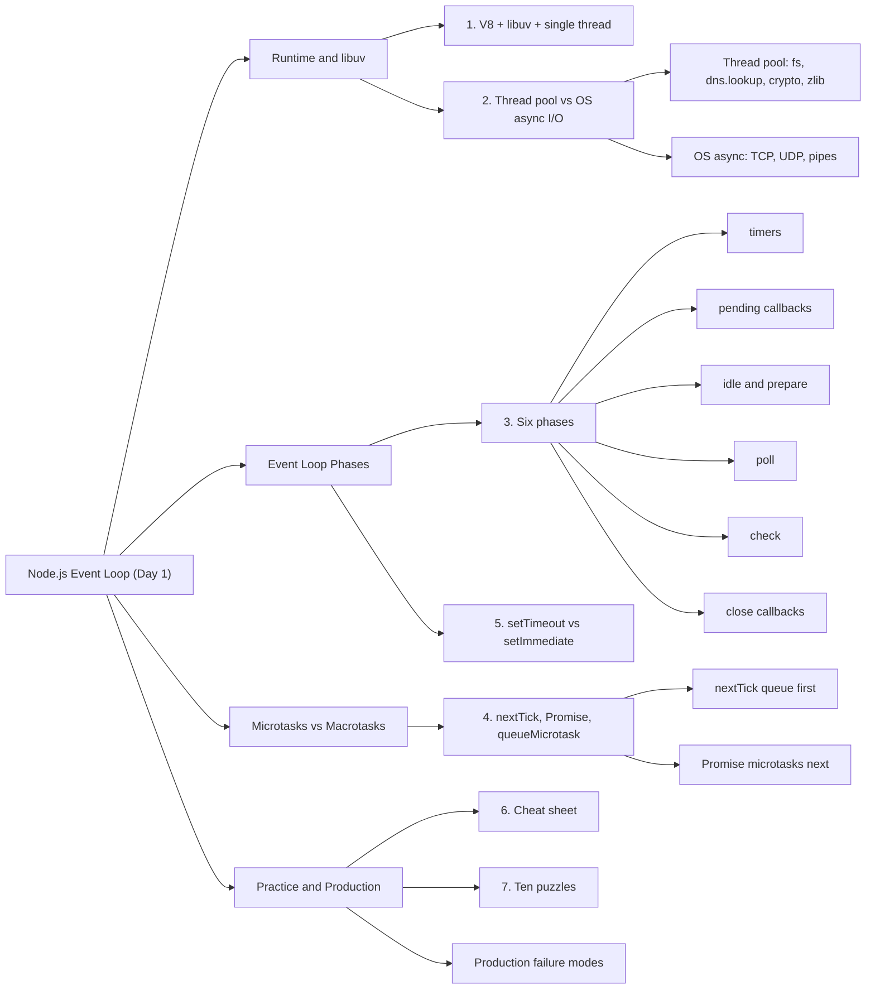
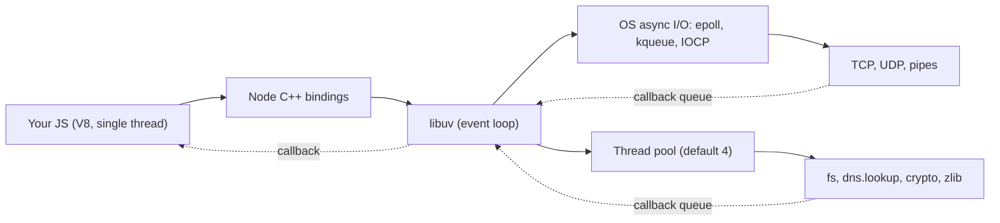
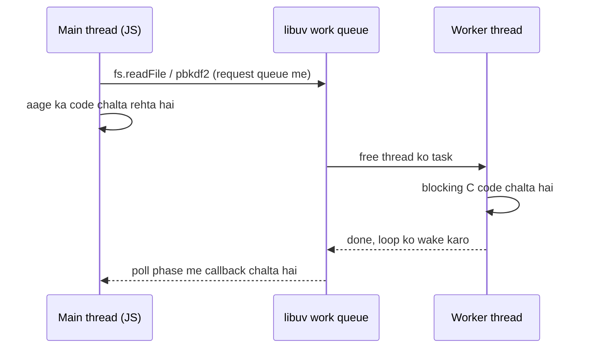
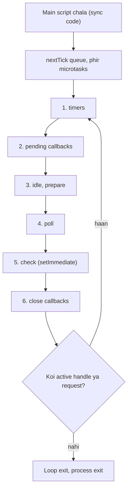
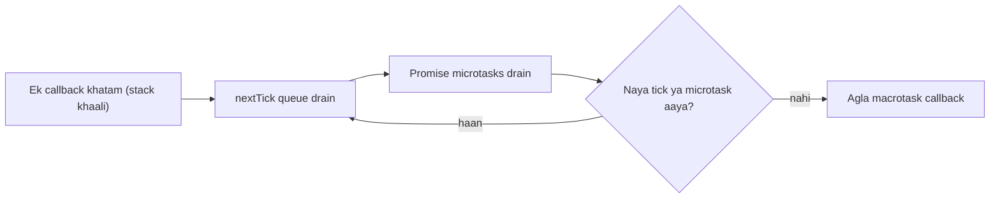

<callout icon="🎯" color="blue_bg">
	**Stage:** S1 Node.js Internals & Concurrency · **Day 1** · **Planned:** 2.5 h · **Type:** Notes
	**Deliverable:** Event loop cheat sheet + 10 output-order puzzles solved
	**Tracker row:** <mention-page url="https://app.notion.com/p/3f4bcc23fb65819a96a4d4b43d34b395"/>
</callout>
## 📌 Overview
- Aaj ka goal: Node.js ka event loop **under the hood** samajhna: kaunsa code kab chalta hai, libuv kya karta hai, aur `nextTick` / Promise / `setTimeout` / `setImmediate` ka **exact order** predict karna (interview ka sabse favourite topic).
- Is page me 3 core topics: **Event loop phases → libuv (thread pool vs OS async I/O) → Microtasks vs Macrotasks**. Deliverable: **cheat sheet** + **10 output-order puzzles**.
- Har section ka structure: **pehle simple version** (ek-line summary → problem → steps → self-check) aur uske neeche **📚 Deep dive** (internals, analogy, gotchas). Pehli baar padh rahe ho to simple version, revision me deep dive.
- End me: Production failure modes, runnable TS scaffold (lag monitor + load shedding + worker_threads), Interview Q&A, Revision checklist.
- Mental model ek line me: **Node = V8 (JS chalata hai) + libuv (wait aur I/O sambhalta hai)**. JS ek hi thread par; wait wala kaam OS / thread pool ko do, result aane par callback queue me aata hai.
- Pichle notes se connection: ye S1 ka **pehla** page hai, isliye abhi koi pichla note nahi hai.
- Aage kya: Day 2 → <mention-page url="https://app.notion.com/p/3f4bcc23fb6581fca0b4e80f04c6c811"/> (Streams & backpressure). Wahan bhi yahi concepts kaam aayenge: stream ka `drain`, `pipeline`, aur thread pool pe chalne wale `fs` reads.
## 🗺️ Mindmap

---
## 1️⃣ Node.js Runtime: V8 + libuv + Single Thread
<callout icon="💡" color="green_bg">
	**Ek line me:** Node = **restaurant ka ek waiter (JS thread)** + **kitchen aur delivery staff (libuv, OS, thread pool)**. Waiter order leta hai, kitchen ko deta hai, aur dish ready hone par serve karta hai. Kisi ek table par khada hokar wait nahi karta.
</callout>
### 🧩 Problem kya hai?
- Server ko hazaaron connections handle karne hain, par JS ek **single thread** par chalta hai.
- Agar har request ke liye wait karna pade (DB, file, network) to baaki sab requests atak jaayengi.
- Solution: **non-blocking I/O + event loop**. Wait wala kaam JS thread ke bahar hota hai.
### 🧩 Kaise kaam karta hai (4 steps)
1. Tum `fs.readFile(...)` ya `http` call karte ho. JS thread request **libuv ko hand-off** karta hai aur turant aage badh jaata hai.
2. libuv kaam **OS (epoll / kqueue / IOCP)** ya **thread pool** se karwata hai. JS thread free rehta hai.
3. Kaam khatam hone par callback ek **queue** me aa jaata hai.
4. **Event loop** jab JS call stack khaali ho tab wo callback uthake chalata hai.

### 🧩 Kaun kya karta hai
<table fit-page-width="true" header-row="true">
<tr>
<td>Component</td>
<td>Kaam</td>
</tr>
<tr>
<td>**V8**</td>
<td>JS execute karta hai, heap + GC sambhalta hai, **microtask queue** (Promises) deta hai</td>
</tr>
<tr>
<td>**libuv**</td>
<td>**Event loop**, timers, thread pool, async I/O abstraction (cross-platform)</td>
</tr>
<tr>
<td>**Node C++ bindings**</td>
<td>`fs`, `net`, `http`, `crypto` jaise APIs ko JS aur libuv ke beech jodta hai</td>
</tr>
<tr>
<td>**OS**</td>
<td>Sockets ka asli wait: epoll (Linux), kqueue (macOS/BSD), IOCP (Windows)</td>
</tr>
</table>
### 🧪 Khud check karo
<details>
<summary>Q. Node single-threaded hai to 10k concurrent connections kaise handle karta hai?</summary>
	- Connections ka **wait OS ke paas** hota hai (epoll). JS thread sirf un events ke callbacks chalata hai jo ready hain.
	- Condition: har handler chhota aur non-blocking ho.
</details>
<details>
<summary>Q. "Node bilkul single thread hai" kya ye sahi hai?</summary>
	- Nahi. **JS code** single (main) thread par chalta hai. Par libuv thread pool (default 4), V8 ke helper threads (GC, JIT) aur `worker_threads` alag threads hain.
</details>
<details>
<summary>Q. Event loop JS language ka part hai?</summary>
	- Nahi. Event loop **libuv** (host environment) ka hai. V8 sirf JS chalata hai aur microtask queue deta hai.
</details>
### 📚 Deep dive
- **Process me threads:** main thread (JS + event loop), libuv thread pool (default 4), V8 platform worker threads (GC, compile), aur tumne `worker_threads` banaye ho to wo bhi.
- **Event loop ECMAScript spec ka part nahi hai.** Host (Node ya browser) provide karta hai. Isiliye browser aur Node ke event loop alag hain.
- **Process kab exit hota hai?** Main script khatam hone ke baad libuv loop (`uv_run`) chalta hai. Jab koi **active aur ref'd handle/request** na bache, loop exit, process exit.
	- Handle examples: `server.listen`, active timer, open socket.
	- `timer.unref()` → wo timer loop ko zinda nahi rakhta (monitoring intervals ke liye useful).
- **JS single thread kyun?** Simplicity: shared-memory data race nahi, locks nahi. Trade-off: **CPU-bound kaam poore server ko roke rakhta hai.**
- **JS/Node analogy:** browser me bhi single JS thread + Web APIs hote hain. Node me Web APIs ki jagah libuv. Farak: browser me rendering step aur HTML spec ke task queues; Node me fixed phases.
- **Gotchas:**
	- **Async ≠ multi-threaded.** `async function` apne aap kuch parallel nahi karta, bas continuation baad me schedule hota hai.
	- CPU-heavy code ko `async` me wrap karne se wo non-blocking nahi ban jaata.
---
## 2️⃣ libuv: Thread Pool vs OS Async I/O
<callout icon="💡" color="green_bg">
	**Ek line me:** libuv = **dispatcher**. Network wala kaam OS ko deta hai (thread nahi lagta), aur jo kaam OS async nahi kar sakta (files, DNS lookup, crypto) wo **thread pool** ko deta hai.
</callout>
### 🧩 Problem kya hai?
- Sockets ke liye OS ke paas non-blocking, readiness-based API hai (epoll). Par **regular files, ****`getaddrinfo`**** (DNS), CPU-heavy crypto** is tarah async nahi hote.
- Inko seedha main thread par chalaoge to loop ruk jaayega.
- Isliye libuv inko **background thread pool** me chalata hai aur result aane par main loop ko batata hai.
### 🧩 Kaam kahan chalta hai?
<table fit-page-width="true" header-row="true">
<tr>
<td>API</td>
<td>Kahan chalta hai</td>
</tr>
<tr>
<td>TCP / UDP / HTTP sockets, pipes</td>
<td>**OS async I/O** (epoll / kqueue / IOCP). Thread pool nahi</td>
</tr>
<tr>
<td>`fs.*` (readFile, writeFile, stat...) aur `fs.promises`</td>
<td>**Thread pool**</td>
</tr>
<tr>
<td>`dns.lookup` (http/net ka default hostname resolve)</td>
<td>**Thread pool** (`getaddrinfo`)</td>
</tr>
<tr>
<td>`dns.resolve*`</td>
<td>c-ares library, network I/O. Thread pool nahi</td>
</tr>
<tr>
<td>`crypto.pbkdf2`, `scrypt`, `randomBytes`, native bcrypt</td>
<td>**Thread pool**</td>
</tr>
<tr>
<td>`zlib` (async gzip, deflate)</td>
<td>**Thread pool**</td>
</tr>
<tr>
<td>`setTimeout`, `setInterval`</td>
<td>libuv timers (min-heap). Koi thread nahi</td>
</tr>
</table>
### 🧩 Thread pool ke 3 facts (yaad rakho)
1. Default size **4**. Badalna ho to env var `UV_THREADPOOL_SIZE` (max 1024).
2. Pool **poore process me shared** hai. Ek type ka heavy kaam doosre ko bhi slow kar sakta hai.
3. 5th task ko tab tak queue me wait karna padta hai jab tak koi thread free na ho.
### 🧪 Khud check karo
<details>
<summary>Q. 5 `pbkdf2` calls ek saath, default pool me. Kya hoga?</summary>
	- 4 parallel chalenge, 5th wait karega. Approx **5th ko 2x time** lagega (agar machine me ≥ 4 free cores hain).
</details>
<details>
<summary>Q. HTTP request ke liye thread pool use hota hai?</summary>
	- Socket I/O ke liye nahi. Par hostname resolve (`dns.lookup`) thread pool me jaata hai. Pool saturated hai to naye connections slow ho sakte hain.
</details>
<details>
<summary>Q. `UV_THREADPOOL_SIZE` kab set karna chahiye?</summary>
	- Process start hone se pehle (shell ya deployment env me). Cores ke aas-paas se start karo aur benchmark karo. Bahut zyada = memory aur context switch cost.
</details>
### 📚 Deep dive
- **libuv** ek C library hai (cross-platform async I/O). Node ke alawa Luvit, Julia jaise projects bhi use karte hain.
- **Do abstractions:**
	- **Handle** = long-lived object (timer, TCP server, signal).
	- **Request** = short-lived operation (fs request, write request).
	- Loop tab tak zinda jab tak koi active handle ya request hai.
- **OS backends:** Linux `epoll`, macOS/BSD `kqueue`, Windows `IOCP`. Readiness model ("ready hai, ab read karo") aur completion model ("ho gaya") ko libuv ek jaisa dikhata hai.
- **Thread pool ka flow:**

- **Head-of-line blocking:** login storm (bcrypt/pbkdf2) pool bhar deta hai to `fs.readFile` aur `dns.lookup` bhi wait karte hain, jabki unka khud ka kaam halka hai.
- **`fs.promises`**** bhi thread pool use karta hai.** Sirf API promise-based hai, execution wahi.
- **`worker_threads`** = alag V8 isolate + alag event loop. Libuv thread pool phir bhi process-wide hai.
- **Tuning:** `UV_THREADPOOL_SIZE` 8 ya 16 try karo aur measure karo. DNS-heavy kaam me `dns.lookup` ki jagah caching ya `dns.resolve` socho.
- **JS/Node analogy:** thread pool ≈ Java ka fixed-size `ExecutorService` (4 threads) aur libuv work queue ≈ uska task queue.
- **Gotchas:**
	- Code me `process.env.UV_THREADPOOL_SIZE = '8'` tabhi kaam karta hai jab pool pehli baar use hone se **pehle** set ho. Safe tareeka: shell ya deployment env.
	- Thread pool me ek baar start hua kaam cancel nahi hota.
	- Network I/O ko thread pool se mat jodo. Isiliye 4 threads ke saath bhi Node hazaaron sockets handle kar leta hai.
---
## 3️⃣ Event Loop Phases
<callout icon="💡" color="green_bg">
	**Ek line me:** Event loop = **security guard ka round**. Baar-baar 6 chowkiyon par ghoomta hai. Har chowki par ek hi type ka kaam nipta ke aage badhta hai.
</callout>
### 🧩 Problem kya hai?
- Bahut saare callbacks pending hain: timers, I/O, immediates. **Kaun pehle chalega?**
- Order fixed na ho to behaviour unpredictable hoga. Isliye libuv ek **fixed phase order** follow karta hai.
### 🧩 6 phases (har iteration me isi order me)
<table fit-page-width="true" header-row="true">
<tr>
<td>#</td>
<td>Phase</td>
<td>Kya chalta hai</td>
<td>Example</td>
</tr>
<tr>
<td>1</td>
<td>**timers**</td>
<td>Jo `setTimeout` / `setInterval` expire ho chuke hain</td>
<td>`setTimeout(fn, 100)`</td>
</tr>
<tr>
<td>2</td>
<td>**pending callbacks**</td>
<td>Pichli iteration se defer hue system-level I/O callbacks</td>
<td>Kuch TCP errors (jaise `ECONNREFUSED`)</td>
</tr>
<tr>
<td>3</td>
<td>**idle, prepare**</td>
<td>Sirf internal use</td>
<td>-</td>
</tr>
<tr>
<td>4</td>
<td>**poll**</td>
<td>Naye I/O events lena aur unke callbacks chalana. Zarurat par yahin **wait (block)** karta hai</td>
<td>`fs` ya network callbacks</td>
</tr>
<tr>
<td>5</td>
<td>**check**</td>
<td>`setImmediate` callbacks</td>
<td>`setImmediate(fn)`</td>
</tr>
<tr>
<td>6</td>
<td>**close callbacks**</td>
<td>Handles band hone ke callbacks</td>
<td>`socket.on('close')`</td>
</tr>
</table>

- **Yaad rakho:** har callback ke baad (Node ≥ 11) pehle `nextTick` queue aur phir Promise microtasks drain hote hain. Detail section 4 me.
### 🧩 Poll phase ke rules (sabse important phase)
1. Poll queue me callbacks hain → ek-ek karke chalao, jab tak queue khaali ho ya system limit aa jaaye.
2. Queue khaali hai aur `setImmediate` scheduled hai → poll chhodke **check** phase me jao. (Wait nahi karta.)
3. Queue khaali, immediate bhi nahi → nearest timer ke due hone tak ya naye I/O tak **wait** karta hai.
### 🧪 Khud check karo
<details>
<summary>Q. `setImmediate` ka callback kaunse phase me chalta hai?</summary>
	- **check** phase me, poll ke turant baad.
</details>
<details>
<summary>Q. Poll phase wait kab karta hai?</summary>
	- Jab koi `setImmediate` pending nahi hai aur koi timer abhi due nahi hai. Tab wo naye I/O events ya nearest timer ka wait karta hai.
</details>
<details>
<summary>Q. `setTimeout(fn, 100)` ka matlab exactly 100 ms par chalega?</summary>
	- Nahi. 100 ms **minimum** delay hai. Loop busy ho (heavy callbacks ya blocking code) to callback late chalega.
</details>
<details>
<summary>Q. Event loop kab ruk jaata hai?</summary>
	- Jab koi active handle ya request nahi bachta (koi server, timer, socket, pending fs). Tab process exit hota hai.
</details>
### 📚 Deep dive
- **libuv ****`uv_run`**** ek iteration me:** loop time update → due timers → pending → idle → prepare → **poll** (timeout compute) → check → closing callbacks.
- **Loop time cached hota hai:** har iteration ke start me `uv_update_time`. Timers isi cached time se compare hote hain. Lambi sync code ke baad ye time stale ho sakta hai.
- **Timers ka internal structure:** Node JS side par same duration wale timers ek **linked list** me rehte hain, aur ek priority queue sabse nearest expiry wali list ko libuv ke **ek hi timer handle** se jodta hai.
- **Timer facts:**
	- Delay `0` (ya 1 se kam) → **1 ms** ban jaata hai.
	- Max delay `2^31-1` ms (≈ 24.8 din). Isse zyada → delay 1 ms ho jaata hai (warning ke saath).
	- Delay **minimum** hai, guarantee nahi.
- **Poll timeout kaise nikalta hai:** `0` agar immediates pending hain (ya idle/closing handles hain). Warna nearest timer tak. Warna infinite, agar active handles hain.
- **Pending callbacks phase:** daily development me rarely dikhta hai. Kuch TCP errors yahan defer hote hain.
- **Close callbacks:** `socket.destroy()` jaise cases ke `close` events. `process.on('exit')` alag hai. Wo loop khatam hone ke baad chalta hai.
- **Phase starvation:** ek phase beech me chhodta nahi. Poll queue me bahut saare heavy callbacks hain to timers late honge (**timer drift**).
- **Observability:** `performance.eventLoopUtilization()` batata hai loop kitna busy raha.
- **JS/Node analogy:** browser event loop me priorities wale task queues aur ek render step hota hai. Node me 6 fixed phases.
- **Gotchas:**
	- `setTimeout(0)` vs `setImmediate` main module se **non-deterministic** (section 5).
	- `setInterval` exact scheduler nahi hai. Callback late chalega to agla bhi shift hota hai. Cron jaisa kaam wahan mat lo.
---
## 4️⃣ Microtasks vs Macrotasks
<callout icon="💡" color="green_bg">
	**Ek line me:** Macrotask = **bank counter par ek customer**. Microtask aur `nextTick` = **us customer ke kaam ke beech ke chhote follow-ups**. Agla customer tabhi bulaya jaata hai jab ye saare follow-ups khatam ho chuke hon.
</callout>
### 🧩 Teen type ke callbacks
<table fit-page-width="true" header-row="true">
<tr>
<td>Type</td>
<td>Examples</td>
<td>Kahan rehte hain</td>
<td>Kab chalte hain</td>
</tr>
<tr>
<td>**nextTick queue**</td>
<td>`process.nextTick(fn)`</td>
<td>Node ki alag queue</td>
<td>Current operation ke turant baad, **sabse pehle**</td>
</tr>
<tr>
<td>**Microtasks**</td>
<td>`promise.then / catch / finally`, `await` ke baad ka code, `queueMicrotask(fn)`</td>
<td>V8 ki microtask queue</td>
<td>nextTick queue khaali hone ke baad</td>
</tr>
<tr>
<td>**Macrotasks**</td>
<td>`setTimeout`, `setInterval`, `setImmediate`, I/O callbacks, close callbacks</td>
<td>libuv phases</td>
<td>Ek-ek karke, apni phase aane par</td>
</tr>
</table>
### 🧩 Golden rule (3 steps)
1. Ek callback (ya main script) khatam hua, call stack khaali.
2. **nextTick queue poori drain** → phir **microtask queue poori drain**. Drain ke dauran naye ticks ya microtasks aaye to dobara, jab tak dono khaali na ho jaayein.
3. Tabhi agla macrotask chalta hai.

### 🧪 Khud check karo
<details>
<summary>Q. CommonJS main script me `nextTick` aur `Promise.then` me pehle kaun?</summary>
	- **`nextTick`**. Uski queue Promise microtasks se pehle drain hoti hai.
</details>
<details>
<summary>Q. Ek microtask ke andar naya microtask banaya. Kab chalega?</summary>
	- **Usi drain me**, kisi bhi macrotask (timer, I/O) se pehle.
</details>
<details>
<summary>Q. Do `setTimeout` callbacks ke beech me Promise microtask chalega?</summary>
	- Node ≥ 11 me **haan**. Har timer callback ke baad ticks aur microtasks drain hote hain.
</details>
### 📚 Deep dive
- **Terminology:** "microtask / macrotask" HTML spec ke words hain. Node docs "phases" aur "nextTick queue" bolte hain. Interview me practically: **macrotask = libuv phase ka callback**.
- **`nextTick`**** technically microtask nahi hai.** Ye Node ki apni `tickQueue` hai. Promise microtasks V8 ki queue me hote hain. Isiliye dono ka priority alag hai.
- **Drain loop (simplified, Node internals):**
```javascript
// simplified version of processTicksAndRejections
function processTicksAndRejections() {
  do {
    while ((tock = tickQueue.shift())) run(tock); // saare nextTicks
    runMicrotasks();                              // V8 queue poori khaali
  } while (!tickQueue.isEmpty());                 // microtask ne naya tick banaya?
}
```
- **Node 11 ka change:** pehle ticks aur microtasks **phase ke beech** (saare timers ke baad) drain hote the. Ab har individual timer aur immediate callback ke baad. Isse browser behaviour se match hota hai.
- **ESM vs CommonJS (bada gotcha):**
	- CommonJS main script me: `nextTick` pehle, phir Promise.
	- ESM top-level me: **Promise pehle, ****`nextTick`**** baad me**, kyunki module evaluation khud ek promise job ke andar chalta hai.
	- Isliye puzzles `.cjs` file me chalao.
- **`await`**** ka cost:** native promise par `await` = 1 microtask hop (V8 ≥ 7.2). Thenable object par zyada hops lagte hain.
- **`async`**** function ka sync part turant chalta hai.** `await` ke baad ka part microtask me jaata hai.
- **Unhandled rejections:** ticks aur microtasks ke baad check hote hain. Node 15+ me default behaviour process crash hai.
- **Kab kya use karein:**
	- `nextTick`: constructor ke baad `emit` jisse caller listener laga sake, ya API ko **hamesha async** banana.
	- `Promise` / `queueMicrotask`: same-tick follow-up, promise chaining.
	- `setImmediate`: "I/O ke baad chalao" ya CPU kaam ko chunks me todna (neeche snippet).
- **Zalgo:** callback kabhi sync, kabhi async chale to bugs aate hain (cache hit pe sync, miss pe async). Fix: sync path me bhi `nextTick` / `setImmediate` se async banao.
- **JS/Node analogy:** browser me `requestAnimationFrame`, `MutationObserver` hote hain. Node me nahi. Par Promise aur `queueMicrotask` dono jagah same semantics.
- **Starvation:**
	- Recursive `nextTick` ya recursive microtask → loop kabhi macrotask tak pahunchta hi nahi → **I/O aur timers kabhi nahi chalte.**
	- Recursive `setImmediate` safe hai, kyunki naya immediate **agli iteration** me chalta hai.
- **CPU kaam chunk karne ka pattern (loop ko saans do):**
```typescript
async function processInChunks<T>(items: T[], fn: (x: T) => void, chunkSize = 1000): Promise<void> {
  for (let i = 0; i < items.length; i += chunkSize) {
    for (const item of items.slice(i, i + chunkSize)) fn(item);
    // sirf `await Promise.resolve()` loop ko yield NAHI karta (microtask hai).
    // setImmediate macrotask hai, isse I/O aur timers ko chance milta hai.
    await new Promise<void>((resolve) => setImmediate(resolve));
  }
}
```
- **Gotchas:**
	- `await` loop me heavy **sync** kaam hai to starvation nahi hota par loop **block** hota hai.
	- `Promise.resolve().then(loop)` jaisi infinite recursion event loop freeze kar deti hai.
	- App code me `nextTick` aur Promise mix karoge to order confusing hoga. Zarurat na ho to `nextTick` avoid karo.
---
## 5️⃣ setTimeout vs setImmediate vs nextTick
<callout icon="💡" color="green_bg">
	**Ek line me:** `nextTick` = **abhi** (current operation ke turant baad). `setImmediate` = **isi iteration ke check phase me**. `setTimeout(0)` = **agli timers phase me, kam se kam 1 ms ke baad**.
</callout>
### 🧩 Naam confusing hain (Node docs bhi maanti hai)
<table fit-page-width="true" header-row="true">
<tr>
<td>API</td>
<td>Naam kya kehta hai</td>
<td>Asli behaviour</td>
</tr>
<tr>
<td>`process.nextTick`</td>
<td>"Agli tick"</td>
<td>**Isi tick me**, sabse pehle</td>
</tr>
<tr>
<td>`setImmediate`</td>
<td>"Turant"</td>
<td>**Agle check phase** me</td>
</tr>
<tr>
<td>`setTimeout(fn, 0)`</td>
<td>"0 ms"</td>
<td>**≥ 1 ms**, timers phase me</td>
</tr>
</table>
### 🧩 Order ke 3 rules
1. **Main module se** `setTimeout(0)` vs `setImmediate`: order **guarantee nahi** (process ki speed par depend).
2. **I/O callback ke andar** se: `setImmediate` **hamesha pehle**.
3. Recursion me: `setImmediate` safe, `nextTick` starvation karta hai.
### 🧪 Khud check karo
<details>
<summary>Q. Main module me timeout aur immediate ka order kyun fix nahi?</summary>
	- Loop start hone par check hota hai ki 1 ms ho chuka ya nahi. Process startup fast ho to timer abhi due nahi hota aur immediate pehle chal jaata hai. Slow ho to timeout pehle.
</details>
<details>
<summary>Q. I/O callback ke andar immediate pehle kyun?</summary>
	- Callback poll phase me chal raha hota hai. Uske baad seedha check phase aata hai (immediate), aur timers phase tab aata hai jab loop agli iteration me wapas pahunche.
</details>
<details>
<summary>Q. Recursion ke liye kaunsa safe?</summary>
	- `setImmediate`. `nextTick` recursion I/O ko starve kar deta hai.
</details>
### 📚 Deep dive
- **Main module ka non-determinism:** `setTimeout(0)` actually 1 ms ka timer hai. Loop start par agar 1 ms guzar chuka hai to timers phase usse chala deti hai, nahi to poll → check (immediate) pehle chal jaata hai.
- **`setImmediate`**** cheaper hai:** timer heap ka kaam nahi, seedha check queue.
- **Node docs ki recommendation:** zyadatar cases me `setImmediate` prefer karo, kyunki `nextTick` se starvation aur reasoning dono mushkil hote hain.
- **Promise-based sleep:**
```typescript
import { setTimeout as sleep } from "node:timers/promises";

await sleep(100); // 100 ms ka non-blocking wait
```
- **Multiple immediates:** ek iteration me jitne queued the sab chalte hain. Check phase ke dauran naya queue kiya to wo **agli iteration** me chalega.
- **Gotchas:**
	- `setTimeout(a, 1)` aur `setTimeout(b, 0)` dono 1 ms hain → registration order me chalenge (`a`, phir `b`).
	- Timer ya immediate ko `clearTimeout` / `clearImmediate` se cancel karna mat bhoolo, warna loop zinda rehta hai ya extra kaam hota hai.
---
## 6️⃣ Event Loop Cheat Sheet (Deliverable 1)
<callout icon="📋" color="purple_bg">
	**Ye page revision ke liye hai.** Interview ya puzzle se pehle bas ye section dekh lo.
</callout>
### 📋 Execution order (ek line me)
1. **Sync code** (call stack)
2. **`process.nextTick`**** queue** (poori)
3. **Promise microtasks aur ****`queueMicrotask`** (poori, FIFO)
4. Event loop: **timers → pending → idle/prepare → poll → check → close**
5. **Har callback ke baad** step 2 aur 3 dobara
### 📋 Quick reference table
<table fit-page-width="true" header-row="true">
<tr>
<td>API</td>
<td>Kahan chalta hai</td>
<td>Priority</td>
<td>Starve kar sakta?</td>
</tr>
<tr>
<td>`process.nextTick`</td>
<td>nextTick queue</td>
<td>1 (sabse high)</td>
<td>✅ Haan</td>
</tr>
<tr>
<td>`Promise.then`, `await`, `queueMicrotask`</td>
<td>V8 microtask queue</td>
<td>2</td>
<td>✅ Haan</td>
</tr>
<tr>
<td>`setTimeout`, `setInterval`</td>
<td>timers phase</td>
<td>3 (macrotask)</td>
<td>❌ Nahi</td>
</tr>
<tr>
<td>I/O callbacks (fs, net)</td>
<td>poll phase</td>
<td>3 (macrotask)</td>
<td>❌ Nahi</td>
</tr>
<tr>
<td>`setImmediate`</td>
<td>check phase</td>
<td>3 (macrotask)</td>
<td>❌ Nahi</td>
</tr>
<tr>
<td>`close` events</td>
<td>close callbacks</td>
<td>3 (macrotask)</td>
<td>❌ Nahi</td>
</tr>
</table>
### 📋 libuv aur thread pool cheat sheet
- **Thread pool me:** `fs`, `dns.lookup`, `crypto` (pbkdf2, scrypt, randomBytes), `zlib`, native bcrypt.
- **OS async me (pool nahi):** TCP, UDP, HTTP sockets, pipes.
- Default pool size **4**, env `UV_THREADPOOL_SIZE`, max 1024, process-wide shared.
- Loop tab tak zinda jab tak active handle ya request hai.
### 📋 Timer quick facts
- `setTimeout(fn, 0)` = 1 ms. Delay **minimum** hai.
- Max delay `2^31-1` ms. Usse zyada → 1 ms.
- Main module: timeout vs immediate = **non-deterministic**. I/O callback ke andar: **immediate pehle**.
- Node ≥ 11: do timers ke beech ticks + microtasks drain hote hain.
### 📋 5 mantras
- **Sync → tick → promise → macrotask.** Hamesha is order me.
- **nextTick aur microtask queue poori khaali hoti hai**, tabhi agla macrotask.
- **CommonJS me tick pehle, ESM top-level me promise pehle.**
- **Recursive nextTick = I/O starvation.** Recursive setImmediate safe.
- **CPU-bound kaam main thread par = poora server frozen.** `worker_threads` ya chunking.
---
## 7️⃣ 10 Output-Order Puzzles (Deliverable 2)
<callout icon="🧠" color="yellow_bg">
	**Kaise karna hai:** pehle code dekho aur **kaagaz par output likho**. Phir `.cjs` file me chalao. Phir toggle khol ke apna answer match karo. **Sab ****`.cjs`**** (CommonJS) me chalao**, ESM me top-level ordering alag hoti hai (section 4).
</callout>
### 🧩 Puzzle 1: Warm-up
```javascript
console.log('1');
setTimeout(() => console.log('2'), 0);
Promise.resolve().then(() => console.log('3'));
process.nextTick(() => console.log('4'));
console.log('5');
```
<details>
<summary>Answer + reason</summary>
	- Output: `1`, `5`, `4`, `3`, `2`
	- Pehle sync code: `1`, `5`.
	- Phir nextTick queue: `4`. Phir Promise microtask: `3`.
	- Last me timer (macrotask): `2`.
	- **Bonus:** yahi code `.mjs` (ESM) me chalao to output `1`, `5`, `3`, `4`, `2` aata hai. Promise pehle, tick baad me.
</details>
### 🧩 Puzzle 2: Tick ke andar promise, promise ke andar tick
```javascript
Promise.resolve()
  .then(() => {
    console.log('p1');
    process.nextTick(() => console.log('tick-inside-p1'));
  })
  .then(() => console.log('p2'));

process.nextTick(() => console.log('tick1'));
```
<details>
<summary>Answer + reason</summary>
	- Output: `tick1`, `p1`, `p2`, `tick-inside-p1`
	- Main script ke baad nextTick queue: `tick1`.
	- Phir microtasks: `p1` chala aur usne ek naya tick queue kiya. Par `p1` ke baad `p2` bhi microtask queue me aa gaya.
	- **Microtask queue poori khaali hoti hai** (`p2` bhi chalta hai) usse pehle tick queue dobara nahi dekhi jaati. Isliye `tick-inside-p1` last.
</details>
### 🧩 Puzzle 3: I/O callback ke andar timeout vs immediate
```javascript
const fs = require('node:fs');

fs.readFile(__filename, () => {
  setTimeout(() => console.log('timeout'), 0);
  setImmediate(() => console.log('immediate'));
});
```
<details>
<summary>Answer + reason</summary>
	- Output: `immediate`, `timeout` (**hamesha** is order me)
	- `readFile` ka callback **poll** phase me chalta hai.
	- Poll ke baad seedha **check** phase aata hai → immediate chalta hai.
	- Timers phase tab aata hai jab loop agli iteration me wapas pahunche → timeout baad me.
</details>
### 🧩 Puzzle 4: Main module me timeout vs immediate
```javascript
setTimeout(() => console.log('timeout'), 0);
setImmediate(() => console.log('immediate'));
```
<details>
<summary>Answer + reason</summary>
	- Output: **guarantee nahi.** Kabhi `timeout, immediate`, kabhi `immediate, timeout`.
	- `setTimeout(0)` = 1 ms timer. Loop start par agar 1 ms nikal chuka ho to timers phase usse chala deti hai, warna immediate pehle.
	- Isko 10-15 baar chala ke dekho. **Interview me "non-deterministic" bolna hi sahi jawab hai.**
</details>
### 🧩 Puzzle 5: Do timers ke beech microtask (Node ≥ 11)
```javascript
setTimeout(() => {
  console.log('t1');
  Promise.resolve().then(() => console.log('p1'));
}, 0);

setTimeout(() => {
  console.log('t2');
}, 0);
```
<details>
<summary>Answer + reason</summary>
	- Output: `t1`, `p1`, `t2`
	- Dono timers same timers phase me chalte hain, par **har timer callback ke baad microtasks drain** hote hain (Node ≥ 11).
	- Node 10 aur purane me output `t1`, `t2`, `p1` aata tha.
</details>
### 🧩 Puzzle 6: async / await ka order
```javascript
async function a() {
  console.log('a1');
  await b();
  console.log('a2');
}
async function b() {
  console.log('b');
}

console.log('start');
a();
Promise.resolve().then(() => console.log('p'));
process.nextTick(() => console.log('tick'));
console.log('end');
```
<details>
<summary>Answer + reason</summary>
	- Output: `start`, `a1`, `b`, `end`, `tick`, `a2`, `p`
	- `a()` ka sync part chalta hai: `a1`, phir `b()` bhi sync chalta hai: `b`. Phir `end`.
	- `await b()` ke baad ka code (`a2`) microtask me gaya, **`p`**** se pehle** register hua.
	- Main script ke baad: nextTick (`tick`), phir microtasks FIFO: `a2`, `p`.
</details>
### 🧩 Puzzle 7: nextTick, Promise, queueMicrotask ek saath
```javascript
process.nextTick(() => console.log('tick1'));
Promise.resolve().then(() => console.log('promise1'));
queueMicrotask(() => console.log('micro1'));
process.nextTick(() => console.log('tick2'));
Promise.resolve().then(() => console.log('promise2'));
```
<details>
<summary>Answer + reason</summary>
	- Output: `tick1`, `tick2`, `promise1`, `micro1`, `promise2`
	- **Saare nextTicks pehle**, chahe beech me promise register hua ho.
	- Promise reactions aur `queueMicrotask` **ek hi V8 queue** me jaate hain, isliye register hone ke order (FIFO) me chalte hain.
</details>
### 🧩 Puzzle 8: Thread pool saturation
```javascript
const { pbkdf2 } = require('node:crypto');

const start = Date.now();
for (let i = 1; i <= 5; i++) {
  pbkdf2('pw', 'salt', 300_000, 64, 'sha512', () => {
    console.log(`hash ${i} done at ${Date.now() - start} ms`);
  });
}
```
<details>
<summary>Answer + reason</summary>
	- Output (approx, machine par depend): pehle **4 hashes lagbhag ek saath** (jaise 400 ms par, unka aapas ka order fix nahi), **5th lagbhag 2x time** par (jaise 800 ms).
	- Reason: default thread pool 4 ka hai. 5th task queue me wait karta hai.
	- `UV_THREADPOOL_SIZE=5 node p08.cjs` chalao to (agar ≥ 5 free cores hain) saare 5 lagbhag ek saath khatam honge.
	- Machine me cores kam hain to numbers badal jaayenge, par pattern same rahega.
</details>
### 🧩 Puzzle 9: nextTick recursion
```javascript
let i = 0;

function tickLoop() {
  if (i++ < 3) process.nextTick(tickLoop);
  console.log('tick', i);
}

setImmediate(() => console.log('immediate'));
tickLoop();
```
<details>
<summary>Answer + reason</summary>
	- Output: `tick 1`, `tick 2`, `tick 3`, `tick 4`, `immediate`
	- Har `tickLoop` agla tick queue karta hai (jab tak `i++ < 3`). Tick queue poori khaali hone tak koi macrotask nahi chalta.
	- Isliye `immediate` sabse last.
	- **Soch ke dekho:** limit hata do (infinite recursion) to `immediate` aur I/O kabhi nahi chalenge. Ye **starvation** hai.
</details>
### 🧩 Puzzle 10: Boss level (sab kuch ek saath)
```javascript
const fs = require('node:fs');

console.log('A sync');
setImmediate(() => console.log('B immediate (main)'));

fs.readFile(__filename, () => {
  console.log('C readFile cb');
  setTimeout(() => console.log('D timeout (in I/O)'), 0);
  setImmediate(() => console.log('E immediate (in I/O)'));
  process.nextTick(() => console.log('F tick (in I/O)'));
  Promise.resolve().then(() => console.log('G promise (in I/O)'));
});

process.nextTick(() => console.log('H tick (main)'));
Promise.resolve().then(() => console.log('I promise (main)'));
console.log('J sync');
```
<details>
<summary>Answer + reason</summary>
	- Output: `A`, `J`, `H`, `I`, `B`, `C`, `F`, `G`, `E`, `D`
	- **Sync:** `A`, `J`.
	- **Main ke ticks aur microtasks:** `H` (tick), `I` (promise).
	- **Pehli iteration ka check phase:** `B`. `readFile` ko kai thread pool round-trips chahiye (open, read, close...), isliye uska callback `B` ke baad aata hai. Practically hamesha, par ye formally guarantee nahi.
	- **`C`** poll phase me. Callback ke baad pehle tick `F`, phir promise `G`.
	- Phir check phase: `E` (I/O ke andar immediate **timeout se pehle**). Last me timers phase: `D`.
</details>
### 📊 Self-score
- 10 me se kitne **bina run kiye** sahi aaye? **8+** = ready. **Kam** = section 4 aur 5 dobara padho aur wrong puzzles ko phir se solve karo.
---
## 🚨 Production Concerns & Failure Modes
- **High load me kya toot-ta hai?**
	- **Event loop block:** ek bhi heavy sync kaam (`JSON.parse` bade payload par, sync crypto, bada `for` loop, `fs.readFileSync`) → saari requests ka **p99 latency spike**, health check timeouts, load balancer pod ko unhealthy mark kar deta hai.
	- **Catastrophic regex (ReDoS):** ek malicious string pure server ko seconds tak freeze kar sakti hai.
	- **Thread pool starvation:** login storm (bcrypt/pbkdf2) pool bhar deta hai → `fs` aur `dns.lookup` bhi slow → unrelated endpoints slow.
	- **nextTick / microtask starvation:** buggy recursion se I/O aur timers band. CPU 100%, par koi request serve nahi hoti.
	- **Unbounded concurrency:** `Promise.all` 10k DB calls ek saath → pool exhaustion, memory spike.
	- **Unhandled rejection:** Node 15+ me process crash.
- **Backpressure aur load shedding kaise bachate hain?**
	- **Event loop lag par shedding:** lag threshold cross ho to naye requests ko jaldi `503 + Retry-After` do. Server khud ko recover hone ka time deta hai (scaffold me hai).
	- **Bounded concurrency:** `p-limit` jaisa limiter ya queue (aage ke stages me BullMQ).
	- **Timeouts aur limits:** `server.requestTimeout`, `headersTimeout`, `server.maxConnections`, body size limit.
	- **CPU kaam alag jagah:** `worker_threads` pool (jaise piscina) ya alag service.
- **Security risks:**
	- **Single request poore server ko freeze kar sakti hai** (noisy neighbour, DoS). Input size aur complexity cap karo (scaffold me `n` ki limit).
	- ReDoS: user input par complex regex avoid karo, safe engine (RE2) ya input length limit.
	- Bade JSON body se `JSON.parse` loop block karta hai. Body size limit lagao.
	- Error messages me internals leak mat karo.
- **Cost / capacity implications:**
	- Autoscaling sirf CPU% par mat karo. **Event loop lag ya ELU** (event loop utilization) bhi signal rakho. Node 1 core hi use karta hai, pod CPU 25% dikhe par loop 100% busy ho sakta hai.
	- `worker_threads` ka har isolate memory leta hai (dheere se tens of MB). Pool size limit rakho.
	- Multi-core ke liye: multiple processes (cluster, PM2, ya k8s pods).
- **Observability:**
	- Metrics: event loop delay (p50, p99, max), **ELU**, active handles, thread pool queue wait, GC pause.
	- Tools: `perf_hooks.monitorEventLoopDelay`, `performance.eventLoopUtilization()`, `--cpu-prof`, `clinic doctor`, `0x` flamegraph.
	- Debug flag: `node --trace-sync-io app.js` pehle loop turn ke baad hui **sync I/O** ka stack trace print karta hai.
---
## 🧪 Runnable TypeScript Scaffold: Event Loop Lab
- **Kya banega:** ek chhota `node:http` server jo blocking vs non-blocking (worker) vs thread pool saturation ko **measure** karke dikhata hai. Saath me **event loop lag monitor** aur optional **load shedding**.
- **Folder structure:**
```plain text
event-loop-lab/
├── package.json
├── tsconfig.json
├── puzzles/            # p01.cjs ... p10.cjs (CommonJS, section 7 ke code)
└── src/
    ├── lag-monitor.ts  # event loop delay + ELU + shedding signal
    ├── phase-demo.ts   # phases ka order console par
    ├── worker.ts       # CPU kaam worker thread me
    └── server.ts       # /fast /block /worker /hash /metrics
```
- **package.json:**
```json
{
  "name": "event-loop-lab",
  "private": true,
  "type": "module",
  "scripts": {
    "build": "tsc",
    "start": "node dist/server.js",
    "phases": "node dist/phase-demo.js"
  },
  "devDependencies": {
    "@types/node": "^22.0.0",
    "typescript": "^5.6.0"
  }
}
```
- **tsconfig.json:**
```json
{
  "compilerOptions": {
    "target": "ES2022",
    "module": "NodeNext",
    "moduleResolution": "NodeNext",
    "strict": true,
    "outDir": "dist",
    "rootDir": "src",
    "skipLibCheck": true
  },
  "include": ["src"]
}
```
- **src/lag-monitor.ts:**
```typescript
import { monitorEventLoopDelay, performance } from "node:perf_hooks";

const RESOLUTION_MS = 10;
const SAMPLE_MS = 100;
const MAX_LAG_MS = Number(process.env.MAX_LAG_MS ?? 200);

const histogram = monitorEventLoopDelay({ resolution: RESOLUTION_MS });

const toMs = (ns: number): number => (Number.isFinite(ns) ? ns / 1e6 : 0);
// histogram values interval-based hote hain (baseline approx resolution),
// isliye resolution minus karke "extra lag" dikhate hain
const extraLag = (ns: number): number =>
  Math.max(0, Number((toMs(ns) - RESOLUTION_MS).toFixed(2)));

let ewmaLagMs = 0;
let lastTick = performance.now();
let lastElu = performance.eventLoopUtilization();

export function startLagMonitor(): void {
  histogram.enable();
  // 10s window: purane spike se p99 hamesha kharab na rahe
  setInterval(() => histogram.reset(), 10_000).unref();

  // toobusy-style sampler: timer kitna late fire hua = event loop lag
  setInterval(() => {
    const now = performance.now();
    const lag = Math.max(0, now - lastTick - SAMPLE_MS);
    lastTick = now;
    ewmaLagMs = ewmaLagMs * 0.7 + lag * 0.3; // smooth, ek chhote spike par shed na ho
  }, SAMPLE_MS).unref(); // unref: ye interval process ko zinda nahi rakhega
}

export const isOverloaded = (): boolean => ewmaLagMs > MAX_LAG_MS;

export function lagSnapshot() {
  return {
    p50Ms: extraLag(histogram.percentile(50)),
    p99Ms: extraLag(histogram.percentile(99)),
    maxMs: extraLag(histogram.max),
    ewmaLagMs: Number(ewmaLagMs.toFixed(1)),
  };
}

export function eluSnapshot() {
  // pichle /metrics call se ab tak ka utilization (0 = idle, 1 = poora busy)
  const delta = performance.eventLoopUtilization(lastElu);
  lastElu = performance.eventLoopUtilization();
  return { eventLoopUtilization: Number(delta.utilization.toFixed(3)) };
}
```
- **src/worker.ts:**
```typescript
import { parentPort, workerData } from "node:worker_threads";

function fib(n: number): number {
  return n < 2 ? n : fib(n - 1) + fib(n - 2);
}

const { n } = workerData as { n: number };
parentPort?.postMessage(fib(n));
```
- **src/phase-demo.ts:**
```typescript
import { readFile } from "node:fs";
import { fileURLToPath } from "node:url";

const order: string[] = [];
const log = (label: string): number => order.push(label);

// readFile ka callback poll phase me chalta hai
readFile(fileURLToPath(import.meta.url), () => {
  log("poll: readFile callback");
  setTimeout(() => log("timers: setTimeout 0"), 0);
  setImmediate(() => log("check: setImmediate"));
  process.nextTick(() => log("nextTick"));
  Promise.resolve().then(() => log("microtask: promise"));

  setTimeout(() => console.log(order.join("\n")), 20); // sab ho jaane ke baad print
});
```
- **src/server.ts:**
```typescript
import http from "node:http";
import { pbkdf2 } from "node:crypto";
import { promisify } from "node:util";
import { fileURLToPath } from "node:url";
import { Worker } from "node:worker_threads";
import { eluSnapshot, isOverloaded, lagSnapshot, startLagMonitor } from "./lag-monitor.js";

const PORT = Number(process.env.PORT ?? 3000);
const SHED = process.env.SHED === "1"; // 1 = load shedding ON
const pbkdf2Async = promisify(pbkdf2);

startLagMonitor();

function fib(n: number): number {
  return n < 2 ? n : fib(n - 1) + fib(n - 2);
}

function fibInWorker(n: number): Promise<number> {
  return new Promise((resolve, reject) => {
    // demo: har request par naya worker. Production me worker pool (jaise piscina) use karo
    const worker = new Worker(fileURLToPath(new URL("./worker.js", import.meta.url)), {
      workerData: { n },
    });
    worker.once("message", resolve);
    worker.once("error", reject);
  });
}

function send(
  res: http.ServerResponse,
  status: number,
  body: unknown,
  headers: Record<string, string> = {},
): void {
  res.writeHead(status, { "content-type": "application/json", ...headers });
  res.end(JSON.stringify(body));
}

const server = http.createServer(async (req, res) => {
  const url = new URL(req.url ?? "/", `http://${req.headers.host ?? "localhost"}`);

  // input cap: koi n=60 bhej ke server ko na roke (DoS guard)
  const raw = Number(url.searchParams.get("n") ?? 38);
  const n = Number.isInteger(raw) && raw >= 0 ? Math.min(raw, 45) : 38;

  try {
    if (url.pathname === "/metrics") {
      return send(res, 200, { ...lagSnapshot(), ...eluSnapshot() });
    }

    // load shedding: loop lag zyada hai to naye kaam ko jaldi mana karo
    if (SHED && isOverloaded()) {
      return send(res, 503, { error: "overloaded" }, { "retry-after": "1" });
    }

    const started = Date.now();
    switch (url.pathname) {
      case "/fast":
        return send(res, 200, { ok: true });
      case "/block": // BAD: CPU kaam main thread par
        return send(res, 200, { fib: fib(n), tookMs: Date.now() - started });
      case "/worker": // GOOD: CPU kaam worker thread me
        return send(res, 200, { fib: await fibInWorker(n), tookMs: Date.now() - started });
      case "/hash": // thread pool use hota hai
        await pbkdf2Async("pw", "salt", 300_000, 64, "sha512");
        return send(res, 200, { tookMs: Date.now() - started });
      default:
        return send(res, 404, { error: "not found" });
    }
  } catch (err) {
    return send(res, 500, { error: (err as Error).message });
  }
});

server.listen(PORT, () =>
  console.log(`listening on :${PORT} (shedding ${SHED ? "ON" : "OFF"})`),
);
```
- **Run karne ka order:**
	- `npm i && npm run build`
	- `npm run phases` → expected order: `poll: readFile callback`, `nextTick`, `microtask: promise`, `check: setImmediate`, `timers: setTimeout 0`
	- `npm start` (terminal 1)
- **Experiments (terminal 2):**
	- **Baseline:** `curl localhost:3000/metrics` (p50/p99 lag lagbhag 0 hona chahiye).
	- **Blocking dekho:** `curl "localhost:3000/block?n=40" &` ke turant baad `curl -w "%{time_total}\n" localhost:3000/fast`. `/fast` ko `/block` khatam hone tak wait karna padega. Phir `/metrics` me `maxMs` badi dikhegi.
	- **Worker se fix:** `curl "localhost:3000/worker?n=40" &` ke baad `/fast` **turant** jawab dega.
	- **Thread pool saturation:** `for i in 1 2 3 4 5; do curl -s localhost:3000/hash & done; wait` → 4 ek jaise, 5th lagbhag 2x. Phir `UV_THREADPOOL_SIZE=8 npm start` karke compare karo.
	- **Load shedding:** `SHED=1 npm start` ke saath `npx autocannon -c 50 -d 10 "localhost:3000/block?n=36"` chalao. 503 count aur `/metrics` ka `ewmaLagMs` dekho.
	- **Puzzles:** section 7 ka har code `puzzles/pXX.cjs` me save karo aur `node puzzles/p01.cjs` chalao. Pehle predict, phir run.
---
## 🎤 Interview Q&A
<details>
<summary>Q1. Node single-threaded hai to bhi hazaaron concurrent requests kaise handle karta hai?</summary>
	- **JS execution** single main thread par hota hai. Par I/O ka wait **OS (epoll/kqueue/IOCP)** ya **libuv thread pool** me hota hai, JS thread me nahi.
	- Handler jab `await` ya callback par aata hai, thread chhod deta hai. Response ready hone par callback queue me aata hai aur event loop use chalata hai.
	- **Concurrency ≠ parallelism:** ek time par ek hi JS callback chalta hai. CPU-bound kaam parallel nahi hota jab tak `worker_threads` ya multiple processes na ho.
	- Limit: ek handler 200 ms CPU kha le to **sab** requests me +200 ms latency.
</details>
<details>
<summary>Q2. Event loop ke phases batao. `setTimeout(0)` aur `setImmediate` ka order kya hota hai?</summary>
	- Phases: **timers → pending callbacks → idle/prepare → poll → check → close callbacks.**
	- Poll me I/O callbacks chalte hain aur loop zarurat par wait karta hai. Check me `setImmediate` chalta hai.
	- **Main module se:** order non-deterministic (`setTimeout(0)` = 1 ms timer, loop start ki speed par depend).
	- **I/O callback ke andar se:** `setImmediate` **hamesha pehle**, kyunki poll ke baad seedha check aata hai.
</details>
<details>
<summary>Q3. `process.nextTick`, `Promise.then` aur `setImmediate` me order kya hai? Problem kab aati hai?</summary>
	- Order: **nextTick queue → Promise microtasks → macrotasks** (timers, I/O, `setImmediate`...). Har callback ke baad ye drain hote hain (Node ≥ 11).
	- Problem: recursive `nextTick` ya microtask se **I/O aur timers starve** ho jaate hain, kyunki loop macrotask tak pahunchta hi nahi.
	- ESM top-level me Promise pehle chalta hai, CommonJS me nextTick.
	- Recommendation: app code me `setImmediate` ya Promises prefer karo. `nextTick` sirf API ko consistently async banane jaise cases me.
</details>
<details>
<summary>Q4. libuv thread pool kya hai? Kaun si APIs use karti hain? 5 `pbkdf2` calls ka kya hoga?</summary>
	- libuv ka background pool (default **4 threads**, `UV_THREADPOOL_SIZE`, max 1024) un kaamo ke liye jo OS async nahi kar sakta: `fs`, `dns.lookup`, `crypto` (pbkdf2, scrypt, randomBytes), `zlib`.
	- **Network sockets pool use nahi karte.** Wo epoll/kqueue/IOCP se chalte hain.
	- 5 `pbkdf2`: 4 parallel, 5th queue me wait → approx 2x time. Pool process-wide shared hai, to ye `fs` aur DNS ko bhi slow kar sakta hai (head-of-line blocking).
	- Fix: pool size tune karo, heavy kaam `worker_threads` ya alag service me, DNS caching.
</details>
<details>
<summary>Q5. Production me event loop block ho raha hai. Kaise detect karoge aur fix karoge?</summary>
	- **Symptoms:** p99 latency spike, health check timeouts, ek core 100% par aur baaki idle.
	- **Detect:** `monitorEventLoopDelay`, `eventLoopUtilization`, `--cpu-prof` ya clinic/0x flamegraph, `--trace-sync-io` (sync I/O pakadne ke liye).
	- **Fix:** CPU kaam `worker_threads` pool me, bade loops ko `setImmediate` se chunk karo, sync APIs hatao, streams use karo, regex safe karo (RE2 ya input limit), body size limit.
	- **Prevent:** lag par load shedding (`503 + Retry-After`), timeouts, autoscaling signal me lag ya ELU.
</details>
---
## ✅ Quick Revision Checklist
- [ ] Node = V8 (JS) + libuv (event loop, thread pool, async I/O). Event loop JS spec ka part nahi
- [ ] JS single thread, par process me thread pool + V8 helper threads + worker_threads alag hain
- [ ] Thread pool (default 4, `UV_THREADPOOL_SIZE`): `fs`, `dns.lookup`, `crypto`, `zlib`. Network sockets pool me nahi
- [ ] 5 `pbkdf2` calls = 4 parallel + 5th wait (approx 2x)
- [ ] 6 phases ka order yaad hai: timers → pending → idle/prepare → poll → check → close
- [ ] Poll ke 3 rules: callbacks chalao, immediate hai to check par jao, warna wait
- [ ] `setTimeout(0)` = 1 ms, delay minimum hai, max `2^31-1` ms
- [ ] Execution order: sync → nextTick → Promise/queueMicrotask → macrotask
- [ ] Har callback ke baad (Node ≥ 11) ticks + microtasks drain hote hain
- [ ] Main module: timeout vs immediate non-deterministic. I/O callback ke andar: immediate pehle
- [ ] CommonJS me tick pehle, ESM top-level me Promise pehle
- [ ] Recursive nextTick / microtask = starvation. Recursive setImmediate safe
- [ ] `await Promise.resolve()` loop ko yield nahi karta, `setImmediate` karta hai
- [ ] Event loop block detect: `monitorEventLoopDelay`, ELU, `--trace-sync-io`, `--cpu-prof`
- [ ] Fix: `worker_threads`, chunking, streams, load shedding on lag
- [ ] 10 puzzles bina run kiye solve kiye (8+ sahi), phir run karke verify kiye
- [ ] Scaffold run kiya: `/block` vs `/worker`, `/hash` x5, `/metrics`