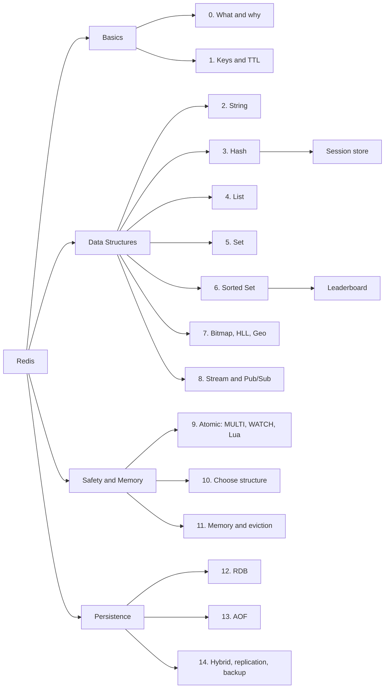
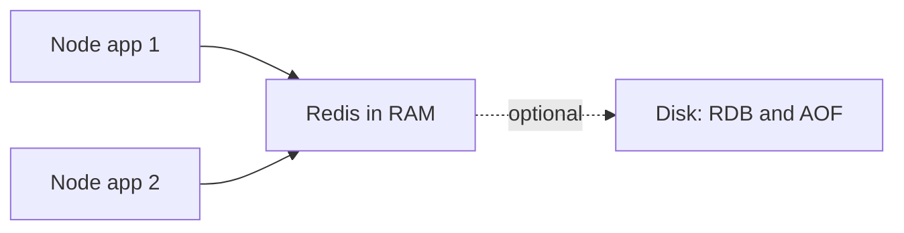
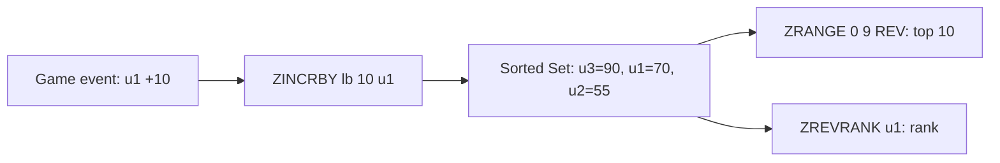
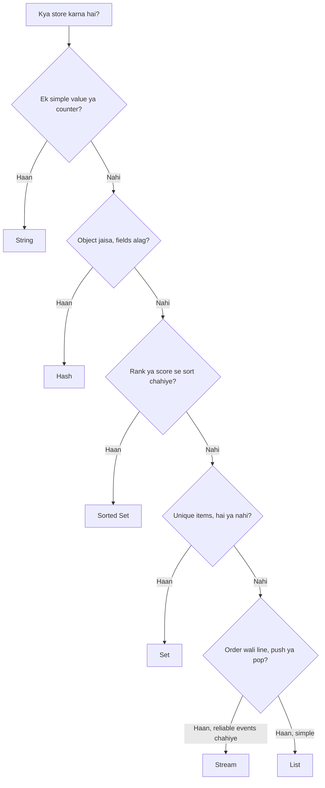
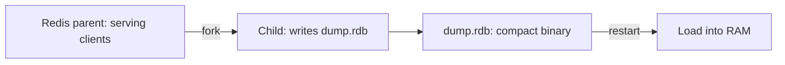

<callout icon="🎯" color="blue_bg">
 **Stage:** S4 Caching & Redis · **Day 22** · **Planned:** 2.5 h · **Type:** Coding
 **Deliverable:** Leaderboard + session store on Redis
 **Tracker row:** <mention-page url="https://app.notion.com/p/3f4bcc23fb6581698e9bfd107f491323"/>
 **Prerequisite:** Basic Node.js, async/await, key-value ka idea. Redis pehle kabhi nahi chalaya to bhi chalega, zero se shuru karenge.
</callout>
## 📖 Ye page kaise padhein (3 levels)
<table fit-page-width="true" header-row="true">
<tr>
<td>Level</td>
<td>Kab</td>
<td>Kya padhna hai</td>
</tr>
<tr>
<td>⚡ **5-min revision**</td>
<td>Interview / exam se pehle</td>
<td>Sirf **Cheat Sheet**, har section ke end ka **⚡ 30-sec revise** box, **Confusing pairs** aur **Quick-fire flashcards**</td>
</tr>
<tr>
<td>📘 **Pehli baar (beginner)**</td>
<td>Aaj</td>
<td>Section 0 se order me. Har section: analogy → kab use → commands → **redis-cli me try karo** → Node code. Deep dive toggles **skip** karo</td>
</tr>
<tr>
<td>📚 **Deep dive**</td>
<td>Doosri baar / interview prep</td>
<td>Har section ke **📚 Deep dive** toggle kholo (internals, gotchas, production tips)</td>
</tr>
</table>
- **Sabse zaruri advice:** sirf padhne se Redis nahi aata. **🧪 Redis CLI Lab** (neeche) khud type karke chalao, 30 minute lagenge.
## 🧠 Cheat Sheet — poora Redis ek table me
<table fit-page-width="true" header-row="true">
<tr>
<td>Structure</td>
<td>Simple matlab</td>
<td>Kab use karein</td>
<td>Top commands</td>
</tr>
<tr>
<td>**String**</td>
<td>Ek key → ek value (text / number / JSON)</td>
<td>Cache, OTP, counter, lock flag</td>
<td>`SET`, `GET`, `INCR`, `SET NX EX`</td>
</tr>
<tr>
<td>**Hash**</td>
<td>Ek key ke andar `field → value` (mini object)</td>
<td>**Session**, user profile</td>
<td>`HSET`, `HGET`, `HGETALL`, `HINCRBY`</td>
</tr>
<tr>
<td>**List**</td>
<td>Ordered line (dono sire khule)</td>
<td>Latest N items, simple queue</td>
<td>`LPUSH`, `RPOP`, `LRANGE`, `LTRIM`</td>
</tr>
<tr>
<td>**Set**</td>
<td>Unique items, order nahi</td>
<td>Unique tracking, tags, mutual friends</td>
<td>`SADD`, `SISMEMBER`, `SCARD`, `SINTER`</td>
</tr>
<tr>
<td>**Sorted Set (ZSET)**</td>
<td>Set + har member ka score, hamesha sorted</td>
<td>**Leaderboard**, ranking, delayed jobs</td>
<td>`ZADD`, `ZINCRBY`, `ZRANGE ... REV`, `ZREVRANK`</td>
</tr>
<tr>
<td>**Bitmap**</td>
<td>String ke bits (0/1 flags)</td>
<td>Daily active flag per user</td>
<td>`SETBIT`, `GETBIT`, `BITCOUNT`</td>
</tr>
<tr>
<td>**HyperLogLog**</td>
<td>Approx unique counter (12 KB fixed)</td>
<td>Unique visitors (approx chalega)</td>
<td>`PFADD`, `PFCOUNT`</td>
</tr>
<tr>
<td>**Geo**</td>
<td>Location points (andar Sorted Set)</td>
<td>Nearby search</td>
<td>`GEOADD`, `GEOSEARCH`</td>
</tr>
<tr>
<td>**Stream**</td>
<td>Append-only event log + consumer groups + ack</td>
<td>Event processing, replay</td>
<td>`XADD`, `XREADGROUP`, `XACK`</td>
</tr>
<tr>
<td>**Pub/Sub**</td>
<td>Live broadcast, store nahi hota</td>
<td>Real-time notifications</td>
<td>`PUBLISH`, `SUBSCRIBE`</td>
</tr>
</table>
**Persistence ek line me:**
- **RDB** = periodic **photo** (compact, fast restart, last photo ke baad ka data lost).
- **AOF** = har write ka **diary / log** (kam loss, `appendfsync everysec` default).
- **Dono saath (hybrid)** = production ke liye best. Restart par **AOF** se load hota hai.
- **Replica ≠ backup.** Cache = persistence off. Session / queue = AOF + `noeviction`.
## 📚 Glossary — beginner words
<table fit-page-width="true" header-row="true">
<tr>
<td>Word</td>
<td>Matlab (simple)</td>
</tr>
<tr>
<td>**RAM vs Disk**</td>
<td>RAM = bahut fast, band hote hi data gaya. Disk = slow, data bacha rehta hai. Redis RAM me kaam karta hai</td>
</tr>
<tr>
<td>**Key / Value**</td>
<td>Key = data ka naam (`sess:abc`). Value = uske andar ka data</td>
</tr>
<tr>
<td>**Command**</td>
<td>Redis ko diya hua order, jaise `SET name Satyam`. Command ke naam case-insensitive hain, **keys case-sensitive** hain</td>
</tr>
<tr>
<td>**TTL (Time To Live)**</td>
<td>Key kitni der me khud delete ho jaayegi</td>
</tr>
<tr>
<td>**Atomic**</td>
<td>Ek command beech me nahi rukti, doosra client aadha kaam nahi dekhta</td>
</tr>
<tr>
<td>**O(1), O(log N), O(N)**</td>
<td>Command ki speed. O(1) = data kitna bhi ho same time. O(log N) = bahut kam badhta hai. O(N) = data ke saath linearly slow</td>
</tr>
<tr>
<td>**Round-trip**</td>
<td>App → Redis → app ka ek network chakkar. Kam round-trips = fast (pipeline)</td>
</tr>
<tr>
<td>**Persistence**</td>
<td>RAM ka data disk par save karna taaki restart ke baad wapas aaye</td>
</tr>
<tr>
<td>**Snapshot (RDB)**</td>
<td>Ek moment par poore data ki copy file</td>
</tr>
<tr>
<td>**AOF**</td>
<td>Append Only File: har write command ka log</td>
</tr>
<tr>
<td>**fsync**</td>
<td>OS ko bolna "buffer ka data **abhi** disk par likh do"</td>
</tr>
<tr>
<td>**fork / copy-on-write**</td>
<td>Redis apna child process banata hai jo snapshot likhta hai. Parent me write aaye to memory page copy hota hai (memory badh sakti hai)</td>
</tr>
<tr>
<td>**Eviction**</td>
<td>Memory full hone par Redis purani/kam zaruri keys khud hata deta hai</td>
</tr>
<tr>
<td>**Replica**</td>
<td>Master ki live copy (read scaling + failover)</td>
</tr>
<tr>
<td>**Source of truth**</td>
<td>Wo jagah jahan data ka asli, final version rehta hai (aam taur par DB, Redis nahi)</td>
</tr>
<tr>
<td>**Big key / Hot key**</td>
<td>Big key = bahut bada value/collection. Hot key = jis par sabse zyada traffic aata hai</td>
</tr>
<tr>
<td>**Blocking (server)**</td>
<td>Redis single thread hai, ek slow command sabko rok deti hai. (Alag cheez: `BRPOP` jaisi "wait karne wali" commands)</td>
</tr>
</table>
## 🗺️ Mindmap

## 🔗 Notes se connection
- **Pichle notes (S4 ke andar):** ye S4 ka pehla page hai, isliye abhi koi pichla Redis note nahi hai.
- **Pehle se likha hua (S6, Day 35):** <mention-page url="https://app.notion.com/p/3f5bcc23fb6581208eebc9eb79a5dde1"/> me BullMQ ke andar Redis structures (wait list, delayed sorted set, job hash, lock key, events stream) aur config (`appendonly yes`, `noeviction`) aaye the. Yahan wahi cheezein zero se samjhenge.
- **Aage kya:** <mention-page url="https://app.notion.com/p/3f4bcc23fb65811f8533f57be592281e"/> (Day 23): cache-aside, write-through, TTL, invalidation. Is page ke TTL + key naming wahan reuse honge. Phir stampede, rate limiting, distributed locks + eviction.
- **Running example:** is page me **leaderboard + session store**. S4 ke baaki din Project 1 par caching layer.
---
## 0️⃣ Redis kya hai? (Beginner start)
<callout icon="💡" color="green_bg">
 **Ek line me:** Redis = **RAM me rakhi hui, bahut fast key-value dictionary**, jiski value sirf text nahi, list / hash / set / sorted set jaise ready-made structures bhi ho sakti hai.
</callout>
### 🌍 Analogy
- **Postgres / DB** = godown ki file-cabinet: sab kuch safe, par file dhundhne me time lagta hai.
- **Redis** = counter par rakha **whiteboard**: jo abhi chahiye turant dikhta hai, par board saaf ho gaya (restart) to saath me wo copy bhi chahiye jo register me likhi ho (persistence).
### 🧩 Problem kya hai?
- Leaderboard, session, counter jaisi cheezein **har request** par chahiye hoti hain.
- Har baar DB query (disk + planner) = slow, aur traffic badhe to DB gir jaata hai.
- Node process ke andar `Map` rakhoge to **2 servers = 2 alag data**, aur restart par sab gaya.
- Redis = **fast (RAM) + shared (network) + optional durable (disk)**.
### 🧩 Kaise kaam karta hai (4 steps)
1. App TCP se Redis server se connect hota hai.
2. App **command** bhejta hai (`ZINCRBY lb 10 u1`).
3. Redis ka **ek hi thread** command execute karta hai (isliye ek command **atomic**).
4. Reply wapas, aam taur par **sub-millisecond**.

### 🧩 Kab use karein / kab nahi
<table fit-page-width="true" header-row="true">
<tr>
<td>✅ Use karo</td>
<td>❌ Mat karo (ya sirf helper ki tarah)</td>
</tr>
<tr>
<td>Cache, session, counters, rate limit</td>
<td>Akela primary database (joins, ad-hoc SQL, bahut bada data)</td>
</tr>
<tr>
<td>Leaderboard, ranking, top-N</td>
<td>Paise / orders jaisa data jisme **zero loss** chahiye (DB me rakho)</td>
</tr>
<tr>
<td>Short-lived data (OTP, tokens)</td>
<td>Bade files / blobs (S3 me rakho, Redis me ID)</td>
</tr>
<tr>
<td>Job queue (BullMQ), pub/sub, locks</td>
<td>Complex relational queries</td>
</tr>
</table>
### 🧩 Setup (2 minute)
1. Redis chalao:
```bash
docker run -d --name redis -p 6379:6379 redis:7
```
1. CLI kholo aur test karo:
```bash
docker exec -it redis redis-cli
127.0.0.1:6379> PING
PONG
127.0.0.1:6379> SET greeting hello
OK
127.0.0.1:6379> GET greeting
"hello"
```
1. Node client install:
```bash
npm i ioredis
npm i -D typescript tsx @types/node
```
```typescript
import { Redis } from "ioredis";

const redis = new Redis("redis://localhost:6379");
await redis.set("greeting", "hello");
console.log(await redis.get("greeting")); // hello
redis.disconnect();

```
- **Client library note:** is roadmap me **ioredis** use hoga (BullMQ ioredis par chalta hai). Doosra popular client `redis` (node-redis) hai, uske method naam camelCase hote hain.
<table fit-page-width="true" header-row="true">
<tr>
<td>Redis command</td>
<td>ioredis</td>
<td>node-redis (`redis` package)</td>
</tr>
<tr>
<td>`HSET k f v`</td>
<td>`hset(k, f, v)` ya `hset(k, obj)`</td>
<td>`hSet(k, obj)`</td>
</tr>
<tr>
<td>`ZADD k 5 a`</td>
<td>`zadd(k, 5, "a")`</td>
<td>`zAdd(k, { score: 5, value: "a" })`</td>
</tr>
<tr>
<td>`ZRANGE k 0 9 REV WITHSCORES`</td>
<td>`zrange(k, 0, 9, "REV", "WITHSCORES")`</td>
<td>`zRangeWithScores(k, 0, 9, { REV: true })`</td>
</tr>
</table>
### 🧩 redis-cli ke kaam ke commands
<table fit-page-width="true" header-row="true">
<tr>
<td>Command</td>
<td>Kya karta hai</td>
</tr>
<tr>
<td>`PING`</td>
<td>Server zinda hai? (`PONG`)</td>
</tr>
<tr>
<td>`HELP @string` / `HELP SET`</td>
<td>Command ki help (group ya single)</td>
</tr>
<tr>
<td>`DBSIZE`</td>
<td>Current db me kitni keys</td>
</tr>
<tr>
<td>`INFO` / `INFO memory`</td>
<td>Server stats</td>
</tr>
<tr>
<td>`TYPE key`</td>
<td>Key ka type (`string`, `hash`, `zset`...)</td>
</tr>
<tr>
<td>`MONITOR`</td>
<td>Live saari commands dekho (sirf dev me, production me slow)</td>
</tr>
<tr>
<td>`FLUSHALL`</td>
<td>**Sab kuch delete.** Production me kabhi nahi</td>
</tr>
</table>
### 🧪 Khud check karo
<details>
<summary>Q. Redis single-threaded hai to do clients ke commands me race condition hoti hai?</summary>
 - Nahi. Commands ek-ek karke chalte hain, to **ek command atomic** hai. Multi-command flow ke liye `MULTI/EXEC` ya Lua (section 9).
</details>
<details>
<summary>Q. Redis restart karne par data kyun gaya?</summary>
 - Data RAM me tha aur persistence ya Docker volume nahi tha. Section 12-14 me detail.
</details>
<details>
<summary>Q. Redis ko primary DB kyun nahi banate (mostly)?</summary>
 - RAM costly, durability tuning chahiye, joins / SQL nahi. DB source of truth, Redis fast layer.
</details>
<details>
<summary>📚 Deep dive: Redis fast kyun, threads, protocol</summary>
 - **Fast kyun:** data RAM me, single-threaded execution (locks nahi), epoll I/O multiplexing, compact encodings (`listpack`, `intset`), simple protocol **RESP**.
 - **Threads ka sach:** commands single thread me; `io-threads` (6.0+) sirf socket read/write parallel; snapshot / AOF rewrite **fork kiye hue child process** me.
 - **Slow command sabko rokti hai:** `KEYS *`, bade `HGETALL` / `SMEMBERS` / `LRANGE 0 -1`, bada `DEL`. Alternatives: `SCAN`, pagination, `UNLINK`.
 - **Logical databases (0-15):** `SELECT 1`. Cluster me sirf db 0, isliye namespace ke liye **key prefix** use karo.
 - **Redis vs Memcached:** Memcached = sirf string cache, multi-threaded. Redis = rich structures + persistence + replication + pub/sub + Lua.
 - **Security:** default me auth nahi hota. Public internet par expose mat karo; password / ACL + TLS + private network.
 - **Node:** ek shared client rakho. Har request par naya connection mat kholo.
 - **JS analogy:** Redis ≈ shared, atomic, network-accessible `Map` jo (persistence ke saath) restart ke baad bhi zinda reh sakta hai.
</details>
<callout icon="⚡" color="gray_bg">
 **30-sec revise (Section 0):** Redis = RAM key-value + data structures · ek command atomic (single thread) · fast par slow command sabko block karti hai · RAM = restart par gaya jab tak persistence na ho · DB source of truth, Redis fast layer · CLI se pehle seekho, phir Node.
</callout>
---
## 1️⃣ Keys & TTL (har structure ki base)
<callout icon="💡" color="green_bg">
 **Ek line me:** Redis me sab kuch **key** se chalta hai. Key ka naam kaise rakhein aur **kab expire** karein, ye pehle seekho; baaki structures iske upar hain.
</callout>
### 🌍 Analogy
- Key = locker ka number, TTL = locker par laga **timer** ("60 sec baad khaali ho jaayega").
### 🧩 Key naming (5 rules)
1. Pattern: `<domain>:<entity>:<id>[:field]` → `sess:abc`, `user:42:sessions`, `lb:2026-W42`.
2. Colon `:` se alag karo; spaces mat rakho.
3. Chhote par meaningful naam. Key bhi RAM leti hai.
4. Environment alag Redis (ya kam se kam prefix).
5. User-input se key banao to **validate / allow-list** karo (key injection).
### 🧩 Key commands
<table fit-page-width="true" header-row="true">
<tr>
<td>Command</td>
<td>Kya karta hai</td>
<td>Complexity</td>
</tr>
<tr>
<td>`EXISTS k`</td>
<td>Key hai? (1 ya 0)</td>
<td>O(1)</td>
</tr>
<tr>
<td>`TYPE k`</td>
<td>Value ka type</td>
<td>O(1)</td>
</tr>
<tr>
<td>`DEL k`</td>
<td>Delete (bada key = block kar sakta hai)</td>
<td>O(N) bade value par</td>
</tr>
<tr>
<td>`UNLINK k`</td>
<td>Delete, memory background me free (**bade key ke liye prefer**)</td>
<td>O(1) call</td>
</tr>
<tr>
<td>`EXPIRE k 60`</td>
<td>60 sec baad delete</td>
<td>O(1)</td>
</tr>
<tr>
<td>`TTL k`</td>
<td>Bacha time (sec). `-1` = expiry nahi, `-2` = key nahi</td>
<td>O(1)</td>
</tr>
<tr>
<td>`PERSIST k`</td>
<td>TTL hata do (key permanent)</td>
<td>O(1)</td>
</tr>
<tr>
<td>`RENAME a b`</td>
<td>Naam badlo</td>
<td>O(1)</td>
</tr>
<tr>
<td>`SCAN 0 MATCH sess:* COUNT 100`</td>
<td>Keys ko chunks me iterate karo (`KEYS` ka safe version)</td>
<td>O(1) per call</td>
</tr>
</table>
- Variants: `PEXPIRE` (ms), `EXPIREAT` (unix timestamp), `PTTL` (ms me bacha). Redis 7+ me `EXPIRE k 60 NX|XX|GT|LT` options bhi hain.
### ▶️ redis-cli me try karo
```bash
127.0.0.1:6379> SET otp:u1 482913 EX 300
OK
127.0.0.1:6379> TTL otp:u1
(integer) 299
127.0.0.1:6379> TYPE otp:u1
string
127.0.0.1:6379> EXISTS otp:u1 nokey
(integer) 1
127.0.0.1:6379> PERSIST otp:u1
(integer) 1
127.0.0.1:6379> TTL otp:u1
(integer) -1
127.0.0.1:6379> TTL nokey
(integer) -2
127.0.0.1:6379> SET otp:u1 111111
OK
```

- `EXISTS otp:u1 nokey` = 1 kyunki sirf ek key mili (multiple keys ka count aata hai).

### 💻 Node

```typescript
await redis.set("otp:u1", "482913", "EX", 300);
console.log(await redis.ttl("otp:u1")); // ~300
await redis.expire("otp:u1", 60);
await redis.persist("otp:u1");

// production-safe iteration (KEYS * kabhi nahi)
let cursor = "0";
do {
  const [next, keys] = await redis.scan(cursor, "MATCH", "sess:*", "COUNT", 200);
  cursor = next;
  // keys par kaam karo (duplicates possible, dedupe karo)
} while (cursor !== "0");
```

### ⚠️ Common mistakes

<table fit-page-width="true" header-row="true">
<tr>
<td>Galti</td>
<td>Result</td>
<td>Fix</td>
</tr>
<tr>
<td>Temporary data par TTL nahi</td>
<td>Memory leak</td>
<td>Har session / cache / OTP par TTL</td>
</tr>
<tr>
<td>Value update ke liye plain `SET`</td>
<td>**Purana TTL hat jaata hai**</td>
<td>`SET ... EX` dobara ya `KEEPTTL`</td>
</tr>
<tr>
<td>`KEYS *` production me</td>
<td>Server block, p99 spike</td>
<td>`SCAN`</td>
</tr>
<tr>
<td>Lakhon keys ek hi TTL par</td>
<td>Ek saath expire, latency spike</td>
<td>TTL me random **jitter**</td>
</tr>
</table>
### 🧪 Khud check karo
<details>
<summary>Q. `TTL` ne `-1` diya, iska kya matlab?</summary>
 - Key hai par expiry set nahi (permanent). `-2` = key exist hi nahi karti.
</details>
<details>
<summary>Q. `SCAN` me kabhi kabhi duplicate keys kyun aati hain?</summary>
 - SCAN incremental cursor hai. Iterate karte waqt keyspace badle to ek key repeat ho sakti hai. App me dedupe karo.
</details>
<details>
<summary>📚 Deep dive: expiry internals, SCAN, encodings</summary>
 - **Expiry 2 tareeke se hoti hai:** (1) **lazy**: key access par check; (2) **active**: Redis periodically random keys sample karke expire karta hai. Isliye expired key thodi der memory me reh sakti hai.
 - **`SCAN`**** ka ****`COUNT`**** sirf hint hai**, guarantee nahi. `MATCH` filter result aane ke baad lagta hai, isliye kam match wale pattern par bhi bahut calls lag sakti hain.
 - **`OBJECT ENCODING k`** se internal representation dekho (`int`, `embstr`, `listpack`, `skiplist`...). **`MEMORY USAGE k`** se bytes.
 - **Big key detect:** `redis-cli --bigkeys`.
 - **Cluster hint:** multi-key ops ke liye keys same slot me chahiye → hash tag `{user:42}:sessions`.
 - **JS analogy:** `SCAN` = generator se chunk-by-chunk iterate; poora array ek saath load nahi.
</details>
<callout icon="⚡" color="gray_bg">
 **30-sec revise (Section 1):** naming `domain:entity:id` · temporary data par hamesha TTL · `TTL`: -1 = no expiry, -2 = no key · plain `SET` TTL hata deta hai · `KEYS` nahi, `SCAN` · bade key ke liye `UNLINK`.
</callout>
---
## 2️⃣ Strings
<callout icon="💡" color="green_bg">
 **Ek line me:** String = sabse basic dabba: **ek key → ek value** (text, number, JSON, ya raw bytes, max 512 MB).
</callout>
### 🌍 Analogy
- Sticky note par ek cheez likhi hui, bas.
### 🧩 Kab use karte hain?
- **Cache:** `SET user:42 '{...json...}' EX 60`
- **Counter:** page views, API hits → `INCR`
- **Lock / dedupe flag:** `SET key val NX EX 30`
- **OTP / token** with expiry
### 🧩 Commands
<table fit-page-width="true" header-row="true">
<tr>
<td>Command</td>
<td>Kya karta hai</td>
<td>Complexity</td>
</tr>
<tr>
<td>`SET k v`</td>
<td>Value set (purana TTL hata deta hai)</td>
<td>O(1)</td>
</tr>
<tr>
<td>`SET k v EX 60`</td>
<td>Value + 60 sec TTL</td>
<td>O(1)</td>
</tr>
<tr>
<td>`SET k v NX`</td>
<td>Sirf agar key **na ho** (lock / dedupe)</td>
<td>O(1)</td>
</tr>
<tr>
<td>`SET k v XX`</td>
<td>Sirf agar key **ho**</td>
<td>O(1)</td>
</tr>
<tr>
<td>`GET k`</td>
<td>Value padho (nahi to `nil`)</td>
<td>O(1)</td>
</tr>
<tr>
<td>`INCR k` / `INCRBY k 5` / `DECR k`</td>
<td>Atomic counter</td>
<td>O(1)</td>
</tr>
<tr>
<td>`MSET` / `MGET`</td>
<td>Kai keys ek round-trip me</td>
<td>O(N)</td>
</tr>
<tr>
<td>`APPEND k str`</td>
<td>Value ke end me jodo</td>
<td>O(1)</td>
</tr>
<tr>
<td>`STRLEN k`</td>
<td>Length</td>
<td>O(1)</td>
</tr>
<tr>
<td>`GETDEL k`</td>
<td>Padho aur delete (one-time token)</td>
<td>O(1)</td>
</tr>
</table>
### ▶️ redis-cli me try karo
```bash
127.0.0.1:6379> SET views 10
OK
127.0.0.1:6379> INCR views
(integer) 11
127.0.0.1:6379> INCRBY views 5
(integer) 16
127.0.0.1:6379> SET lock:job1 worker1 NX EX 30
OK
127.0.0.1:6379> SET lock:job1 worker2 NX EX 30
(nil)
127.0.0.1:6379> MSET a 1 b 2
OK
127.0.0.1:6379> MGET a b nokey
1) "1"
2) "2"
3) (nil)
127.0.0.1:6379> GETDEL a
"1"
```
- Doosra `SET ... NX` `(nil)` deta hai kyunki key pehle se hai. Yahi **lock / dedupe** ka basic idea hai.
### 💻 Node
```typescript
await redis.set("otp:u1", "482913", "EX", 300);
const got = await redis.set("job:42:lock", "w1", "EX", 30, "NX"); // "OK" ya null
const views = await redis.incr("views:post:7"); // number
const [a, b] = await redis.mget("a", "b");
```
### ⚠️ Common mistakes
<table fit-page-width="true" header-row="true">
<tr>
<td>Galti</td>
<td>Fix</td>
</tr>
<tr>
<td>Counter ke liye `GET`  • `SET` (race, lost update)</td>
<td>`INCR` (atomic)</td>
</tr>
<tr>
<td>`SETNX`  • `EXPIRE` do alag commands (beech me crash = lock hamesha ke liye)</td>
<td>Ek hi `SET k v NX EX`</td>
</tr>
<tr>
<td>`GET` string hi deta hai, number samajh liya</td>
<td>`Number()` / `JSON.parse` se parse karo</td>
</tr>
<tr>
<td>MB-size values</td>
<td>Compress karo ya S3 / DB me rakho, Redis me ID</td>
</tr>
</table>
### 🧪 Khud check karo
<details>
<summary>Q. `SET key val NX EX 30` me NX aur EX kya karte hain?</summary>
 - NX = sirf tab set jab key na ho. EX = 30 sec baad auto-delete. Dono ek hi atomic command me.
</details>
<details>
<summary>Q. Counter ke liye `GET` phir `SET` kyun galat hai?</summary>
 - Do commands ke beech doosra client aa sakta hai (lost update). `INCR` ek atomic command hai.
</details>
<details>
<summary>📚 Deep dive: encodings, JSON vs Hash, gotchas</summary>
 - String **binary-safe** hai: number, JSON, protobuf, image bytes sab.
 - **Encodings:** `int` (chhota number), `embstr` (chhoti string), `raw` (badi string). `OBJECT ENCODING key` se dekho.
 - **`SET`**** options:** `EX/PX` (TTL), `NX/XX` (condition), `GET` (purani value return), `KEEPTTL` (TTL na badlo).
 - **JSON string vs Hash:** poora object hamesha padhna ho → JSON string. Field-wise update / partial read → Hash (agla section).
 - **JS analogy:** `localStorage.setItem` ka server-side, atomic, expiry wala version.
</details>
<callout icon="⚡" color="gray_bg">
 **30-sec revise (Strings):** `SET/GET` basic · `INCR` atomic counter · `SET k v NX EX` = lock/dedupe in one command · `SET` TTL reset karta hai · `GET` hamesha string · MGET/MSET round-trips bachate hain.
</callout>
---
## 3️⃣ Hashes
<callout icon="💡" color="green_bg">
 **Ek line me:** Hash = **ek key ke andar chhoti-si object / row**: `field → value` pairs. **Session store** ke liye perfect.
</callout>
### 🌍 Analogy
- Ek **ID card**: upar ek number (key), andar naam, role, photo jaisi alag-alag fields.
### 🧩 Kab use karte hain?
- **Session:** `sess:abc → { userId, role, createdAt }`
- **User profile / settings** (ek field badalna ho bina poora JSON rewrite kiye)
- Chhote objects, field-wise counters (`HINCRBY`)
### 🧩 Commands
<table fit-page-width="true" header-row="true">
<tr>
<td>Command</td>
<td>Kya karta hai</td>
<td>Complexity</td>
</tr>
<tr>
<td>`HSET k f v [f v ...]`</td>
<td>Ek ya kai fields set</td>
<td>O(1) per field</td>
</tr>
<tr>
<td>`HGET k f`</td>
<td>Ek field padho</td>
<td>O(1)</td>
</tr>
<tr>
<td>`HMGET k f1 f2`</td>
<td>Kuch fields padho</td>
<td>O(N) fields</td>
</tr>
<tr>
<td>`HGETALL k`</td>
<td>Saari fields + values</td>
<td>O(N)</td>
</tr>
<tr>
<td>`HEXISTS k f`</td>
<td>Field hai?</td>
<td>O(1)</td>
</tr>
<tr>
<td>`HKEYS` / `HVALS` / `HLEN`</td>
<td>Field names / values / count</td>
<td>O(N), O(N), O(1)</td>
</tr>
<tr>
<td>`HINCRBY k f 1`</td>
<td>Field counter (atomic)</td>
<td>O(1)</td>
</tr>
<tr>
<td>`HDEL k f`</td>
<td>Field hatao</td>
<td>O(1)</td>
</tr>
<tr>
<td>`HSCAN k 0`</td>
<td>Bade hash ko chunks me padho</td>
<td>O(1) per call</td>
</tr>
<tr>
<td>`EXPIRE k 1800`</td>
<td>**Poori key** par TTL (field par nahi)</td>
<td>O(1)</td>
</tr>
</table>
### ▶️ redis-cli me try karo
```bash
127.0.0.1:6379> HSET sess:abc userId u1 role user
(integer) 2
127.0.0.1:6379> EXPIRE sess:abc 1800
(integer) 1
127.0.0.1:6379> HGET sess:abc userId
"u1"
127.0.0.1:6379> HGETALL sess:abc
1) "userId"
2) "u1"
3) "role"
4) "user"
127.0.0.1:6379> HINCRBY sess:abc visits 1
(integer) 1
127.0.0.1:6379> HDEL sess:abc role
(integer) 1
127.0.0.1:6379> HLEN sess:abc
(integer) 2
```
### 💻 Node
```typescript
await redis.hset("sess:abc", { userId: "u1", role: "user" });
await redis.expire("sess:abc", 1800);
const s = await redis.hgetall("sess:abc"); // { userId: "u1", role: "user" }
// key na ho to hgetall {} (empty object) deta hai, null nahi
```
### ⚠️ Common mistakes
<table fit-page-width="true" header-row="true">
<tr>
<td>Galti</td>
<td>Fix</td>
</tr>
<tr>
<td>`HSET` aur `EXPIRE` alag chalana (beech me crash = bina TTL ka session)</td>
<td>`MULTI/EXEC` me dono (scaffold me dikhega)</td>
</tr>
<tr>
<td>Nested object daal diya (Hash me values sirf strings)</td>
<td>JSON string field me, ya flatten karo</td>
</tr>
<tr>
<td>Numbers string wapas aate hain</td>
<td>`Number()` se parse</td>
</tr>
<tr>
<td>Bade hash par `HGETALL`</td>
<td>`HSCAN` ya `HMGET` sirf zaruri fields</td>
</tr>
</table>
### 🧪 Khud check karo
<details>
<summary>Q. Hash ke ek field par alag TTL laga sakte ho?</summary>
 - Traditionally nahi, TTL poori key par hota hai. Naye Redis versions (7.4+) me hash-field expiry aayi hai, par portable design me key-level TTL maano.
</details>
<details>
<summary>Q. Session ko JSON string vs Hash: kab kya?</summary>
 - Hamesha poora padhte ho → JSON string theek. Ek-do field badalte ho (`lastSeen`, `cartCount`) → Hash.
</details>
<details>
<summary>📚 Deep dive: encodings, session design</summary>
 - Hash ≈ JS object / `Map<string,string>` ek key ke andar.
 - **Encoding:** chhota hash → `listpack` (compact); bada ho to `hashtable`. Thresholds `hash-max-listpack-entries` / `hash-max-listpack-value`.
 - **Memory trick:** bahut saare chhote objects ke liye 1 key per object (hash) aksar alag-alag string keys se kam memory leta hai.
 - **Session design:** key `sess:<random id>`, value Hash, TTL **sliding** (har request par `EXPIRE` refresh), extra Set `user:<id>:sessions` (logout-all-devices ke liye). Session id **crypto-random** (32 bytes).
 - **JS analogy:** `Object.assign(session, { lastSeen })` ka network version. `express-session` + `connect-redis` andar yahi karte hain.
</details>
<callout icon="⚡" color="gray_bg">
 **30-sec revise (Hash):** key ke andar fields · session ke liye best · `HSET/HGET/HGETALL/HINCRBY/HDEL` · TTL poori key par · values strings · HSET+EXPIRE ko `MULTI` me.
</callout>
---
## 4️⃣ Lists
<callout icon="💡" color="green_bg">
 **Ek line me:** List = **dono sire se khulne wali line (deque)**. Ek side se daalo, doosri se nikaalo. Queue / stack / "latest N items".
</callout>
### 🌍 Analogy
- Ticket counter ki line: `RPUSH` = line ke piche lagna, `LPOP` = aage wale ka kaam hona.
### 🧩 Kab use karte hain?
- **Latest N items:** recent activity, last 10 notifications → `LPUSH` + `LTRIM`
- **Simple queue / buffer:** `LPUSH` + `BRPOP`
- **Undo history / stack**
### 🧩 Commands
<table fit-page-width="true" header-row="true">
<tr>
<td>Command</td>
<td>Kya karta hai</td>
<td>Complexity</td>
</tr>
<tr>
<td>`LPUSH k v` / `RPUSH k v`</td>
<td>Left / right se daalo</td>
<td>O(1)</td>
</tr>
<tr>
<td>`LPOP k` / `RPOP k`</td>
<td>Left / right se nikaalo</td>
<td>O(1)</td>
</tr>
<tr>
<td>`BRPOP k 5`</td>
<td>Khaali ho to 5 sec wait (blocking pop)</td>
<td>O(1)</td>
</tr>
<tr>
<td>`LRANGE k 0 9`</td>
<td>Pehle 10 items (`0 -1` = sab)</td>
<td>O(S+N)</td>
</tr>
<tr>
<td>`LLEN k`</td>
<td>Length</td>
<td>O(1)</td>
</tr>
<tr>
<td>`LTRIM k 0 99`</td>
<td>Sirf pehle 100 rakho</td>
<td>O(N)</td>
</tr>
<tr>
<td>`LINDEX k 5`</td>
<td>5th item (beech me slow)</td>
<td>O(N)</td>
</tr>
<tr>
<td>`LMOVE src dst LEFT RIGHT`</td>
<td>Atomically ek list se doosri me move (processing list pattern)</td>
<td>O(1)</td>
</tr>
</table>
### ▶️ redis-cli me try karo
```bash
127.0.0.1:6379> RPUSH q a b c
(integer) 3
127.0.0.1:6379> LRANGE q 0 -1
1) "a"
2) "b"
3) "c"
127.0.0.1:6379> LPUSH q z
(integer) 4
127.0.0.1:6379> LPOP q
"z"
127.0.0.1:6379> RPOP q
"c"
127.0.0.1:6379> LLEN q
(integer) 2
127.0.0.1:6379> LTRIM q 0 0
OK
127.0.0.1:6379> LRANGE q 0 -1
1) "a"
```
### 💻 Node
```typescript
// latest 100 activity, newest first (atomic group)
await redis
  .multi()
  .lpush("feed:u1", JSON.stringify({ t: Date.now(), msg: "scored 10" }))
  .ltrim("feed:u1", 0, 99)
  .exec();
const latest = await redis.lrange("feed:u1", 0, 9);
```
### ⚠️ Common mistakes
<table fit-page-width="true" header-row="true">
<tr>
<td>Galti</td>
<td>Fix</td>
</tr>
<tr>
<td>List unbounded badhne di (memory leak)</td>
<td>`LPUSH`  • `LTRIM` ek saath</td>
</tr>
<tr>
<td>Bade list par `LRANGE 0 -1`</td>
<td>Pagination (`0 49`, `50 99`)</td>
</tr>
<tr>
<td>Reliable job queue ke liye plain List (pop karke crash = job gaya)</td>
<td>BullMQ / Streams / `LMOVE` pattern</td>
</tr>
<tr>
<td>Beech ke element `LINDEX` par depend</td>
<td>Sorted Set / alag structure</td>
</tr>
</table>
### 🧪 Khud check karo
<details>
<summary>Q. `LINDEX 5000` slow kyun hai jabki dono sire O(1) hain?</summary>
 - Internally linked structure hai, beech ke index tak chalna padta hai → O(N).
</details>
<details>
<summary>Q. `LPUSH` + `RPOP` se FIFO hota hai ya LIFO?</summary>
 - FIFO (pehle aaya, pehle gaya). Dono same side use karo to LIFO (stack).
</details>
<details>
<summary>📚 Deep dive: quicklist, blocking pops, LMOVE</summary>
 - Internally **quicklist** = linked list of `listpack` nodes: memory-efficient + dono sire O(1).
 - **Blocking pops** (`BLPOP` / `BRPOP`) polling ki jagah wait karte hain; worker idle me CPU nahi khata.
 - **`LMOVE`** (pehle `RPOPLPUSH`): item ko atomically "processing" list me move karo. Crash ke baad processing list se retry kar sakte ho.
 - **Kab nahi:** random access / search / priority → Sorted Set. Replay + many consumers → Streams.
 - **JS analogy:** `array.unshift()` + `array.pop()`, par shared + blocking.
</details>
<callout icon="⚡" color="gray_bg">
 **30-sec revise (List):** deque, dono sire O(1) · latest-N = `LPUSH` + `LTRIM` · `BRPOP` = wait karke pop · beech ka access O(N) · reliable queue ke liye List nahi · unbounded list = leak.
</callout>
---
## 5️⃣ Sets
<callout icon="💡" color="green_bg">
 **Ek line me:** Set = **unique items ka thaila** (order nahi, duplicate nahi). "Hai ya nahi?" aur intersection / union jaise sawalon ke liye.
</callout>
### 🌍 Analogy
- Party ki **guest list**: ek naam do baar nahi likhte, "ye aaya tha?" turant pooch sakte ho.
### 🧩 Kab use karte hain?
- **Unique tracking:** aaj kin users ne login kiya
- **Tags / followers:** `user:1:followers`
- **Mutual friends:** intersection
- **User ke saare session ids** (logout-all-devices)
### 🧩 Commands
<table fit-page-width="true" header-row="true">
<tr>
<td>Command</td>
<td>Kya karta hai</td>
<td>Complexity</td>
</tr>
<tr>
<td>`SADD k a b`</td>
<td>Add (duplicate ignore)</td>
<td>O(1) per item</td>
</tr>
<tr>
<td>`SISMEMBER k a`</td>
<td>Member hai?</td>
<td>O(1)</td>
</tr>
<tr>
<td>`SREM k a`</td>
<td>Hatao</td>
<td>O(1)</td>
</tr>
<tr>
<td>`SCARD k`</td>
<td>Kitne items</td>
<td>O(1)</td>
</tr>
<tr>
<td>`SMEMBERS k`</td>
<td>Sab items (bade set par dangerous)</td>
<td>O(N)</td>
</tr>
<tr>
<td>`SINTER a b` / `SUNION` / `SDIFF`</td>
<td>Common / sab / pehle me jo doosre me nahi</td>
<td>O(N) ya zyada</td>
</tr>
<tr>
<td>`SPOP k` / `SRANDMEMBER k`</td>
<td>Random item (hata ke / bina hataye)</td>
<td>O(1)</td>
</tr>
<tr>
<td>`SSCAN k 0`</td>
<td>Bade set ko chunks me padho</td>
<td>O(1) per call</td>
</tr>
</table>
### ▶️ redis-cli me try karo
```bash
127.0.0.1:6379> SADD tags redis node redis
(integer) 2
127.0.0.1:6379> SISMEMBER tags node
(integer) 1
127.0.0.1:6379> SCARD tags
(integer) 2
127.0.0.1:6379> SADD a 1 2 3
(integer) 3
127.0.0.1:6379> SADD b 2 3 4
(integer) 3
127.0.0.1:6379> SINTER a b
1) "2"
2) "3"
127.0.0.1:6379> SDIFF a b
1) "1"
127.0.0.1:6379> SUNION a b
1) "1"
2) "2"
3) "3"
4) "4"
```
- `redis` do baar daala par `SADD` ne **2** (naye items) bataya. Output ka order guaranteed nahi hota.
### 💻 Node
```typescript
await redis.sadd("dau:2026-10-14", "u1", "u2", "u1"); // u1 ek hi baar
console.log(await redis.scard("dau:2026-10-14")); // 2
const mutual = await redis.sinter("follows:a", "follows:b");
```
### ⚠️ Common mistakes
<table fit-page-width="true" header-row="true">
<tr>
<td>Galti</td>
<td>Fix</td>
</tr>
<tr>
<td>Bade set par `SMEMBERS` (server block)</td>
<td>`SSCAN`</td>
</tr>
<tr>
<td>10 crore unique users Set me (bahut memory)</td>
<td>HyperLogLog (approx) ya Bitmap (dense ids)</td>
</tr>
<tr>
<td>Set se per-member TTL ki ummeed</td>
<td>Sorted Set (score = expiry time)</td>
</tr>
<tr>
<td>`user:id:sessions` set me expired session ids jama hote rehte hain</td>
<td>Read par clean karo, ya Sorted Set (score = expiry)</td>
</tr>
</table>
### 🧪 Khud check karo
<details>
<summary>Q. Set aur List me kab kaunsa?</summary>
 - Duplicate nahi chahiye + "hai ya nahi" tez chahiye → Set. Order + duplicates chahiye (history, queue) → List.
</details>
<details>
<summary>Q. `SINTER` bade sets par kab costly hota hai?</summary>
 - Cost sets ke size par depend karta hai, bade sets par slow. Result cache kar lo.
</details>
<details>
<summary>📚 Deep dive: encodings, set ops</summary>
 - **Encoding:** sirf integers → `intset` (bahut compact); chhota mixed → `listpack`; baaki `hashtable`.
 - `SINTERSTORE` / `SUNIONSTORE` / `SDIFFSTORE` result ko naye key me rakhte hain (cache ke liye).
 - `SPOP` / `SRANDMEMBER` lottery, sampling ke liye.
 - **JS analogy:** `new Set()`; `SINTER` ≈ `[...a].filter(x => b.has(x))`.
</details>
<callout icon="⚡" color="gray_bg">
 **30-sec revise (Set):** unique, no order · `SADD/SISMEMBER/SREM/SCARD` O(1) · `SINTER/SUNION/SDIFF` · `SMEMBERS` bade set par nahi (SSCAN) · per-member TTL nahi · bahut bade unique count → HLL.
</callout>
---
## 6️⃣ Sorted Sets (ZSET): leaderboard ka dil
<callout icon="💡" color="green_bg">
 **Ek line me:** Sorted Set = **Set + har member ka score**, aur Redis list ko **hamesha score ke hisaab se sorted** rakhta hai. Rank, top-N, range sab fast.
</callout>
### 🌍 Analogy
- Cricket ki **points table**: team (member) + points (score). Match ke baad points badhte hain aur table khud re-sort ho jaati hai.
### 🧩 Problem kya hai? (leaderboard)
- DB me `ORDER BY score DESC LIMIT 10` har request par = sort / index scan, aur "mera rank kya hai?" aur mehnga.
- ZSET me: score update O(log N), top-10 O(log N + 10), rank O(log N), lakhon users par bhi milliseconds.
### 🧩 Kaise kaam karta hai (4 steps)
1. Member = `userId`, score = points.
2. `ZINCRBY lb 10 u1` → u1 ke points +10 (nahi tha to ban jaata hai).
3. Redis member ko sahi sorted position par rakhta hai.
4. `ZRANGE lb 0 9 REV WITHSCORES` → top 10 (REV = bada score pehle).

### 🧩 Commands
<table fit-page-width="true" header-row="true">
<tr>
<td>Command</td>
<td>Kya karta hai</td>
<td>Complexity</td>
</tr>
<tr>
<td>`ZADD k 50 u1`</td>
<td>Add / score overwrite (`NX`, `XX`, `GT`, `LT` options bhi)</td>
<td>O(log N)</td>
</tr>
<tr>
<td>`ZINCRBY k 10 u1`</td>
<td>Score me atomic +10</td>
<td>O(log N)</td>
</tr>
<tr>
<td>`ZRANGE k 0 9 REV WITHSCORES`</td>
<td>Top 10 (bada pehle)</td>
<td>O(log N + M)</td>
</tr>
<tr>
<td>`ZRANGE k 0 -1 WITHSCORES`</td>
<td>Chhote score se sab (ascending)</td>
<td>O(log N + M)</td>
</tr>
<tr>
<td>`ZREVRANK k u1`</td>
<td>Rank, bade score se (0 = leader)</td>
<td>O(log N)</td>
</tr>
<tr>
<td>`ZRANK k u1`</td>
<td>Rank, chhote score se</td>
<td>O(log N)</td>
</tr>
<tr>
<td>`ZSCORE k u1`</td>
<td>Member ka score</td>
<td>O(1)</td>
</tr>
<tr>
<td>`ZRANGE k min max BYSCORE`</td>
<td>Score range me members</td>
<td>O(log N + M)</td>
</tr>
<tr>
<td>`ZCOUNT k min max`</td>
<td>Range me kitne</td>
<td>O(log N)</td>
</tr>
<tr>
<td>`ZREM k u1`</td>
<td>Member hatao</td>
<td>O(log N)</td>
</tr>
<tr>
<td>`ZREMRANGEBYSCORE` / `ZREMRANGEBYRANK`</td>
<td>Purane / neeche ke entries clean (top-K cap)</td>
<td>O(log N + M)</td>
</tr>
<tr>
<td>`ZCARD k`</td>
<td>Total members</td>
<td>O(1)</td>
</tr>
<tr>
<td>`ZUNIONSTORE` / `ZINTERSTORE`</td>
<td>Kai zsets ko weights ke saath jodo</td>
<td>O(N log N)</td>
</tr>
</table>
### ▶️ redis-cli me try karo
```bash
127.0.0.1:6379> ZADD lb 120 alice 95 bob
(integer) 2
127.0.0.1:6379> ZINCRBY lb 10 bob
"105"
127.0.0.1:6379> ZRANGE lb 0 -1 REV WITHSCORES
1) "alice"
2) "120"
3) "bob"
4) "105"
127.0.0.1:6379> ZREVRANK lb bob
(integer) 1
127.0.0.1:6379> ZSCORE lb bob
"105"
127.0.0.1:6379> ZADD lb 130 carol
(integer) 1
127.0.0.1:6379> ZRANGE lb 0 1 REV
1) "carol"
2) "alice"
127.0.0.1:6379> ZCARD lb
(integer) 3
127.0.0.1:6379> ZREM lb bob
(integer) 1
```
- Rank 0-based hai (leader = 0). UI me `+1` karo.
### 🧩 Example: "mere aas-paas ke players"
- Pehle `ZREVRANK` se rank nikalo (maan lo 41).
- Phir `ZRANGE lb 39 43 REV WITHSCORES` → mere upar-neeche 2-2 players.
### 💻 Node
```typescript
await redis.zadd("lb:global", 120, "alice", 95, "bob");
await redis.zincrby("lb:global", 10, "bob"); // "105"
const raw = await redis.zrange("lb:global", 0, 9, "REV", "WITHSCORES");
// raw = ["alice","120","bob","105"], flat array, pairs me parse karo
const rank = await redis.zrevrank("lb:global", "bob"); // 0-based, ya null
```
### ⚠️ Common mistakes
<table fit-page-width="true" header-row="true">
<tr>
<td>Galti</td>
<td>Fix</td>
</tr>
<tr>
<td>Purane `ZREVRANGE` / `ZRANGEBYSCORE` use karna</td>
<td>6.2+ me `ZRANGE ... REV` / `BYSCORE`</td>
</tr>
<tr>
<td>Member me user ka naam daalna</td>
<td>userId rakho, naam alag Hash / DB se</td>
</tr>
<tr>
<td>Rank ko 1-based samajhna</td>
<td>Rank 0-based, `+1` UI ke liye</td>
</tr>
<tr>
<td>Score ko integer maanna</td>
<td>Score float (double) hai, `Number()` se parse</td>
</tr>
<tr>
<td>Millions members par `ZRANGE 0 -1`</td>
<td>Pagination / top-K cap</td>
</tr>
</table>
### 🧪 Khud check karo
<details>
<summary>Q. Do users ka score same ho to order kaise tay hota hai?</summary>
 - Same score par **member ka lexicographic (string) order**. Time-based tie-break chahiye to score me fraction jodo (deep dive).
</details>
<details>
<summary>Q. `ZRANK` aur `ZREVRANK` me fark?</summary>
 - `ZRANK` = chhote score se (0 = sabse kam). `ZREVRANK` = bade score se (0 = leader).
</details>
<details>
<summary>Q. Weekly leaderboard kaise banaoge?</summary>
 - Har hafte ki alag key (`lb:2026-W42`) + `EXPIRE`. All-time board alag key. Combine ke liye `ZUNIONSTORE`.
</details>
<details>
<summary>📚 Deep dive: internals, ties, scale</summary>
 - **Internals:** bada zset = **skiplist + hashtable** (skiplist sorted order / rank ke liye, hashtable `ZSCORE` O(1) ke liye). Chhota zset = `listpack`.
 - **Score = double (64-bit float):** 2\^53 ke upar integers me precision jaati hai.
 - **Tie-break trick:** `score = points + (1 - ts / 1e13)`: same points me jo pehle aaya wo upar.
 - **Pagination:** `ZRANGE k offset offset+size-1 REV`, deep offsets par bhi O(log N + M).
 - **Sliding window:** score = timestamp, `ZREMRANGEBYSCORE k 0 (now - window)` se purane hatao (rate limiting me aayega).
 - **Scale:** ek zset ek node par rehta hai. Bahut bada board (10 crore+) → bucket-shard + merge top-K, ya sirf top 1000 Redis me. Hot key par 1-2 sec local cache.
 - **Delayed jobs:** score = run-at timestamp → `ZRANGE k 0 now BYSCORE` (BullMQ ka `delayed` set yahi hai).
 - **JS analogy:** `array.sort((a,b) => b.score - a.score)` + `Map` ka combo, par sort **har insert par maintain** hota hai.
</details>
<callout icon="⚡" color="gray_bg">
 **30-sec revise (ZSET):** member + score, hamesha sorted · leaderboard: `ZINCRBY`, `ZRANGE ... REV WITHSCORES`, `ZREVRANK` · rank 0-based · ties = lexicographic · skiplist + hashtable, O(log N) · weekly = key per week + EXPIRE · member me userId.
</callout>
---
## 7️⃣ Bitmaps, HyperLogLog, Geo (special structures)
<callout icon="💡" color="green_bg">
 **Ek line me:** Ye teeno smart tricks hain: bahut kam memory me haan/na flags (Bitmap), approximate unique count (HyperLogLog), location queries (Geo).
</callout>
### 🧩 Kab kaunsa?
<table fit-page-width="true" header-row="true">
<tr>
<td>Problem</td>
<td>Structure</td>
<td>Commands</td>
<td>Trade-off</td>
</tr>
<tr>
<td>User aaj active tha ya nahi (1 bit per user)</td>
<td>**Bitmap**</td>
<td>`SETBIT`, `GETBIT`, `BITCOUNT`, `BITOP`</td>
<td>Exact, par ids dense integers hon</td>
</tr>
<tr>
<td>Unique visitors ka approx count</td>
<td>**HyperLogLog**</td>
<td>`PFADD`, `PFCOUNT`, `PFMERGE`</td>
<td>\~0.81% error, members wapas nahi milte</td>
</tr>
<tr>
<td>"5 km me restaurants"</td>
<td>**Geo**</td>
<td>`GEOADD`, `GEOSEARCH`, `GEODIST`</td>
<td>Sirf points, polygon nahi</td>
</tr>
</table>
### ▶️ redis-cli me try karo
```bash
127.0.0.1:6379> SETBIT active:2026-10-14 1042 1
(integer) 0
127.0.0.1:6379> GETBIT active:2026-10-14 1042
(integer) 1
127.0.0.1:6379> BITCOUNT active:2026-10-14
(integer) 1
127.0.0.1:6379> PFADD uv:home u1 u2 u1
(integer) 1
127.0.0.1:6379> PFCOUNT uv:home
(integer) 2
127.0.0.1:6379> GEOADD shops 77.209 28.6139 cp-store
(integer) 1
127.0.0.1:6379> GEOSEARCH shops FROMLONLAT 77.2 28.6 BYRADIUS 5 km
1) "cp-store"
```
### 💻 Node
```typescript
await redis.setbit("active:2026-10-14", 1042, 1);
const dau = await redis.bitcount("active:2026-10-14");

await redis.pfadd("uv:home", "u1", "u2", "u1");
console.log(await redis.pfcount("uv:home")); // ~2

await redis.geoadd("shops", 77.209, 28.6139, "cp-store");
const near = await redis.geosearch("shops", "FROMLONLAT", 77.2, 28.6, "BYRADIUS", 5, "km");

```
### 🧪 Khud check karo
<details>
<summary>Q. 1 crore users ka daily active bitmap kitni memory lega?</summary>
 - 1 crore bits ≈ **1.2 MB**. Set me ye bahut zyada hota.
</details>
<details>
<summary>Q. DAU ke liye Set, Bitmap, HyperLogLog me kya choose karoge?</summary>
 - Exact + member list → Set. Exact + dense integer ids + retention (`BITOP`) → Bitmap. Dashboard ka approx number, fixed \~12 KB → HLL.
</details>
<details>
<summary>📚 Deep dive: caveats</summary>
 - **Bitmap** = String ke bits, `userId` = bit offset. Bahut bada offset (`SETBIT k 4000000000 1`) pehli baar me \~512 MB allocate karwa sakta hai. Sparse ids (UUID) ke liye nahi.
 - **`BITOP AND/OR`****:** retention analysis (aaj aur kal dono active).
 - **HyperLogLog:** fixed \~12 KB per key, chahe lakhon unique ho.
 - **Geo** internally Sorted Set hai (geohash score), isliye `ZREM` / `ZRANGE` bhi chalte hain. `GEORADIUS` purana hai, `GEOSEARCH` use karo.
 - **Bloom filter / Top-K:** alag module (Redis Stack / newer builds), cache penetration (S4 me aage) me zikr hoga.
</details>
<callout icon="⚡" color="gray_bg">
 **30-sec revise:** Bitmap = 1 bit/user, exact · HLL = approx unique, 12 KB · Geo = Sorted Set ke upar · Set = exact + members · sparse ids par Bitmap nahi.
</callout>
---
## 8️⃣ Streams aur Pub/Sub
<callout icon="💡" color="green_bg">
 **Ek line me:** **Stream** = Redis ke andar **append-only event log** (consumer groups, ack, replay). **Pub/Sub** = **live radio**: sunne wale ko hi milta hai, store nahi hota.
</callout>
### 🌍 Analogy
- Stream = **CCTV recording**: baad me bhi dekh sakte ho, kai log alag-alag speed se.
- Pub/Sub = **live radio**: tune nahi kiya to gaana gaya.
### 🧩 Compare: List-queue vs Stream vs Pub/Sub
<table fit-page-width="true" header-row="true">
<tr>
<td></td>
<td>List queue</td>
<td>Stream</td>
<td>Pub/Sub</td>
</tr>
<tr>
<td>Message store hota hai?</td>
<td>Haan (pop hone tak)</td>
<td>Haan (trim hone tak)</td>
<td>**Nahi**</td>
</tr>
<tr>
<td>Offline consumer ko milega?</td>
<td>Haan</td>
<td>Haan (replay)</td>
<td>**Nahi**</td>
</tr>
<tr>
<td>Ack / retry</td>
<td>Nahi</td>
<td>Haan (PEL + `XACK`)</td>
<td>Nahi</td>
</tr>
<tr>
<td>Kai consumers (har ko sab)</td>
<td>Nahi</td>
<td>Haan (alag groups)</td>
<td>Haan</td>
</tr>
<tr>
<td>Best for</td>
<td>Simple buffer</td>
<td>Reliable events</td>
<td>Real-time notifications</td>
</tr>
</table>
### 🧩 Stream commands
<table fit-page-width="true" header-row="true">
<tr>
<td>Command</td>
<td>Kya karta hai</td>
</tr>
<tr>
<td>`XADD events * type order.created orderId o-1`</td>
<td>Event add; `*` = auto id (timestamp-seq)</td>
</tr>
<tr>
<td>`XLEN events` / `XRANGE events - +`</td>
<td>Count / saare events dekho</td>
</tr>
<tr>
<td>`XGROUP CREATE events billing 0 MKSTREAM`</td>
<td>Consumer group (`0` = shuru se, `$` = sirf naye)</td>
</tr>
<tr>
<td>`XREADGROUP GROUP billing w1 COUNT 10 BLOCK 5000 STREAMS events >`</td>
<td>Naye messages lo (`>` = abhi tak kisi ko nahi diye gaye)</td>
</tr>
<tr>
<td>`XACK events billing id`</td>
<td>"Ho gaya" (pending se hatao)</td>
</tr>
<tr>
<td>`XPENDING events billing`</td>
<td>Kaun se messages ack nahi hue</td>
</tr>
<tr>
<td>`XAUTOCLAIM`</td>
<td>Crash hue consumer ke pending messages dusre worker ko</td>
</tr>
<tr>
<td>`XTRIM events MAXLEN 10000`</td>
<td>Size cap (warna memory badhti hai)</td>
</tr>
</table>
### ▶️ redis-cli me try karo
```bash
127.0.0.1:6379> XADD events * type order.created orderId o-1
"1728886000000-0"
127.0.0.1:6379> XLEN events
(integer) 1
127.0.0.1:6379> XGROUP CREATE events billing 0 MKSTREAM
OK
127.0.0.1:6379> XREADGROUP GROUP billing w1 COUNT 1 STREAMS events >
1) 1) "events"
   2) 1) 1) "1728886000000-0"
         2) 1) "type"
            2) "order.created"
            3) "orderId"
            4) "o-1"
127.0.0.1:6379> XACK events billing 1728886000000-0
(integer) 1
```

- Message id tumhare system me alag hoga. `XACK` se pehle `XPENDING events billing` chalao to pending count 1 dikhega, ack ke baad 0.

### ▶️ Pub/Sub lab (2 terminals)

```bash
# Terminal 1
127.0.0.1:6379> SUBSCRIBE news
# Terminal 2
127.0.0.1:6379> PUBLISH news "hello"
(integer) 1
```

- `PUBLISH` ka `1` = ek subscriber ko mila. Subscriber na ho to `0` aur message gaya.

### 💻 Node

```typescript
await redis.xadd("events", "*", "type", "order.created", "orderId", "o-1");
const last = await redis.xrevrange("events", "+", "-", "COUNT", 5);

// pub/sub: subscriber ke liye ALAG connection (subscribe mode me normal commands nahi chalte)
const sub = new Redis();
await sub.subscribe("news");
sub.on("message", (channel, msg) => console.log(channel, msg));
await redis.publish("news", "hello");
```

### ⚠️ Common mistakes

<table fit-page-width="true" header-row="true">
<tr>
<td>Galti</td>
<td>Fix</td>
</tr>
<tr>
<td>Important jobs ke liye Pub/Sub</td>
<td>Stream / BullMQ (offline = message gaya)</td>
</tr>
<tr>
<td>Stream trim nahi kiya</td>
<td>`XTRIM MAXLEN`</td>
</tr>
<tr>
<td>Same connection par subscribe + commands</td>
<td>Subscriber ke liye alag connection</td>
</tr>
<tr>
<td>Ack bhoola, pending jama hote gaye</td>
<td>`XACK`  • `XAUTOCLAIM` job</td>
</tr>
</table>
### 🧪 Khud check karo
<details>
<summary>Q. Stream aur List-queue me sabse bada fark?</summary>
 - Stream me ack + pending list + consumer groups + replay hai. List me pop karte hi message gaya.
</details>
<details>
<summary>Q. Pub/Sub kab sahi hai?</summary>
 - Jab message miss hone se farak na pade (live notification, cache-invalidate hint). Reliability chahiye to Stream.
</details>
<details>
<summary>📚 Deep dive</summary>
 - **Pending Entries List (PEL):** delivered par un-acked messages, at-least-once ka Redis version (RabbitMQ ack jaisa: <mention-page url="https://app.notion.com/p/3f5bcc23fb658135ad28c463aa2cd48b"/>).
 - **Streams vs Kafka vs RabbitMQ:** Redis Stream chhote-medium event log ke liye; bahut high volume / long retention → Kafka.
 - BullMQ ka `QueueEvents` andar Redis Streams use karta hai (<mention-page url="https://app.notion.com/p/3f5bcc23fb6581208eebc9eb79a5dde1"/>).
 - Pub/Sub WebSocket scaling me (S7) kaam aayega.
</details>
<callout icon="⚡" color="gray_bg">
 **30-sec revise:** Stream = log + groups + ack + replay, trim zaruri · Pub/Sub = fire-and-forget, store nahi · reliable → Stream / BullMQ · subscriber ke liye alag connection.
</callout>
---
## 9️⃣ Atomic patterns: MULTI/EXEC, WATCH, Lua, Pipeline
<callout icon="💡" color="green_bg">
 **Ek line me:** Ek command atomic hai, par **kai commands ka group** apne aap atomic nahi. Uske liye 4 tools: **pipeline** (speed), **MULTI/EXEC** (group), **WATCH** (conflict check), **Lua** (logic + atomic).
</callout>
### 🌍 Analogy
- ATM me "balance dekho" aur "paise nikalo" alag steps hain. Beech me koi aur nikaal le to galat. Isliye ya to ek hi step (`INCR`), ya poora process ek **sealed envelope** (Lua) me.
### 🧩 4 tools ka fark
<table fit-page-width="true" header-row="true">
<tr>
<td>Tool</td>
<td>Kya deta hai</td>
<td>Atomic?</td>
<td>Kab use karein</td>
</tr>
<tr>
<td>**Pipeline**</td>
<td>Kai commands ek round-trip me (speed)</td>
<td>**Nahi** (beech me doosre commands aa sakte hain)</td>
<td>Bahut saari independent commands</td>
</tr>
<tr>
<td>**MULTI/EXEC**</td>
<td>Commands queue hoke ek saath, beech me koi nahi aata</td>
<td>Haan (par rollback nahi)</td>
<td>`HSET`  • `EXPIRE`, `LPUSH`  • `LTRIM`</td>
</tr>
<tr>
<td>**WATCH + MULTI**</td>
<td>Optimistic lock: key badli to EXEC fail</td>
<td>Haan</td>
<td>Read → decide → write (kam contention)</td>
</tr>
<tr>
<td>**Lua (****`EVAL`****)**</td>
<td>Script Redis ke andar atomically chalti hai</td>
<td>Haan</td>
<td>Compare-and-delete lock, rate limit</td>
</tr>
</table>
### ▶️ redis-cli me try karo
```bash
127.0.0.1:6379> MULTI
OK
127.0.0.1:6379(TX)> SET a 1
QUEUED
127.0.0.1:6379(TX)> INCR a
QUEUED
127.0.0.1:6379(TX)> EXEC
1) OK
2) (integer) 2

127.0.0.1:6379> WATCH balance
OK
127.0.0.1:6379> MULTI
OK
127.0.0.1:6379(TX)> DECRBY balance 10
QUEUED
127.0.0.1:6379(TX)> EXEC
(nil)

```
- Aakhri `EXEC` ne `(nil)` diya = WATCH ke baad kisi aur ne `balance` badal diya, transaction **abort** (app ko retry karna hoga).
### 💻 Node
```typescript
// pipeline: speed (atomic nahi)
const p = redis.pipeline();
p.get("a"); p.get("b"); p.incr("views");
const res = await p.exec(); // [[err, val], [err, val], ...]

// multi: atomic group
await redis.multi().hset("sess:x", { userId: "u1" }).expire("sess:x", 1800).exec();

// lua: compare-and-delete (lock sirf wahi chhode jisne liya)
const script = `
if redis.call("get", KEYS[1]) == ARGV[1] then
  return redis.call("del", KEYS[1])
else
  return 0
end`;
await redis.eval(script, 1, "lock:job1", "worker1");
```

### ⚠️ Common mistakes

<table fit-page-width="true" header-row="true">
<tr>
<td>Galti</td>
<td>Fix</td>
</tr>
<tr>
<td>Maan lena MULTI me ek command fail hui to sab rollback</td>
<td>Redis me **rollback nahi**; syntax error par poora EXEC reject, runtime error par baaki commands chalti hain</td>
</tr>
<tr>
<td>Pipeline ko atomic samajhna</td>
<td>Atomic chahiye to MULTI / Lua</td>
</tr>
<tr>
<td>Lock release me seedha `DEL`</td>
<td>Compare-and-delete Lua (warna doosre ka lock hat sakta hai)</td>
</tr>
<tr>
<td>Lambi Lua script</td>
<td>Chhoti rakho: script chalte waqt poora server block</td>
</tr>
</table>
### 🧪 Khud check karo
<details>
<summary>Q. Pipeline aur MULTI me fark?</summary>
 - Pipeline = sirf network round-trips bachata hai. MULTI/EXEC = commands beech me interleave nahi hotin (atomic block).
</details>
<details>
<summary>Q. `WATCH` kab EXEC ko fail karta hai?</summary>
 - WATCH kiye hue key ko koi aur client EXEC se pehle badal de to EXEC `nil` deta hai.
</details>
<details>
<summary>📚 Deep dive</summary>
 - **Cluster me** MULTI / Lua me use hone wali saari keys same slot me hon (hash tag).
 - **Lua** me keys `KEYS[]` se pass karo (hardcode nahi), baaki `ARGV[]` se.
 - Redis 7 me **Functions** (`FUNCTION LOAD`) Lua scripts ka naya persistent tareeka hai.
 - Rate limiting, distributed lock jaise patterns aage S4 me isi par bante hain.
</details>
<callout icon="⚡" color="gray_bg">
 **30-sec revise:** command atomic, group nahi · pipeline = speed · MULTI/EXEC = atomic group, rollback nahi · WATCH = optimistic lock, fail par retry · Lua = atomic logic, chhoti rakho.
</callout>
---
## 🔟 Sahi data structure kaise choose karein
### 🧩 Decision flow

### 🧩 Problem → structure table
<table fit-page-width="true" header-row="true">
<tr>
<td>Problem</td>
<td>Structure</td>
<td>Key example</td>
</tr>
<tr>
<td>API response cache</td>
<td>String (JSON) + TTL</td>
<td>`cache:user:42`</td>
</tr>
<tr>
<td>Login session</td>
<td>Hash + TTL</td>
<td>`sess:abc`</td>
</tr>
<tr>
<td>Page view counter</td>
<td>String + `INCR`</td>
<td>`views:post:7`</td>
</tr>
<tr>
<td>Top 10 players, rank</td>
<td>Sorted Set</td>
<td>`lb:global`</td>
</tr>
<tr>
<td>Last 20 notifications</td>
<td>List + `LTRIM`</td>
<td>`notif:u1`</td>
</tr>
<tr>
<td>User ke saare sessions</td>
<td>Set</td>
<td>`user:u1:sessions`</td>
</tr>
<tr>
<td>Aaj kitne users active (exact, dense ids)</td>
<td>Bitmap</td>
<td>`active:2026-10-14`</td>
</tr>
<tr>
<td>Unique visitors (approx)</td>
<td>HyperLogLog</td>
<td>`uv:home`</td>
</tr>
<tr>
<td>Nearby shops</td>
<td>Geo</td>
<td>`shops`</td>
</tr>
<tr>
<td>Order events, replay + ack</td>
<td>Stream</td>
<td>`events:orders`</td>
</tr>
<tr>
<td>Live notification (miss chalega)</td>
<td>Pub/Sub</td>
<td>channel `news`</td>
</tr>
<tr>
<td>Lock / dedupe / OTP</td>
<td>String + `SET NX EX`</td>
<td>`lock:job1`</td>
</tr>
</table>
<callout icon="⚡" color="gray_bg">
 **30-sec revise:** value → String · object → Hash · rank → ZSET · unique → Set · line → List · reliable events → Stream · live only → Pub/Sub · bahut bade unique → HLL / Bitmap.
</callout>
---
## 1️⃣1️⃣ Memory & Eviction (persistence se pehle ye zaruri)
<callout icon="💡" color="green_bg">
 **Ek line me:** Redis RAM me hai, RAM limited hai. `maxmemory` set karo aur **tay karo** full hone par kya hoga: **errors dena** ya **purani keys hata dena**.
</callout>
### 🧩 Settings
```plain text
maxmemory 256mb
maxmemory-policy noeviction
```
<table fit-page-width="true" header-row="true">
<tr>
<td>Policy</td>
<td>Kya hota hai</td>
<td>Kab</td>
</tr>
<tr>
<td>`noeviction`</td>
<td>Memory full → **naye writes error**, purani keys safe</td>
<td>**Session, queue, leaderboard** (data kho nahi sakte)</td>
</tr>
<tr>
<td>`allkeys-lru`</td>
<td>Kisi bhi key me se **least recently used** hatao</td>
<td>**Pure cache**</td>
</tr>
<tr>
<td>`allkeys-lfu`</td>
<td>**Least frequently used** hatao</td>
<td>Cache (popular keys zyada rakhna)</td>
</tr>
<tr>
<td>`volatile-lru` / `volatile-lfu` / `volatile-ttl`</td>
<td>Sirf **TTL wali** keys me se hatao</td>
<td>Mixed use (kuch keys permanent)</td>
</tr>
<tr>
<td>`allkeys-random` / `volatile-random`</td>
<td>Random hatao</td>
<td>Kam kaam ki</td>
</tr>
</table>
- `volatile-*` policies me agar kisi key par TTL nahi hai to wo hata nahi sakte, memory full par `noeviction` jaisa error aa sakta hai.
### ▶️ redis-cli me try karo
```bash
127.0.0.1:6379> CONFIG GET maxmemory-policy
1) "maxmemory-policy"
2) "noeviction"
127.0.0.1:6379> INFO memory
used_memory:...
maxmemory:0
127.0.0.1:6379> INFO stats
...
evicted_keys:0
expired_keys:...
```
### ⚠️ Common mistakes
<table fit-page-width="true" header-row="true">
<tr>
<td>Galti</td>
<td>Result</td>
</tr>
<tr>
<td>Session / queue Redis par `allkeys-lru`</td>
<td>Keys **chupchap udd jaati** hain, users logout, jobs gayab</td>
</tr>
<tr>
<td>`maxmemory` set hi nahi kiya</td>
<td>Redis RAM bhar deta hai, OS OOM-killer process maar sakta hai</td>
</tr>
<tr>
<td>Cache Redis par `noeviction`</td>
<td>Memory full par app me write errors</td>
</tr>
</table>
### 🧪 Khud check karo
<details>
<summary>Q. Session store ke liye kaunsi policy?</summary>
 - `noeviction` (alert memory 80% par) + TTL. Eviction chalu hui to session loss.
</details>
<details>
<summary>Q. `allkeys-lru` aur `volatile-lru` me fark?</summary>
 - `allkeys` = har key candidate. `volatile` = sirf TTL wali keys candidate.
</details>
<details>
<summary>📚 Deep dive</summary>
 - LRU / LFU **approximate** hain (sampling), exact nahi. `maxmemory-samples` se accuracy badalti hai.
 - Monitor: `evicted_keys` (session / queue Redis par 0 rehni chahiye), `used_memory`, `mem_fragmentation_ratio`.
 - Distributed locks + eviction ka detailed din aage S4 me hai.
</details>
<callout icon="⚡" color="gray_bg">
 **30-sec revise:** `maxmemory` zaruri · cache = `allkeys-lru/lfu` · session / queue = `noeviction` · volatile-\* sirf TTL keys · `evicted_keys` monitor.
</callout>
---
## 1️⃣2️⃣ Persistence #1: RDB (Snapshot)
<callout icon="💡" color="green_bg">
 **Ek line me:** RDB = **photo**. Redis har kuch der me poore dataset ki ek compact photo (`dump.rdb`) disk par rakh deta hai. Crash hua to last photo se wapas aa jaata hai.
</callout>
### 🌍 Analogy
- Har 5 minute me **whiteboard ki photo** kheench lena. Board saaf hua to last photo se dobara likh lo, par photo ke baad likha hua gaya.
### 🧩 Problem kya hai?
- Redis RAM me hai: process mara / machine restart = **sab data gaya**.
- Session store, leaderboard, queue me ye acceptable nahi, disk par copy chahiye.
### 🧩 Kaise kaam karta hai (4 steps)
1. Config rule: `save 300 10` = "300 sec me 10 changes hue to snapshot lo".
2. Redis **fork** karta hai: child process dataset ki photo disk par likhta hai.
3. Parent tab bhi requests serve karta rehta hai (**copy-on-write**).
4. Photo ready → purani `dump.rdb` ko atomically replace karta hai.

### 🧩 Commands aur config
<table fit-page-width="true" header-row="true">
<tr>
<td>Item</td>
<td>Matlab</td>
</tr>
<tr>
<td>`save 3600 1 300 100 60 10000`</td>
<td>Redis 7 ke default rules: 1 ghante me 1 change, 5 min me 100, 1 min me 10000</td>
</tr>
<tr>
<td>`save ""`</td>
<td>RDB band (pure cache)</td>
</tr>
<tr>
<td>`BGSAVE`</td>
<td>Background snapshot (fork)</td>
</tr>
<tr>
<td>`SAVE`</td>
<td>**Blocking** snapshot, production me nahi</td>
</tr>
<tr>
<td>`LASTSAVE`</td>
<td>Last successful save ka unix time</td>
</tr>
<tr>
<td>`dir` / `dbfilename dump.rdb`</td>
<td>File kahan, naam kya</td>
</tr>
<tr>
<td>`stop-writes-on-bgsave-error yes`</td>
<td>Snapshot fail ho to Redis **writes reject** karta hai (alert lagao)</td>
</tr>
</table>
### ▶️ redis-cli me try karo
```bash
127.0.0.1:6379> SET k1 v1
OK
127.0.0.1:6379> BGSAVE
Background saving started
127.0.0.1:6379> LASTSAVE
(integer) 1728886123
127.0.0.1:6379> INFO persistence
rdb_changes_since_last_save:0
rdb_last_bgsave_status:ok
...
127.0.0.1:6379> CONFIG GET save
```
### 🧩 RDB: pros / cons
<table fit-page-width="true" header-row="true">
<tr>
<td>👍 Pros</td>
<td>👎 Cons</td>
</tr>
<tr>
<td>Compact single file</td>
<td>Last snapshot ke baad ka data lost (minutes)</td>
</tr>
<tr>
<td>**Fast restart** (bade dataset par bhi)</td>
<td>`fork` bade dataset par heavy (latency + memory)</td>
</tr>
<tr>
<td>Backup / disaster recovery ke liye best</td>
<td>Frequent snapshots = zyada disk I/O</td>
</tr>
<tr>
<td>Runtime par kam overhead</td>
<td>Real-time durability nahi</td>
</tr>
</table>
### 🧪 Khud check karo
<details>
<summary>Q. Snapshot ke 4 minute baad crash hua aur `save 300 10` hai: kya lost?</summary>
 - Last snapshot ke baad ke saare writes (interval ke andar jo bhi change hua).
</details>
<details>
<summary>Q. `SAVE` aur `BGSAVE` me fark?</summary>
 - `SAVE` main thread me blocking snapshot (avoid). `BGSAVE` fork karke background me.
</details>
<details>
<summary>📚 Deep dive: fork, copy-on-write, backups</summary>
 - **Fork + COW:** fork par parent aur child memory pages share karte hain. Parent me write aaya to page copy hota hai, write-heavy workload me snapshot ke dauran memory **lagbhag 2x tak** ja sakti hai. Isliye memory headroom + Linux `vm.overcommit_memory = 1` recommend hota hai.
 - **Fork latency:** bade dataset par fork khud kuch ms-sec parent ko pause kar sakta hai. Monitor: `latest_fork_usec` (`INFO`).
 - **File safety:** temp file likh kar rename hoti hai, isliye half-written file load nahi hoti.
 - **Backup:** `dump.rdb` ko S3 / doosri machine par copy karo. Ek hi disk par rakhna backup nahi.
 - **Graceful shutdown** (`SHUTDOWN SAVE` / SIGTERM) par Redis RDB likhta hai agar save points configured hain. `SIGKILL` / power-cut par nahi.
 - **JS analogy:** `fs.writeFile("backup.json", JSON.stringify(map))` har 5 min, par fork se main thread block kiye bina.
</details>
<callout icon="⚡" color="gray_bg">
 **30-sec revise (RDB):** point-in-time snapshot · `save N M` rules · `BGSAVE` fork + COW · compact, fast restart · last snapshot tak ka loss · `SAVE` production me nahi · off-box backup.
</callout>
---
## 1️⃣3️⃣ Persistence #2: AOF (Append Only File)
<callout icon="💡" color="green_bg">
 **Ek line me:** AOF = **diary / CCTV recording**. Har write command log file me likhi jaati hai. Restart par Redis wo commands dobara chala kar data wapas banata hai.
</callout>
### 🌍 Analogy
- Whiteboard par jo bhi likha, **register me bhi likhte jao**. Board saaf hua to register dobara padh kar wapas likh lo.
### 🧩 Kaise kaam karta hai (4 steps)
1. `appendonly yes` on karo (default **off**).
2. Har write command (`ZINCRBY lb 10 u1`) AOF buffer me jaati hai.
3. `appendfsync` policy ke hisaab se disk par flush hoti hai.
4. Restart par Redis AOF replay karke dataset banata hai.
### 🧩 fsync policy (sabse zaruri setting)
<table fit-page-width="true" header-row="true">
<tr>
<td>`appendfsync`</td>
<td>Kab disk par flush</td>
<td>Crash me loss</td>
<td>Speed</td>
</tr>
<tr>
<td>`always`</td>
<td>Har write ke baad</td>
<td>Lagbhag zero</td>
<td>Sabse slow</td>
</tr>
<tr>
<td>`everysec` (default)</td>
<td>Har second</td>
<td>\~1 second tak</td>
<td>Fast, **best balance**</td>
</tr>
<tr>
<td>`no`</td>
<td>OS jab chahe</td>
<td>Zyada (OS par depend)</td>
<td>Fastest</td>
</tr>
</table>
### 🧩 AOF rewrite (file ko chhota karna)
- Log badhta jaata hai (`INCR x` 1000 baar = 1000 lines).
- **Rewrite:** Redis current dataset se nayi chhoti AOF banata hai (1000 INCR ki jagah final state).
- Auto: `auto-aof-rewrite-percentage 100` + `auto-aof-rewrite-min-size 64mb`. Manual: `BGREWRITEAOF`.
- **Redis 7:** AOF ek folder (`appendonlydir`) me hoti hai: **base file + incremental files + manifest**.
### ▶️ redis-cli me try karo
```bash
127.0.0.1:6379> CONFIG SET appendonly yes
OK
127.0.0.1:6379> CONFIG GET appendfsync
1) "appendfsync"
2) "everysec"
127.0.0.1:6379> BGREWRITEAOF
Background append only file rewriting started
127.0.0.1:6379> INFO persistence
aof_enabled:1
aof_last_write_status:ok
aof_rewrite_in_progress:0
...
```
```bash
# container ke andar files dekho
docker exec redis ls -la /data /data/appendonlydir
```
### 🧩 AOF: pros / cons
<table fit-page-width="true" header-row="true">
<tr>
<td>👍 Pros</td>
<td>👎 Cons</td>
</tr>
<tr>
<td>Kam data loss (everysec: \~1 sec)</td>
<td>File RDB se badi</td>
</tr>
<tr>
<td>Append-only, corruption risk kam</td>
<td>Restart slower (replay)</td>
</tr>
<tr>
<td>fsync tunable</td>
<td>Write overhead, disk I/O</td>
</tr>
<tr>
<td>Rewrite se compact</td>
<td>Rewrite bhi fork karta hai</td>
</tr>
</table>
### 🧪 Khud check karo
<details>
<summary>Q. AOF `everysec` me worst case kitna data jaa sakta hai?</summary>
 - Lagbhag last \~1 second. Zero-loss chahiye to `always` (performance cost).
</details>
<details>
<summary>Q. AOF file hamesha badhti kyun nahi rehti?</summary>
 - Background **rewrite** use compact karta rehta hai.
</details>
<details>
<summary>Q. AOF default me on hota hai?</summary>
 - Nahi. `appendonly` default **no**. Khud on karo.
</details>
<details>
<summary>📚 Deep dive</summary>
 - **Rewrite bhi fork** karta hai (RDB jaisa COW memory + fork latency). Rewrite ke dauran nayi writes incremental file me jaati rehti hain.
 - **Durability vs speed:** `always` me throughput bahut girta hai. `everysec` me fsync background me hota hai, par disk slow ho to writes thodi delay ho sakti hain.
 - **Corrupt / truncated AOF:** `aof-load-truncated yes` (default) Redis ko load karne deta hai; repair ke liye `redis-check-aof --fix` (data loss samajh ke).
 - **Replay time:** bahut bada AOF = restart slow. Isliye rewrite + RDB preamble (agla section).
 - **Disaster recovery:** galti se `FLUSHALL` ho gaya aur AOF abhi rewrite nahi hui to incr file se wo command hata kar recover karne ki koshish ho sakti hai (backup behtar hai).
 - **JS analogy:** event-sourcing / **write-ahead log**: state ko events ke replay se rebuild karna.
</details>
<callout icon="⚡" color="gray_bg">
 **30-sec revise (AOF):** write log, replay on restart · `appendonly` default off · fsync: always / **everysec (default)** / no · rewrite compacts (`BGREWRITEAOF`) · Redis 7 = multi-part (`appendonlydir`) · restart RDB se slow.
</callout>
---
## 1️⃣4️⃣ Durability choose karna: Hybrid, Replication, Backup
<callout icon="💡" color="green_bg">
 **Ek line me:** Cache = persistence off. Session / leaderboard / queue = **AOF everysec + RDB**. Zero-loss chahiye to Redis ko primary DB mat banao.
</callout>
### 🧩 RDB vs AOF ek jagah
<table fit-page-width="true" header-row="true">
<tr>
<td></td>
<td>RDB</td>
<td>AOF</td>
</tr>
<tr>
<td>Kya store</td>
<td>Dataset ki photo</td>
<td>Write commands ka log</td>
</tr>
<tr>
<td>Data loss</td>
<td>Last snapshot ke baad (minutes)</td>
<td>\~1 sec (everysec), \~0 (always)</td>
</tr>
<tr>
<td>File size</td>
<td>Compact</td>
<td>Badi (rewrite se chhoti)</td>
</tr>
<tr>
<td>Restart speed</td>
<td>**Fast**</td>
<td>Slower</td>
</tr>
<tr>
<td>Runtime overhead</td>
<td>Kam (fork periodic)</td>
<td>Zyada (har write log)</td>
</tr>
<tr>
<td>Best for</td>
<td>Backup / DR</td>
<td>Kam data loss</td>
</tr>
</table>
### 🧩 Kaunsa option kab
<table fit-page-width="true" header-row="true">
<tr>
<td>Use case</td>
<td>Persistence</td>
<td>Kyun</td>
</tr>
<tr>
<td>Pure cache (DB se rebuild)</td>
<td>Off ya sirf RDB</td>
<td>Loss ka dar nahi, speed best</td>
</tr>
<tr>
<td>Session store, leaderboard</td>
<td>**AOF everysec + RDB**</td>
<td>Max \~1 sec loss, restart bhi fast</td>
</tr>
<tr>
<td>Job queue (BullMQ)</td>
<td>AOF + `noeviction`</td>
<td>Jobs gayab nahi hone chahiye</td>
</tr>
<tr>
<td>Strict zero-loss data</td>
<td>Redis nahi, DB</td>
<td>DB source of truth</td>
</tr>
</table>
### 🧩 Dono saath on ho to? (Hybrid)
- Restart par Redis **AOF se load karta hai** (zyada complete).
- **`aof-use-rdb-preamble yes`** (default): AOF rewrite ka base part **RDB format** me, to load fast + recent writes AOF me.
### 🧩 Recommended minimal config
```plain text
# redis.conf
appendonly yes
appendfsync everysec
aof-use-rdb-preamble yes
auto-aof-rewrite-percentage 100
auto-aof-rewrite-min-size 64mb
save 900 1 300 10
maxmemory 256mb
maxmemory-policy noeviction
```
```yaml
# docker-compose.yml (volume = container delete ke baad bhi data bachega)
services:
  redis:
    image: redis:7
    command: ["redis-server", "--appendonly", "yes", "--appendfsync", "everysec", "--save", "900", "1", "300", "10", "--maxmemory", "256mb", "--maxmemory-policy", "noeviction"]
    ports: ["6379:6379"]
    volumes:
      - redis_data:/data
volumes:
  redis_data:
```
### 🧩 Replication, Sentinel, Cluster (beginner overview)
<table fit-page-width="true" header-row="true">
<tr>
<td>Cheez</td>
<td>Kya hai</td>
<td>Kab</td>
</tr>
<tr>
<td>**Replication**</td>
<td>Master ki live copy (replica), read scaling + failover base</td>
<td>High availability</td>
</tr>
<tr>
<td>**Sentinel**</td>
<td>Master mara to replica ko auto-promote</td>
<td>HA, data ek node me fit ho</td>
</tr>
<tr>
<td>**Cluster**</td>
<td>Data ko slots me shard (kai masters)</td>
<td>Data / traffic ek node se bada</td>
</tr>
<tr>
<td>**Managed Redis** (ElastiCache, Upstash...)</td>
<td>Provider sab sambhalta hai</td>
<td>Production me aam. Persistence options provider ke docs me check karo</td>
</tr>
</table>
- **Replication async hai:** master ne write ack diya par replica tak pahunchne se pehle master mara → **failover par wo writes lost**. `WAIT numreplicas timeout` loss kam karta hai par strong guarantee nahi.
- **Replica backup nahi hai:** master par `FLUSHALL` hua to wo replicate hokar replica ko bhi saaf kar deta hai.
### 🧪 Khud check karo
<details>
<summary>Q. Replica hai to backup ki zarurat nahi: sahi?</summary>
 - Galat. Replica live copy hai, galti (accidental delete) replicate ho jaati hai. Backup = alag jagah ka point-in-time file.
</details>
<details>
<summary>Q. Docker container delete karne par data kyun gaya?</summary>
 - `/data` par volume mount nahi tha (RDB / AOF container ke andar thi).
</details>
<details>
<summary>Q. RDB + AOF dono on hon to restart par kaunsa load hota hai?</summary>
 - AOF (zyada complete hone ki wajah se).
</details>
<details>
<summary>📚 Deep dive</summary>
 - **Persistence + eviction:** `noeviction` me memory full par writes error (data safe). `allkeys-lru` me keys chupchap hat jaati hain, session / queue ke liye khatarnak.
 - **Persistence ka cost:** fork, COW memory, disk I/O. Bade dataset par snapshots replica par chalao.
 - **Restore drill:** backup tabhi backup hai jab restore **test** kiya ho (file naye Redis me load karke `DBSIZE` check).
 - **Monitor:** `INFO persistence` (`aof_enabled`, `aof_last_write_status`, `rdb_last_bgsave_status`), failed save alert, disk usage.
 - Persistence on = "kabhi data nahi khoyega" nahi hai, sirf loss window chhoti hoti hai. RDB / AOF same disk par ho aur disk gayi to sab gaya, isliye off-box backup.
 - **JS analogy:** RDB ≈ periodic `JSON.stringify` backup; AOF ≈ event log; hybrid ≈ snapshot + recent events.
</details>
<callout icon="⚡" color="gray_bg">
 **30-sec revise:** cache = off · session/leaderboard/queue = AOF everysec + RDB + noeviction · dono on = AOF load · hybrid = RDB preamble · replication async, backup nahi · Docker me volume · off-box backup + restore test.
</callout>
---
## 🧪 Redis CLI Lab (30 min): khud karke seekho
<callout icon="🔬" color="yellow_bg">
 Ye lab Node ke bina sirf `redis-cli` se hai. Har step ke baad **output apne andaze se match** karo. Galat aaye to wahi section dobara padho.
</callout>
### Part 1: Leaderboard + session, sirf CLI se
1. Saaf shuruaat: `FLUSHALL` (**sirf local practice Redis par**).
2. Leaderboard: `ZADD lb 100 alice 80 bob 60 carol` → `ZINCRBY lb 30 carol` → `ZRANGE lb 0 -1 REV WITHSCORES` (carol 90 par aana chahiye) → `ZREVRANK lb bob` (2).
3. Session: `HSET sess:s1 userId alice role user` → `EXPIRE sess:s1 30` → `TTL sess:s1` → 30 sec baad `HGETALL sess:s1` (khaali).
4. Logout-all: `SADD user:alice:sessions s1 s2` → `SMEMBERS user:alice:sessions` → `SREM user:alice:sessions s1`.
5. Counter: `INCR views:home` 3 baar → `GET views:home` → `"3"`.
6. Lock: `SET lock:job1 w1 NX EX 30` → dobara chalao → `(nil)`.
7. Type check: `TYPE lb`, `TYPE sess:s1`, `TYPE user:alice:sessions` (zset, hash, set).
8. Encoding: `OBJECT ENCODING lb` (chhota hai to `listpack`).
### Part 2: Persistence crash test (Docker)
1. Aisa container chalao jisme AOF **on** ho aur volume ho:
```bash
docker rm -f redis
docker run -d --name redis -p 6379:6379 -v redis_data:/data redis:7 redis-server --appendonly yes --appendfsync everysec
```
1. Data daalo: `docker exec -it redis redis-cli SET survive yes`.
2. 2 second ruko (everysec flush ho jaye), phir **zabardasti maaro**: `docker kill redis`.
3. Wapas shuru: `docker start redis` → `docker exec -it redis redis-cli GET survive` → `"yes"` aana chahiye.
4. Ab **persistence band** karke wahi test:
```bash
docker rm -f redis
docker run -d --name redis -p 6379:6379 redis:7 redis-server --appendonly no --save ""
docker exec -it redis redis-cli SET gone yes
docker kill redis && docker start redis
docker exec -it redis redis-cli GET gone
```
→ `(nil)`: data gaya. Yahi persistence ka fark hai.
1. `INFO persistence` dono baar dekho (`aof_enabled`, `rdb_last_bgsave_status`).
2. Cleanup: `docker rm -f redis` (aur volume chahiye to `docker volume rm redis_data`).
### Part 3: Safe iteration
1. 1000 keys banao: `redis-cli --eval` ki jagah shell loop: `for i in $(seq 1 1000); do echo "SET k:$i v"; done | docker exec -i redis redis-cli`.
2. `SCAN 0 MATCH k:* COUNT 100` baar baar chalao jab tak cursor `0` na aaye. Total count karo.
3. `UNLINK k:1` aur `DBSIZE`.
---
## 💻 Practical Project: Leaderboard + Session Store (Node + TS)
- **Flow:** `POST /login` → session (Hash + TTL + cookie) → `POST /score` (ZINCRBY) → `GET /leaderboard`, `GET /rank` → `POST /logout`.
- **Folder structure:**
```plain text
redis-leaderboard/
├── package.json
├── docker-compose.yml   # Section 14 wala (volume + AOF)
└── src/
    ├── redis.ts         # shared client
    ├── sessions.ts      # Hash + TTL + user->sessions Set
    ├── leaderboard.ts   # Sorted Set
    └── server.ts        # node:http routes
```
- **package.json:**
```json
{
  "name": "redis-leaderboard",
  "private": true,
  "type": "module",
  "scripts": {
    "dev": "tsx src/server.ts"
  },
  "dependencies": { "ioredis": "^5.4.0" },
  "devDependencies": {
    "@types/node": "^22.0.0",
    "tsx": "^4.19.0",
    "typescript": "^5.6.0"
  }
}
```
- **src/redis.ts:**
```typescript
import { Redis } from "ioredis";

export const redis = new Redis(process.env.REDIS_URL ?? "redis://localhost:6379", {
  maxRetriesPerRequest: 2,
  enableOfflineQueue: false, // Redis down ho to commands queue me jama nahi, jaldi fail
  retryStrategy: (times) => Math.min(times * 200, 2000),
});

redis.on("error", (e) => console.error("redis error:", e.message));

```
- **src/sessions.ts:**
```typescript
import { randomBytes } from "node:crypto";
import { redis } from "./redis.js";

const TTL_SECONDS = 30 * 60; // sliding expiry: 30 min
const sessKey = (id: string) => `sess:${id}`;
const userKey = (userId: string) => `user:${userId}:sessions`;

export async function createSession(userId: string): Promise<string> {
  const id = randomBytes(32).toString("hex"); // unpredictable id
  await redis
    .multi() // HSET + EXPIRE + SADD ek atomic group me
    .hset(sessKey(id), { userId, createdAt: String(Date.now()) })
    .expire(sessKey(id), TTL_SECONDS)
    .sadd(userKey(userId), id)
    .exec();
  return id;
}

export async function getSession(id: string): Promise<{ userId: string } | null> {
  const data = await redis.hgetall(sessKey(id));
  if (!data.userId) return null; // expired ya invalid
  await redis.expire(sessKey(id), TTL_SECONDS); // sliding expiration
  return { userId: data.userId };
}

export async function destroySession(id: string): Promise<void> {
  const userId = await redis.hget(sessKey(id), "userId");
  const tx = redis.multi().unlink(sessKey(id));
  if (userId) tx.srem(userKey(userId), id);
  await tx.exec();
}

export async function destroyAllSessions(userId: string): Promise<number> {
  const ids = await redis.smembers(userKey(userId));
  const tx = redis.multi();
  for (const id of ids) tx.unlink(sessKey(id));
  tx.unlink(userKey(userId));
  await tx.exec();
  return ids.length;
}
```

- **src/leaderboard.ts:**

```typescript
import { redis } from "./redis.js";

const KEY = "lb:global";

export interface Row {
  rank: number; // 1-based (UI ke liye)
  userId: string;
  score: number;
}

function parse(raw: string[], firstRank: number): Row[] {
  const rows: Row[] = [];
  for (let i = 0; i < raw.length; i += 2) {
    rows.push({ rank: firstRank + i / 2, userId: raw[i], score: Number(raw[i + 1]) });
  }
  return rows;
}

export async function addPoints(userId: string, points: number): Promise<number> {
  const score = await redis.zincrby(KEY, points, userId); // atomic
  return Number(score);
}

export async function top(n: number): Promise<Row[]> {
  const raw = await redis.zrange(KEY, 0, n - 1, "REV", "WITHSCORES");
  return parse(raw, 1);
}

export async function myRank(userId: string): Promise<{ rank: number; score: number } | null> {
  const [rank, score] = await Promise.all([
    redis.zrevrank(KEY, userId), // 0-based, leader = 0
    redis.zscore(KEY, userId),
  ]);
  if (rank === null || score === null) return null;
  return { rank: rank + 1, score: Number(score) };
}

// "mere aas-paas" ke players
export async function around(userId: string, radius = 2): Promise<Row[] | null> {
  const rank = await redis.zrevrank(KEY, userId);
  if (rank === null) return null;
  const start = Math.max(0, rank - radius);
  const raw = await redis.zrange(KEY, start, rank + radius, "REV", "WITHSCORES");
  return parse(raw, start + 1);
}
```

- **src/server.ts:**

```typescript
import { createServer, type IncomingMessage, type ServerResponse } from "node:http";
import { redis } from "./redis.js";
import { createSession, getSession, destroySession } from "./sessions.js";
import { addPoints, top, myRank, around } from "./leaderboard.js";

const MAX_BODY = 10_000; // bytes

function send(res: ServerResponse, status: number, body: unknown, headers: Record<string, string> = {}) {
  res.writeHead(status, { "content-type": "application/json", ...headers });
  res.end(JSON.stringify(body));
}

async function readJson(req: IncomingMessage): Promise<Record<string, unknown>> {
  let raw = "";
  for await (const chunk of req) {
    raw += chunk;
    if (raw.length > MAX_BODY) throw new Error("body too large");
  }
  return raw ? (JSON.parse(raw) as Record<string, unknown>) : {};
}

function sidFrom(req: IncomingMessage): string | null {
  const m = /(?:^|;\s*)sid=([a-f0-9]{64})/.exec(req.headers.cookie ?? "");
  return m ? m[1] : null;
}

const server = createServer(async (req, res) => {
  try {
    const url = new URL(req.url ?? "/", "http://localhost");

    if (req.method === "GET" && url.pathname === "/health") {
      return send(res, 200, { redis: await redis.ping() });
    }

    if (req.method === "POST" && url.pathname === "/login") {
      const { userId } = await readJson(req);
      if (typeof userId !== "string" || !/^[a-z0-9_-]{1,32}$/i.test(userId)) {
        return send(res, 400, { error: "valid userId required" });
      }
      const sid = await createSession(userId); // demo: real app me password verify pehle
      return send(res, 200, { ok: true }, {
        "set-cookie": `sid=${sid}; HttpOnly; SameSite=Lax; Path=/; Max-Age=1800`, // prod me Secure bhi
      });
    }

    if (req.method === "GET" && url.pathname === "/leaderboard") {
      const n = Math.min(Number(url.searchParams.get("top") ?? 10) || 10, 100); // cap
      return send(res, 200, await top(n));
    }

    // yahan se neeche login zaroori
    const sid = sidFrom(req);
    const session = sid ? await getSession(sid) : null;
    if (!session) return send(res, 401, { error: "login required" });

    if (req.method === "GET" && url.pathname === "/me") {
      return send(res, 200, { userId: session.userId });
    }
    if (req.method === "POST" && url.pathname === "/score") {
      const { points } = await readJson(req);
      if (typeof points !== "number" || !Number.isFinite(points) || Math.abs(points) > 1000) {
        return send(res, 400, { error: "points must be a number within +-1000" });
      }
      return send(res, 200, { score: await addPoints(session.userId, points) });
    }
    if (req.method === "GET" && url.pathname === "/rank") {
      return send(res, 200, { me: await myRank(session.userId), around: await around(session.userId) });
    }
    if (req.method === "POST" && url.pathname === "/logout") {
      if (sid) await destroySession(sid);
      return send(res, 200, { ok: true }, { "set-cookie": "sid=; HttpOnly; Path=/; Max-Age=0" });
    }

    send(res, 404, { error: "not found" });
  } catch (err) {
    console.error(err);
    send(res, 500, { error: "internal error" });
  }
});

server.listen(3000, () => console.log("api on :3000"));

async function shutdown() {
  server.close();
  await redis.quit(); // pending replies flush karke connection band
  process.exit(0);
}
process.on("SIGINT", shutdown);
process.on("SIGTERM", shutdown);
```

- **Run order:** `docker compose up -d` → `npm i` → `npm run dev` → test:

```bash
curl -c a.txt -X POST localhost:3000/login -H 'content-type: application/json' -d '{"userId":"asha"}'
curl -c b.txt -X POST localhost:3000/login -H 'content-type: application/json' -d '{"userId":"bala"}'

curl -b a.txt -X POST localhost:3000/score -H 'content-type: application/json' -d '{"points":50}'
curl -b b.txt -X POST localhost:3000/score -H 'content-type: application/json' -d '{"points":70}'

curl "localhost:3000/leaderboard?top=10"
curl -b a.txt localhost:3000/rank
```

- **Expected:** leaderboard me bala (70) pehle, asha (50) doosre; asha ka `/rank` me `rank: 2`.
- **Experiments:**
 	- `docker exec -it redis redis-cli` me `SCAN 0 MATCH sess:*`, `TTL sess:<id>` dekho, `/me` hit karke TTL refresh hota dekho (sliding expiry).
 	- `OBJECT ENCODING lb:global` (chhota → `listpack`), 200+ members daalo aur dobara dekho (`skiplist`).
 	- **Crash test:** score daalo → `docker kill redis` → `docker start redis` → `/leaderboard` check (Lab Part 2 wala).
 	- `/login` 5-6 baar karke `SMEMBERS user:asha:sessions` dekho, ek session TTL se expire hone par set me stale id ka behaviour observe karo.

---

## 🚨 Production Concerns & Failure Modes

- **High load / p99 latency:**
 	- **Slow command (single thread):** `KEYS *`, bade `HGETALL` / `SMEMBERS` / `LRANGE 0 -1` → sabki latency spike. Fix: `SCAN`/`*SCAN`, pagination, `SLOWLOG GET`.
 	- **Fork spike:** BGSAVE / AOF rewrite par memory 2x tak aur latency spike → OOM-killer. Fix: memory headroom, off-peak, replica par snapshot.
 	- **Hot key:** ek leaderboard key par saara traffic → ek node saturate. Fix: top-10 par 1-2 sec local cache.
 	- **Thundering expiry:** ek hi TTL par lakhon keys → ek saath expire. Fix: TTL jitter.
- **Memory / OOM:** TTL nahi, unbounded list / stream, big keys → `maxmemory` hit. Fix: TTL, `LTRIM` / `XTRIM`, `maxmemory` + sahi policy (Section 11).
- **Connection exhaustion:** har request par naya client → `maxclients` / FD limit. Fix: ek shared client / pool.
- **Backpressure (Node ↔ Redis):**
 	- Redis down ho to `enableOfflineQueue: false` + `maxRetriesPerRequest` se commands queue me jama hone ki jagah **jaldi fail** (memory blow nahi).
 	- Concurrency limit, timeouts + circuit breaker. Session check fail par safe default (login redirect), leaderboard fail par stale / empty response.
 	- Bounded structures (`LTRIM`, `XTRIM`, `ZREMRANGEBYRANK` se top-K cap) = explicit load shedding.
- **Data loss:** RDB = snapshot tak loss; AOF = fsync policy par; replication async. Acceptable loss tay karo aur **restore test** karo.
- **Security:**
 	- Redis private rakho; `requirepass` / **ACL** + TLS; dangerous commands (`FLUSHALL`, `CONFIG`, `DEBUG`) restrict.
 	- Session id crypto-random, cookie `HttpOnly` + `Secure` + `SameSite`, login ke baad session id regenerate. Tokens log mat karo.
 	- Session / leaderboard me **PII** mat daalo (RDB / AOF disk par plain-text hoti hai).
 	- User-controlled key (`GET /lb/:name`) validate karo (key injection).
- **Cost:** Redis RAM costly → TTL, chhote values, `MEMORY USAGE`; replicas + snapshot disk ka bhi cost.
- **Observability:** `INFO` (`used_memory`, `connected_clients`, `instantaneous_ops_per_sec`, `evicted_keys`, `keyspace_hits/misses`), `SLOWLOG`, `LATENCY DOCTOR`, `latest_fork_usec`; alerts: memory over 80%, evictions over 0 (session/queue Redis par), bgsave failed, replica lag.

---

## 🔀 Confusing Pairs (revision ka sabse kaam ka table)

<table fit-page-width="true" header-row="true">
<tr>
<td>Pair</td>
<td>Fark ek line me</td>
</tr>
<tr>
<td>`KEYS` vs `SCAN`</td>
<td>`KEYS` sab ek saath, server block. `SCAN` cursor se chhote chunks</td>
</tr>
<tr>
<td>`DEL` vs `UNLINK`</td>
<td>`DEL` memory turant free (bade key par block). `UNLINK` background me free</td>
</tr>
<tr>
<td>`SAVE` vs `BGSAVE`</td>
<td>`SAVE` blocking. `BGSAVE` fork karke background</td>
</tr>
<tr>
<td>`SET` vs `SET ... KEEPTTL`</td>
<td>Plain `SET` TTL hata deta hai. `KEEPTTL` purana TTL rakhta hai</td>
</tr>
<tr>
<td>`EXPIRE` vs `PERSIST`</td>
<td>Timer lagana vs timer hatana</td>
</tr>
<tr>
<td>`TTL -1` vs `-2`</td>
<td>-1 = key hai par expiry nahi. -2 = key nahi hai</td>
</tr>
<tr>
<td>`ZRANK` vs `ZREVRANK`</td>
<td>Chhote score se vs bade score se (leader = 0)</td>
</tr>
<tr>
<td>`ZADD` vs `ZINCRBY`</td>
<td>Score **set** karna vs score me **jodna** (atomic)</td>
</tr>
<tr>
<td>Set vs Sorted Set</td>
<td>Set = unique, order nahi. ZSET = unique + score se sorted</td>
</tr>
<tr>
<td>Set vs HyperLogLog vs Bitmap</td>
<td>Exact + members vs approx + 12 KB vs exact + 1 bit per dense id</td>
</tr>
<tr>
<td>List vs Stream</td>
<td>List = pop karte hi gaya. Stream = ack + replay + groups</td>
</tr>
<tr>
<td>Stream vs Pub/Sub</td>
<td>Stream store hota hai. Pub/Sub nahi (offline = miss)</td>
</tr>
<tr>
<td>Pipeline vs MULTI</td>
<td>Pipeline = speed (atomic nahi). MULTI = atomic group</td>
</tr>
<tr>
<td>MULTI vs Lua</td>
<td>MULTI me commands fixed. Lua me logic (if / else) ke saath atomic</td>
</tr>
<tr>
<td>RDB vs AOF</td>
<td>Photo vs log. Fast restart vs kam loss</td>
</tr>
<tr>
<td>`everysec` vs `always`</td>
<td>\~1 sec loss, fast vs \~0 loss, slow</td>
</tr>
<tr>
<td>`noeviction` vs `allkeys-lru`</td>
<td>Errors do, data safe vs purani keys hata do (cache)</td>
</tr>
<tr>
<td>Replica vs Backup</td>
<td>Live copy (galti replicate hoti hai) vs point-in-time alag file</td>
</tr>
<tr>
<td>Sentinel vs Cluster</td>
<td>Failover (ek dataset) vs sharding (data baanta jaata hai)</td>
</tr>
</table>
---
## 🎤 Interview Q&A
### Part A: Data Structures
<details>
<summary>Q1. Redis single-threaded hote hue itna fast kaise hai? Kya ye bottleneck nahi?</summary>
 - Data RAM me, single thread = locks / context switch nahi, epoll multiplexing, compact encodings, simple protocol. Commands atomic.
 - Bottleneck tab banta hai jab **slow command** (`KEYS`, bade `HGETALL`) ya bada value ho, poora server block hota hai.
 - Scale: vertical limit ke baad Redis Cluster / read replicas. `io-threads` sirf network I/O ke liye.
</details>
<details>
<summary>Q2. Real-time leaderboard kaise design karoge? Ties, pagination, "mere aas-paas", weekly reset, bade scale?</summary>
 - **Sorted Set:** member = userId, score = points; `ZINCRBY` (atomic), top-N = `ZRANGE ... REV WITHSCORES`, rank = `ZREVRANK`, neighbours = rank se `ZRANGE` window.
 - **Ties:** same score par lexicographic; time tie-break ke liye score me fraction.
 - **Weekly:** key per week + `EXPIRE`; all-time alag; `ZUNIONSTORE` se combine.
 - **Scale:** skiplist O(log N); ek zset ek node par → bahut bade board me bucket-shard + merge top-K, hot key par local cache.
 - **Durability:** Redis ko source of truth mat banao, events DB / Kafka me, Redis rebuild ho sake.
</details>
<details>
<summary>Q3. Session store ke liye Hash vs JSON string vs DB? Sliding expiry kaise?</summary>
 - Redis: fast, TTL built-in, kai app servers me shared (stateless Node pods). DB: slow aur manual cleanup.
 - Hash: field-level update (`lastSeen`) bina poora rewrite. JSON string: poora hamesha padhna ho to simple.
 - Sliding: har request par `EXPIRE`; absolute max lifetime ke liye `createdAt` check.
 - Atomicity: create me `MULTI`; logout-all ke liye `user:<id>:sessions` Set; secure id + HttpOnly cookie + regenerate on login.
 - Persistence: AOF on + `noeviction`, warna restart / eviction par mass logout.
</details>
<details>
<summary>Q4. `KEYS *` production me kyun nahi? Alternative aur big-key problem?</summary>
 - O(N) aur single thread block → sab clients ki latency spike.
 - `SCAN` (cursor, chhote chunks; duplicates possible → dedupe) aur collections ke liye `HSCAN` / `SSCAN` / `ZSCAN`.
 - Big key: `--bigkeys` / `MEMORY USAGE`; todo, TTL, delete me `UNLINK`.
</details>
<details>
<summary>Q5. DAU ke liye Set, Bitmap, HyperLogLog me kya choose karoge?</summary>
 - Set: exact + member list, memory zyada. Bitmap: exact, dense integer ids par bahut compact, `BITOP` se retention. HLL: approx (\~0.81% error), fixed \~12 KB, members nahi milte.
</details>
<details>
<summary>Q6. Pub/Sub vs Streams vs List queue?</summary>
 - Pub/Sub: fire-and-forget, offline subscriber ko message nahi milta. List: pop karte hi gaya, ack nahi. Stream: store + consumer groups + ack + replay (at-least-once), `XTRIM` zaruri.
</details>
<details>
<summary>Q7. MULTI/EXEC, WATCH aur Lua ka kya role hai? Redis me rollback hota hai?</summary>
 - MULTI/EXEC commands ko ek atomic block me chalata hai. WATCH optimistic lock deta hai (key badli to EXEC fail, retry). Lua read-modify-write logic ko atomic banata hai.
 - Rollback nahi hota: syntax error par poora EXEC reject, runtime error par baaki commands chalti hain.
</details>
### Part B: Persistence & Durability
<details>
<summary>Q8. RDB vs AOF: fark, pros / cons aur kab kya?</summary>
 - RDB: periodic snapshot (compact, fast restart, backup-friendly) par last snapshot ke baad ka data lost.
 - AOF: har write ka log (kam loss, fsync tunable) par bada file, slower restart, write overhead.
 - Best practice: dono (hybrid preamble): AOF `everysec` + RDB backups; pure cache → off.
</details>
<details>
<summary>Q9. `appendfsync` ke teen options aur trade-off? Default?</summary>
 - `always`: har write par fsync, \~zero loss, slow. `everysec` (default): \~1 sec loss, balanced. `no`: OS decide kare, fast, zyada loss.
 - Choice business loss tolerance par: session / leaderboard → everysec; payments jaisa data Redis me nahi.
</details>
<details>
<summary>Q10. BGSAVE / AOF rewrite me fork aur copy-on-write ka asar?</summary>
 - Child photo likhta hai, parent serve karta rehta hai; write hone par page copy → memory spike (write-heavy me \~2x tak).
 - Fork latency bade dataset par parent ko pause kar sakti hai; OOM-killer risk.
 - Mitigation: memory headroom, `overcommit_memory=1`, off-peak / replica par snapshot, `latest_fork_usec` monitor.
</details>
<details>
<summary>Q11. Redis restart ke baad data gayab: kin reasons ko check karoge?</summary>
 - Persistence off (`appendonly no`, `save ""`), Docker volume missing, last RDB purani (SIGKILL / crash), eviction ne keys hata di, TTL expire, galat `dir` / permission se save fail (`stop-writes-on-bgsave-error`), ya `FLUSHALL`.
 - Debug: `INFO persistence`, logs, `CONFIG GET appendonly save dir`, `ls /data`.
</details>
<details>
<summary>Q12. Replica / Sentinel hone par bhi data loss kaise? Kya Redis ko primary DB banana chahiye?</summary>
 - Replication async: master ne ack diya par replica tak nahi pahunchi → failover par writes lost; `WAIT` loss kam karta hai par strong guarantee nahi.
 - Replica backup nahi hai (`FLUSHALL` replicate hota hai), off-box snapshots chahiye.
 - Primary DB tab hi jab loss window, RAM cost aur querying limits (no joins / ad-hoc SQL) acceptable hon; warna DB source of truth, Redis fast layer.
</details>
<details>
<summary>Q13. Cache aur session ke liye eviction policy me kya fark rakhoge?</summary>
 - Cache: `allkeys-lru` / `allkeys-lfu` (purani hata do). Session / queue: `noeviction` + TTL + memory alert, taaki data chupchap na jaye.
</details>
---
## 🃏 Quick-fire Flashcards (sawal → jawab, 5-min revision)
<table fit-page-width="true" header-row="true">
<tr>
<td>Sawal</td>
<td>Jawab</td>
</tr>
<tr>
<td>Redis kya hai?</td>
<td>RAM me key-value + data structures server</td>
</tr>
<tr>
<td>Ek command atomic kyun?</td>
<td>Single-threaded execution</td>
</tr>
<tr>
<td>Counter ke liye kaunsa command?</td>
<td>`INCR` (GET + SET nahi)</td>
</tr>
<tr>
<td>Lock ka correct command?</td>
<td>`SET key val NX EX 30` (ek command me)</td>
</tr>
<tr>
<td>Session ke liye structure?</td>
<td>Hash + TTL (sliding `EXPIRE`)</td>
</tr>
<tr>
<td>Leaderboard ke liye?</td>
<td>Sorted Set: `ZINCRBY`, `ZRANGE ... REV WITHSCORES`, `ZREVRANK`</td>
</tr>
<tr>
<td>ZSET rank 0-based ya 1-based?</td>
<td>0-based (UI me +1)</td>
</tr>
<tr>
<td>ZSET ties?</td>
<td>Lexicographic member order</td>
</tr>
<tr>
<td>ZSET internal?</td>
<td>skiplist + hashtable (chhota = listpack)</td>
</tr>
<tr>
<td>Latest N items?</td>
<td>`LPUSH`  • `LTRIM`</td>
</tr>
<tr>
<td>Unique + membership?</td>
<td>Set (`SADD`, `SISMEMBER`)</td>
</tr>
<tr>
<td>Approx unique count?</td>
<td>HyperLogLog, \~12 KB, \~0.81% error</td>
</tr>
<tr>
<td>1 bit per user flag?</td>
<td>Bitmap (`SETBIT`, `BITCOUNT`)</td>
</tr>
<tr>
<td>Nearby search?</td>
<td>Geo (`GEOADD`, `GEOSEARCH`)</td>
</tr>
<tr>
<td>Reliable events + ack?</td>
<td>Streams (consumer groups, `XACK`)</td>
</tr>
<tr>
<td>Pub/Sub me offline subscriber?</td>
<td>Message miss (store nahi hota)</td>
</tr>
<tr>
<td>Hash me TTL kahan?</td>
<td>Poori key par (field par nahi, traditionally)</td>
</tr>
<tr>
<td>Plain `SET` ka TTL par asar?</td>
<td>TTL hata deta hai</td>
</tr>
<tr>
<td>`KEYS *` ki jagah?</td>
<td>`SCAN` (cursor)</td>
</tr>
<tr>
<td>Bade key delete?</td>
<td>`UNLINK`</td>
</tr>
<tr>
<td>MULTI me rollback?</td>
<td>Nahi</td>
</tr>
<tr>
<td>RDB kya?</td>
<td>Point-in-time snapshot (`dump.rdb`), fork + COW</td>
</tr>
<tr>
<td>AOF kya?</td>
<td>Write command log, replay on restart</td>
</tr>
<tr>
<td>`appendfsync` default?</td>
<td>`everysec` (\~1 sec loss)</td>
</tr>
<tr>
<td>`appendonly` default?</td>
<td>**no** (off)</td>
</tr>
<tr>
<td>Dono on ho to restart par?</td>
<td>AOF load hota hai</td>
</tr>
<tr>
<td>Hybrid AOF?</td>
<td>`aof-use-rdb-preamble yes` (RDB base + AOF tail)</td>
</tr>
<tr>
<td>Session / queue Redis eviction?</td>
<td>`noeviction`</td>
</tr>
<tr>
<td>Pure cache eviction?</td>
<td>`allkeys-lru` / `allkeys-lfu`</td>
</tr>
<tr>
<td>Replica backup hai?</td>
<td>Nahi (galti replicate hoti hai)</td>
</tr>
<tr>
<td>Replication sync ya async?</td>
<td>Async (failover par writes lost)</td>
</tr>
<tr>
<td>Docker me data bachane ke liye?</td>
<td>Volume on `/data`  • persistence on</td>
</tr>
</table>
---
## 🏋️ Practice tasks (khud karo, phir answer dekho)
<details>
<summary>Task 1. "Aaj ka top 5 + mera rank" API ka Redis design likho (keys, commands).</summary>
 - Key `lb:2026-10-14` (EXPIRE 8 din). Score update `ZINCRBY`. Top 5 = `ZRANGE k 0 4 REV WITHSCORES`. Mera rank = `ZREVRANK` + `ZSCORE`. Names alag Hash `user:<id>` se.
</details>
<details>
<summary>Task 2. 30 min idle timeout wala session aur "sab devices se logout" kaise karoge?</summary>
 - `sess:<id>` Hash + `EXPIRE 1800` har request par refresh. `user:<uid>:sessions` Set me ids. Logout-all = `SMEMBERS` → har id `UNLINK` → set `UNLINK` (MULTI me). Stale ids ke liye read par clean.
</details>
<details>
<summary>Task 3. Redis restart par session gaye, 3 possible kaaran aur fix?</summary>
 - Persistence off → AOF everysec on. Docker volume missing → `/data` mount. Eviction policy `allkeys-lru` → `noeviction`.
</details>
<details>
<summary>Task 4. 1 crore users ke DAU ka cheapest tareeka (exact aur approx dono)?</summary>
 - Exact + dense ids: Bitmap (\~1.2 MB/din). Approx: HyperLogLog (12 KB). Set bahut zyada memory lega.
</details>
<details>
<summary>Task 5. Redis ko cache me use kar rahe ho (DB se rebuild ho jaata hai). Persistence kya rakhoge?</summary>
 - Off ya sirf RDB. Eviction `allkeys-lru`. TTL + jitter. `maxmemory` set.
</details>
---
## ✅ Quick Revision Checklist
- [ ] Redis = RAM me data structures ka server; command execution single thread → har command atomic
- [ ] Slow commands (`KEYS`, bade `HGETALL` / `SMEMBERS` / `LRANGE 0 -1`) poora server block karte hain → `SCAN` / `*SCAN`, pagination, `UNLINK`
- [ ] Key naming `domain:entity:id`, har temporary data par TTL (jitter); `TTL` -1 / -2 ka matlab; plain `SET` TTL hata deta hai
- [ ] String: cache, `INCR` counter, `SET key val NX EX` (single atomic command)
- [ ] Hash: session / small objects; TTL poori key par; `MULTI` me HSET + EXPIRE
- [ ] List: queue / latest-N (`LPUSH` + `LTRIM`); reliable queue ke liye List nahi → BullMQ / Streams
- [ ] Set: unique + membership + intersection; per-member TTL nahi
- [ ] Sorted Set: leaderboard (`ZINCRBY`, `ZRANGE ... REV WITHSCORES`, `ZREVRANK`), skiplist + hashtable, ties = lexicographic, rank 0-based
- [ ] Bitmap / HyperLogLog / Geo kab kya (exact vs approx, memory)
- [ ] Streams = log + consumer group + ack + replay + `XTRIM`; Pub/Sub = fire-and-forget
- [ ] Pipeline (speed) vs MULTI/EXEC (atomic group, no rollback) vs WATCH vs Lua
- [ ] Eviction: cache = `allkeys-lru/lfu`; session / queue = `noeviction`; `maxmemory` set
- [ ] RDB = snapshot (fork + COW), fast restart, last snapshot tak loss
- [ ] AOF = write log; `appendfsync` always / everysec (default) / no; rewrite; `appendonly` default off
- [ ] Hybrid (`aof-use-rdb-preamble yes`); dono on ho to restart par AOF load
- [ ] Replication async, backup nahi; Sentinel = failover, Cluster = sharding; off-box backup + restore test
- [ ] Security: auth / ACL + TLS + private network, random session id, HttpOnly cookie, no PII
- [ ] Lab chalaya: CLI practice + `docker kill redis` crash test (AOF on vs off)
- [ ] Scaffold chalaya: login → score → leaderboard / rank → logout
## 📎 Official references
- [Redis data types](https://redis.io/docs/latest/develop/data-types/)
- [Redis persistence](https://redis.io/docs/latest/management/persistence/)
- [Redis eviction](https://redis.io/docs/latest/develop/reference/eviction/)
- [Redis transactions](https://redis.io/docs/latest/develop/interact/transactions/)
- [Redis Streams](https://redis.io/docs/latest/develop/data-types/streams/)
