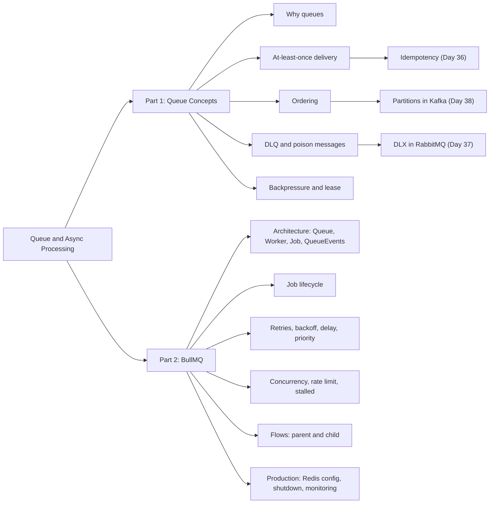
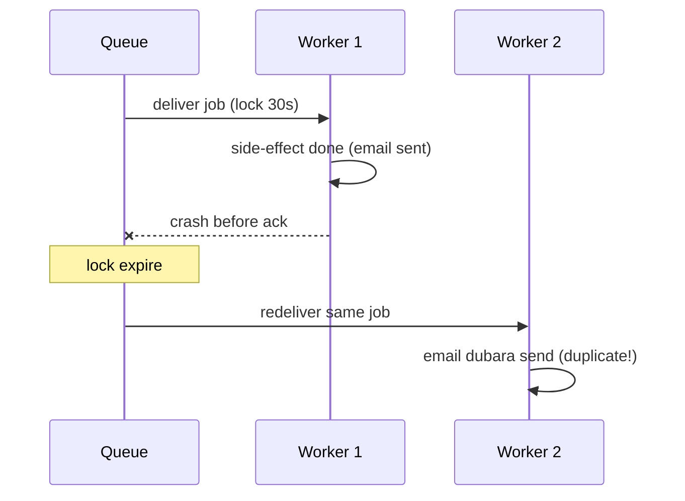
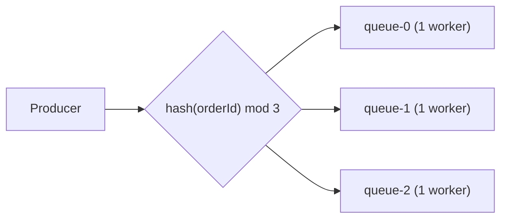
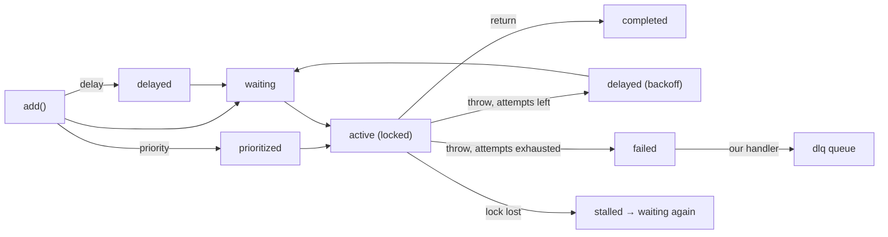
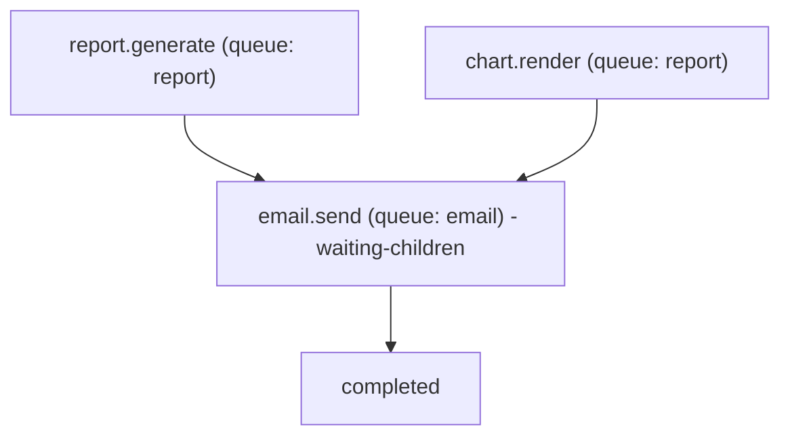

<callout icon="🎯" color="blue_bg">
 **Stage:** S6 Queues & Async Processing · **Day 35** · **Planned:** 4 h · **Type:** Coding
 **Deliverable:** Email/report job pipeline with BullMQ
 **Tracker row:** <mention-page url="https://app.notion.com/p/3f4bcc23fb65817083e7cc4ac10e1bbf"/>
</callout>
## 📌 Overview
- Aaj ke 2 parts hain:
 - **Part 1 — Queue concepts (theory jo har broker pe lagti hai):** at-least-once delivery, ordering, DLQ, plus backpressure, visibility/lease, poison messages.
 - **Part 2 — BullMQ (Node.js + Redis job queue):** architecture, job lifecycle, retries/backoff, concurrency, rate limit, flows, stalled jobs, production setup.
- Isse **S6 stage ki foundation** banti hai — aage Retries/Idempotency, RabbitMQ aur Kafka isi concepts ke upar chalenge.
- Mental model: **Producer → Queue (durable buffer) → Worker (ack/complete) → failure par retry → exhaust hone par DLQ**.
### 🔗 Is stage ke notes se connection
- **Pehle se likha hua:** <mention-page url="https://app.notion.com/p/3f5bcc23fb658135ad28c463aa2cd48b"/> — wahan DLX/DLQ, manual ack, prefetch, persistence, outbox/idempotent-consumer ka broker-side view hai.
- **Is page ka kaam:** wahi concepts **broker-agnostic** tareeke se samajhna + Redis-based BullMQ me implement karna. RabbitMQ page padhte waqt "queue = buffer, ack = commit" yahin se aayega.
- **Aage kya:**
 - Day 36 → Retries, backoff & idempotent consumers (yahan sirf intro, deep dive wahan)
 - Day 37 → RabbitMQ (exchange, routing, ack)
 - Day 38 → Kafka (partitions, consumer groups, offsets)
- **Running example:** is stage me domain **orders / emails / reports** rahega, taaki code continuous rahe.
- **Redis basics refresher:** Redis ke structures (List, Sorted Set, Hash, Streams) aur persistence (RDB/AOF) zero se yahan hai: <mention-page url="https://app.notion.com/p/3f9bcc23fb65814ca41bed93a259d096"/> (S4, Day 22).
## 🗺️ Mindmap

---
# 📘 Part 1 — Queue Concepts
## 1️⃣ Kyun Queue? (Sync vs Async)
- **Problem:** API request me email/PDF/image kaam karoge to response slow, timeout, aur traffic spike par server gir jaata hai.
- **Solution:** API sirf **job enqueue** karke `202 Accepted` de, kaam **worker** background me kare.
- **Fayde:**
 - **Decoupling:** API aur worker alag deploy/scale hote hain.
 - **Load levelling:** spike aaye to queue buffer ban jaati hai.
 - **Resilience:** worker down ho to jobs queue me safe.
 - **Retry:** transient failure (SMTP timeout) automatic retry.
 - **Rate control:** third-party API limits ke andar kaam.
- **Trade-offs:** eventual consistency, debugging mushkil, duplicate/ordering problems, extra infra (Redis/broker).
- **Anatomy:** **Producer** → **Queue/Broker** → **Consumer/Worker**; message = **payload + metadata** (id, attempts, timestamps).
- **Kab queue mat use karo:**
 - User ko response me result chahiye (sync flow).
 - Kaam 50 ms ka hai aur failure rare — overkill.
 - Strong cross-service transaction chahiye (queue atomic nahi hoti DB ke saath → outbox pattern, Day 37 page me mention).
- **JS/Node analogy:**
 - `setImmediate` / `process.nextTick` = same process ka async, **crash par jobs gaye**.
 - Queue = **durable, cross-process** version — process restart par bhi job bachta hai.
```typescript
// Anti-pattern: request ke andar heavy kaam
app.post("/signup", async (req, res) => {
  await sendWelcomeEmail(req.body.email); // SMTP slow → request slow
  res.json({ ok: true });
});

// Better: enqueue + 202
app.post("/signup", async (req, res) => {
  await emailQueue.add("welcome", { to: req.body.email });
  res.status(202).json({ queued: true });
});

```
## 2️⃣ Delivery Semantics — At-least-once
- **Teen guarantees:**
 - **At-most-once:** 0 ya 1 baar. Loss possible, duplicate nahi. (auto-ack, fire-and-forget)
 - **At-least-once:** 1 ya zyada baar. **Loss nahi, duplicate possible.** ← **Practically default**.
 - **Exactly-once:** sach me network pe nahi milta; hota hai "**at-least-once + idempotent processing**" = effectively-once.
- **At-least-once kaise banta hai?**
 - Consumer ko message milta hai par queue use **turant delete nahi karti**.
 - Consumer **success ke baad ack/complete** karta hai → tab delete.
 - Beech me crash / timeout → broker message dobara deta hai → **duplicate**.
- **Duplicates kahan se aate hain?**
 - Worker ne kaam kar diya par ack se pehle crash.
 - Ack network me kho gaya.
 - Lock/lease expire (slow job ya event loop block) → doosre worker ko mil gaya.
 - Producer ne timeout ke baad retry kiya (publish dubara).
 - Manual replay (DLQ se).
- **Ack kab?** Side-effect (DB commit / API call) **ke baad**. Pehle ack = at-most-once ban jaata hai.
- **Duplicate se kaise bachen — intro (deep dive Day 36):**
 - **Idempotency key** (messageId/jobId) DB me unique constraint.
 - **Natural idempotent ops:** `UPSERT`, `SET status='paid'`.
 - **Dedupe window:** Redis `SET key NX EX`.
- **Visibility timeout / lease / lock:**
 - Message deliver hone ke baad ek time tak "invisible/locked" rehta hai. Time khatam + ack nahi = dobara visible.
 - SQS: **visibility timeout**; RabbitMQ: **unacked + connection close**; BullMQ: **job lock** (`lockDuration`); Kafka: **offset commit**.


- **Interview line:** "Exactly-once delivery nahi hota, **exactly-once processing** idempotency se achieve hota hai."

## 3️⃣ Ordering

- **FIFO** = first in first out. Par distributed queue me **global order mehnga hai**.
- **Order kab toot-ta hai?**
 	- **Multiple consumers/concurrency \> 1:** job 2 job 1 se pehle khatam ho sakta hai.
 	- **Retry:** job 1 fail → delay ke baad wapas → job 2, 3 aage nikal gaye.
 	- **Requeue/redelivery** (nack requeue).
 	- **Priority / delayed jobs.**
 	- **Partitioned/sharded queues.**
- **Order vs Throughput trade-off:** strict order = ek time pe ek consumer = slow. Parallelism = order loss.
- **Practical strategy — "per-key ordering":**
 	- Sach me zarurat **global order** ki nahi, **per entity order** ki hoti hai (same `orderId` / `userId` ke events).
 	- **Shard by key:** `hash(key) % N` → N queues, har queue pe **concurrency = 1** worker.
 	- Kafka me ye natural hai (partition key). RabbitMQ me consistent-hash exchange / single-active-consumer. BullMQ me multiple queues ya Pro "groups".
- **Order-insensitive design (best):**
 	- Events me **version / sequence number** rakho; consumer purana event ignore kare (`if event.version less than stored.version skip`).
 	- State-based updates (`SET`), commutative operations (counter increment).
- **Out-of-order example:** `order.paid` pehle process hua, `order.created` baad me → consumer ko "parked/retry" ya version check chahiye.



## 4️⃣ DLQ (Dead Letter Queue) & Poison Messages

- **Poison message:** aisa job jo **har baar fail** hota hai (bad payload, bug, deleted dependency).
- **Bina DLQ ke:** infinite retry loop → CPU burn, queue block (head-of-line), logs spam.
- **DLQ = parking lot** failed jobs ke liye — investigation + manual/automatic replay.
- **Job DLQ me kab jaata hai?**
 	- Max **attempts exhaust**.
 	- **Non-retryable error** (validation fail, 4xx from provider) — seedha DLQ.
 	- **TTL expire** (stale job).
 	- Queue overflow / rejected.
- **DLQ message me kya store karo:** original payload, **error message + stack**, attempt count, first/last failure time, source queue, trace id.
- **Retryable vs Non-retryable errors:**
 	- Retryable: network timeout, 5xx, 429, DB deadlock.
 	- Non-retryable: invalid email, schema mismatch, 400/404, business rule violation.
- **DLQ operations:**
 	- **Alert:** DLQ depth \> 0 par notification.
 	- **Inspect:** payload + error dekho.
 	- **Fix root cause** → **replay** (wapas main queue me push; idempotent consumer ke saath).
 	- **Retention:** DLQ me PII ho sakta hai → expiry/masking.
- **Different systems me DLQ:**
 	- **SQS:** native DLQ + `maxReceiveCount`.
 	- **RabbitMQ:** DLX + DLQ (<mention-page url="https://app.notion.com/p/3f5bcc23fb658135ad28c463aa2cd48b"/> me detail).
 	- **Kafka:** native DLQ nahi — manually `*.dlq` topic pe produce.
 	- **BullMQ:** native DLQ **nahi** — **failed set** hi "dead" jobs rakhta hai; apni `dlq` queue bana sakte ho (neeche code).

## 5️⃣ Baaki Core Concepts (jo interview me aate hain)

- **Backpressure:**
 	- Producer tez, consumer slow → queue depth badhta hai.
 	- Controls: bounded queue / max length, **consumer concurrency**, rate limiter, producer-side throttle (`429`), autoscale workers.
 	- Metric: **queue depth + oldest job age** (CPU nahi).
- **Work queue vs Pub/Sub vs Stream:**
 	- Work queue: har job **ek** worker ko (competing consumers).
 	- Pub/Sub: har subscriber ko **copy**.
 	- Stream/log (Kafka): **replay**, offset-based.
- **Delay & scheduling:** delayed jobs, cron/repeatable jobs.
- **Priority:** urgent jobs pehle (starvation risk).
- **Rate limiting:** third-party API limit ke andar (e.g. 20 emails/sec).
- **Job states:** waiting → active → completed / failed / delayed.
- **Retries + backoff (intro):** fixed vs **exponential** backoff, **jitter** (thundering herd se bachne ke liye). Deep dive: Day 36.
- **Job size:** payload chhota rakho — **ID pass karo, data DB se lo** (claim-check).
- **Observability:** queue depth, processing time, failure rate, retries, DLQ depth, job age.

---

# 📗 Part 2 — BullMQ

## 6️⃣ BullMQ Kya Hai? Architecture

- **BullMQ** = Node.js (TypeScript) job queue library, **Redis** ke upar. (Bull ka modern rewrite; naye projects me BullMQ use karo.)
- **Components:**
 	- **Queue** → jobs add karta hai (producer side).
 	- **Worker** → jobs process karta hai (consumer side), alag process/pod me chal sakta hai.
 	- **Job** → data + options + state + progress + return value.
 	- **QueueEvents** → Redis Streams se global events (completed/failed/progress) sunne ke liye.
 	- **FlowProducer** → parent-child job trees.
 	- **Job Scheduler** → repeatable/cron jobs (recent 5.x me `upsertJobScheduler`; purane me `repeat` option).
- **Redis ke andar kya hota hai (under the hood):**
 	- `wait` (list) → pending jobs, `active` (list) → process ho rahe, `delayed` (sorted set, score = time), `prioritized` (sorted set), `completed`/`failed` (sorted sets), job data = **hash** (`bull:<queue>:<id>`), lock = key with TTL, events = **stream**.
 	- State transitions **Lua scripts** se **atomic** hote hain → race conditions nahi.
 	- Worker blocking command se wait karta hai (polling nahi).
- **Fit kab?** Node.js backend, Redis pehle se hai, simple-to-medium job workloads: email, reports, image/video processing, webhooks, scheduled tasks.
- **Limitations:**
 	- Redis = primary datastore nahi → durability config pe depend (AOF).
 	- Strict global ordering / replayable log chahiye → Kafka.
 	- Complex routing (topic/fanout) → RabbitMQ.
- **JS analogy:** BullMQ ≈ `p-queue` ya `async.queue` jo **Redis me persist** hota hai aur **multi-process** chalta hai.

## 7️⃣ Setup

- **Redis (persistence + noeviction):**

```yaml
services:
  redis:
    image: redis:7
    command: ["redis-server", "--appendonly", "yes", "--appendfsync", "everysec", "--maxmemory-policy", "noeviction"]
    ports: ["6379:6379"]
    volumes:
      - redis_data:/data
volumes:
  redis_data:
```

- **Install:**

```bash
npm i bullmq ioredis
npm i -D typescript tsx @types/node
```

- **Redis config rules (important):**
 	- `maxmemory-policy noeviction` — warna Redis queue keys evict kar sakta hai → **jobs gayab**.
 	- **AOF on** (`appendonly yes`) — restart par jobs bachen.
 	- Worker connection me `maxRetriesPerRequest: null` (BullMQ requirement).
 	- Redis Cluster me queue **hash tag** prefix use karo (`{email}`), taaki keys same slot me ayein.
 	- Cache aur queue ke liye **alag Redis instance** (cache eviction policy alag hoti hai).

## 8️⃣ Queue, Job, Worker — Basics

```typescript
import { Queue, Worker } from "bullmq";
import IORedis from "ioredis";

const connection = new IORedis("redis://localhost:6379", { maxRetriesPerRequest: null });

const queue = new Queue("email", { connection });
await queue.add("welcome", { to: "a@b.com" }, { attempts: 3 });

const worker = new Worker(
  "email",
  async (job) => {
    console.log(job.name, job.data);
    return { sent: true }; // return value = job result (completed)
  },
  { connection, concurrency: 5 }
);

worker.on("completed", (job) => console.log("done", job.id));
worker.on("failed", (job, err) => console.error("failed", job?.id, err.message));
```

- **Samajhne wali baatein:**
 	- Processor **throw** kare = job **failed** (attempts bache hain to retry). Return kare = **completed**.
 	- **Ack manually nahi karna** — BullMQ khud promise resolve/reject se complete/fail karta hai.
 	- `job.updateProgress(50)` → UI/QueueEvents me progress.
 	- `job.id` custom set kar sakte ho (`jobId` option) → **dedupe**.
 	- Job data JSON-serializable hona chahiye.
- **Useful job options:**

<table fit-page-width="true" header-row="true">
<tr>
<td>Option</td>
<td>Kya karta hai</td>
</tr>
<tr>
<td>`attempts`</td>
<td>Total tries (pehli + retries)</td>
</tr>
<tr>
<td>`backoff`</td>
<td>`fixed` ya `exponential`  • `delay` ms (custom strategy bhi)</td>
</tr>
<tr>
<td>`delay`</td>
<td>Job itne ms baad run hoga</td>
</tr>
<tr>
<td>`priority`</td>
<td>1 = highest; chhota number pehle</td>
</tr>
<tr>
<td>`lifo`</td>
<td>Last-in-first-out</td>
</tr>
<tr>
<td>`jobId`</td>
<td>Custom id; same id dubara add = ignore (dedupe)</td>
</tr>
<tr>
<td>`removeOnComplete` / `removeOnFail`</td>
<td>Redis memory control (age/count)</td>
</tr>
<tr>
<td>`timeout`</td>
<td>Built-in nahi — `AbortController` / `Promise.race` se khud lagao</td>
</tr>
</table>
## 9️⃣ Job Lifecycle

- **Extra states:** `paused` (queue pause), `waiting-children` (flow parent).
- **Retry ka matlab:** job `delayed` me jaata hai (backoff time tak) phir `waiting` → **ordering badal jaati hai** (Part 1, topic 3).
- **Cleanup:** `removeOnComplete`/`removeOnFail` na lagao to Redis memory badhti jayegi.
## 🔟 Retries, Backoff, Delay, Priority, Scheduling
- **Retries + backoff:**
```typescript
await queue.add("send", data, {
  attempts: 5,
  backoff: { type: "exponential", delay: 2000 }, // 2s, 4s, 8s, 16s
});
```
- **Jitter** manually add karo (custom backoff strategy) taaki sab failed jobs ek saath retry na karein (thundering herd).
- Custom: Worker `settings: { backoffStrategy: (attemptsMade) => ... }` + job `backoff: { type: "custom" }`.
- **Non-retryable error:** `throw new UnrecoverableError("invalid email")` → attempts bachi hon tab bhi **seedha failed**.
- **Rate-limit response (429) par:** `worker.rateLimit(ms)` + `throw Worker.RateLimitError()` → job retry attempt count kharch kiye bina wapas.
- **Delayed job:** `{ delay: 60_000 }` — 1 min baad.
- **Priority:** `{ priority: 1 }` urgent; baaki default (priority wale jobs normal wale se pehle).
- **Repeatable/cron:**
```typescript
// BullMQ 5.x (recent): job scheduler
await reportQueue.upsertJobScheduler(
  "daily-report",
  { pattern: "0 9 * * *" }, // har roz 9 AM (cron)
  { name: "report.generate", data: { type: "daily" } }
);
```
- Scheduler id ke saath **upsert** = deploy par duplicate schedules nahi bante.
## 1️⃣1️⃣ Concurrency, Rate Limit, Stalled Jobs
- **Concurrency:** `new Worker(..., { concurrency: 10 })` — ek process me 10 jobs parallel (async I/O ke liye best).
 - **CPU-heavy** job (PDF render, image resize) = event loop block → **sandboxed processor** (alag process/thread) ya alag worker service; concurrency chhoti.
 - Scale-out: **zyada worker processes/pods** — sab same queue se compete karte hain.
- **Global rate limiter:**
```typescript
new Worker("email", processor, {
  connection,
  limiter: { max: 20, duration: 1000 }, // 20 jobs/sec, saare workers mila ke
});
```
- **Locks & Stalled jobs (at-least-once ka BullMQ version):**
 - Active job par worker **lock** rakhta hai (`lockDuration` default 30 s) aur auto-renew karta hai.
 - Worker crash / **event loop blocked** → lock renew nahi → job **stalled** → checker use wapas `waiting` me daal deta hai (`maxStalledCount`, default 1).
 - Result: **duplicate execution** possible → **idempotent processor** zaroori.
 - `maxStalledCount` exceed → job **failed** ("job stalled more than allowable limit").
 - Fix: sync heavy code mat chalao, `lockDuration` kaam ke hisaab se, health monitoring.
- **Graceful shutdown:** `await worker.close()` — current jobs khatam hone ka wait, naya job nahi lega. `SIGTERM` handle karo (k8s rolling deploy).
- **QueueEvents (global listener):**
```typescript
import { QueueEvents } from "bullmq";
const events = new QueueEvents("report", { connection });
events.on("completed", ({ jobId, returnvalue }) => console.log(jobId, returnvalue));
events.on("failed", ({ jobId, failedReason }) => console.error(jobId, failedReason));
// job.waitUntilFinished(events) → request-reply jaisa wait (sparingly)
```
## 1️⃣2️⃣ Flows (Parent → Child Jobs)
- **Use case:** report generate hone ke **baad** hi email jaaye — dependency chain.
- **Rule:** parent tab tak `waiting-children` me rehta hai jab tak **saare children complete** na ho jayein.
- Parent worker me `job.getChildrenValues()` se children ke results milte hain.
- Child fail ho to parent fail/ignore behaviour options se control hota hai (`failParentOnFailure`, `ignoreDependencyOnFailure`).

## 1️⃣3️⃣ At-least-once, Ordering, DLQ — BullMQ me Mapping
<table fit-page-width="true" header-row="true">
<tr>
<td>Concept</td>
<td>BullMQ me kaise</td>
</tr>
<tr>
<td>At-least-once</td>
<td>Job `active`  • lock; crash par lock expire → stalled → redeliver. Duplicate possible → idempotent processor</td>
</tr>
<tr>
<td>Dedupe</td>
<td>`jobId` (job exist karti hai tab tak) + DB-level idempotency key</td>
</tr>
<tr>
<td>Ordering</td>
<td>FIFO wait list; concurrency 1 + single worker = near-strict order. Retry/concurrency/priority se order toot-ta hai</td>
</tr>
<tr>
<td>Per-key ordering</td>
<td>Multiple queues (hash shard) + concurrency 1; ya BullMQ Pro **Groups**</td>
</tr>
<tr>
<td>DLQ</td>
<td>Native nahi; `failed` set + custom `dlq` queue (attempts exhaust par handoff)</td>
</tr>
<tr>
<td>Backpressure</td>
<td>`concurrency`, `limiter`, queue depth metrics, producer-side check (`queue.count()`)</td>
</tr>
<tr>
<td>Replay</td>
<td>`job.retry()` failed job pe; DLQ se manual re-add</td>
</tr>
</table>
## 1️⃣4️⃣ BullMQ vs RabbitMQ vs Kafka vs SQS
<table fit-page-width="true" header-row="true">
<tr>
<td>Point</td>
<td>BullMQ</td>
<td>RabbitMQ</td>
<td>Kafka</td>
<td>SQS</td>
</tr>
<tr>
<td>Backend</td>
<td>Redis</td>
<td>Erlang broker</td>
<td>Distributed log</td>
<td>AWS managed</td>
</tr>
<tr>
<td>Routing</td>
<td>Queue-per-name</td>
<td>Exchanges (rich)</td>
<td>Topics/partitions</td>
<td>Queue-per-name</td>
</tr>
<tr>
<td>Delivery</td>
<td>At-least-once</td>
<td>At-least-once</td>
<td>At-least-once (exactly-once with txn)</td>
<td>At-least-once (FIFO: exactly-once window)</td>
</tr>
<tr>
<td>Ordering</td>
<td>Best-effort FIFO</td>
<td>Per-queue FIFO</td>
<td>Per-partition</td>
<td>FIFO queue optional</td>
</tr>
<tr>
<td>Replay</td>
<td>No</td>
<td>Streams only</td>
<td>Yes</td>
<td>No</td>
</tr>
<tr>
<td>DLQ</td>
<td>Manual</td>
<td>DLX</td>
<td>Manual topic</td>
<td>Native</td>
</tr>
<tr>
<td>Best for</td>
<td>Node job processing, delayed/cron jobs</td>
<td>Service messaging, routing</td>
<td>Event streaming, analytics</td>
<td>Serverless/AWS jobs</td>
</tr>
</table>
- **Choose kaise?** Node app + Redis hai + background jobs → **BullMQ**. Multi-service routing + polyglot → **RabbitMQ**. Event log/replay/very high volume → **Kafka**. AWS-native → **SQS**.
---
## 🚨 Production Concerns & Failure Modes
- **Kya toot-ta hai high load me?**
 - **Redis memory full:** `removeOnComplete/Fail` nahi lagaya, ya bade payloads → OOM/eviction → jobs loss. Fix: `noeviction` + cleanup + chhote payloads (ID pass karo).
 - **Queue backlog:** workers kam → job age badhta hai → SLA miss. Autoscale on `waiting count / oldest job age`.
 - **Event loop block:** CPU-heavy processor → lock renew fail → stalled → **duplicate emails**.
 - **Redis connection starvation:** har Queue/Worker/QueueEvents ke apne connections → limit ka dhyan; shared `connection` reuse (Queue ke liye).
 - **Redis failover:** async replication me last writes loss possible → critical jobs ke liye DB outbox + reconciliation.
 - **Thundering herd:** third-party outage ke baad saare retries ek saath → jitter + limiter.
 - **Poison jobs:** attempts limit + UnrecoverableError + DLQ alert.
- **Backpressure se server kaise bachta hai?**
 - Worker `concurrency` + `limiter` = downstream (SMTP/DB) overload se bachav.
 - API side: queue depth `\>` threshold par `503/429` (load shedding).
 - Bounded retries + backoff = retry storm nahi.
- **Security:**
 - Redis ko public network pe expose mat karo; **password/ACL + TLS**.
 - Job payload me **PII / secrets** mat daalo (Redis + DLQ + dashboards me dikhega) — IDs rakho.
 - Bull Board/Arena dashboard **auth ke peeche**.
 - Job data **validate (zod)** worker ke start me — untrusted/old schema jobs.
- **Cost:** Redis RAM costly → retention policies, payload size; email/SMS providers ka per-message cost → duplicate = paisa barbaad (idempotency!).
- **Observability:** metrics `waiting`, `active`, `delayed`, `failed`, job latency (enqueue→complete), attempts distribution, DLQ depth; `queue.getJobCounts()`; Bull Board/Prometheus exporter.
---
## 🧪 Runnable TypeScript Scaffold — Email/Report Pipeline (BullMQ)
- **Flow:** `POST /reports` → **flow** (child: report generate → parent: email send) → retries/backoff → exhausted par **DLQ**.
- **Folder structure:**
```plain text
bullmq-pipeline/
├── package.json
├── docker-compose.yml      # redis (upar diya hua)
└── src/
    ├── connection.ts
    ├── queues.ts
    ├── workers.ts          # report + email workers, DLQ handoff, graceful shutdown
    ├── api.ts              # node:http producer
    └── dlq-replay.ts       # DLQ inspect + replay
```
- **package.json:**
```json
{
  "name": "bullmq-pipeline",
  "private": true,
  "type": "module",
  "scripts": {
    "api": "tsx src/api.ts",
    "workers": "tsx src/workers.ts",
    "replay": "tsx src/dlq-replay.ts"
  },
  "dependencies": { "bullmq": "^5.0.0", "ioredis": "^5.4.0" },
  "devDependencies": {
    "@types/node": "^22.0.0",
    "tsx": "^4.19.0",
    "typescript": "^5.6.0"
  }
}
```
- **src/connection.ts:**
```typescript
import IORedis from "ioredis";

export const connection = new IORedis(process.env.REDIS_URL ?? "redis://localhost:6379", {
  maxRetriesPerRequest: null, // BullMQ workers ke liye zaroori
});

```
- **src/queues.ts:**
```typescript
import { Queue, FlowProducer, type JobsOptions } from "bullmq";
import { connection } from "./connection.js";

const defaultJobOptions: JobsOptions = {
  attempts: 5,
  backoff: { type: "exponential", delay: 2000 }, // 2s, 4s, 8s, 16s
  removeOnComplete: { age: 3600, count: 1000 }, // Redis memory control
  removeOnFail: { age: 7 * 24 * 3600 },
};

export const reportQueue = new Queue("report", { connection, defaultJobOptions });
export const emailQueue = new Queue("email", { connection, defaultJobOptions });
export const dlqQueue = new Queue("dlq", { connection }); // manual dead-letter queue
export const flow = new FlowProducer({ connection });
```

- **src/workers.ts:**

```typescript
import { Worker, UnrecoverableError, type Job } from "bullmq";
import { connection } from "./connection.js";
import { dlqQueue } from "./queues.js";

const sleep = (ms: number) => new Promise((r) => setTimeout(r, ms));

// demo: 30% transient failure (SMTP timeout jaisa)
async function sendEmail(to: string, url?: string) {
  await sleep(200);
  if (Math.random() < 0.3) throw new Error("SMTP timeout");
  console.log(`email sent to ${to} with ${url}`);
}

const reportWorker = new Worker(
  "report",
  async (job: Job<{ userId: string }>) => {
    for (let i = 1; i <= 5; i++) {
      await sleep(300); // heavy kaam ka simulation (I/O-bound)
      await job.updateProgress(i * 20);
    }
    return { url: `https://files.example.com/reports/${job.data.userId}.pdf` };
  },
  { connection, concurrency: 2 }
);

const emailWorker = new Worker(
  "email",
  async (job: Job<{ to: string }>) => {
    if (!job.data.to?.includes("@")) {
      throw new UnrecoverableError("invalid email"); // retry bekaar → seedha failed
    }
    const children = await job.getChildrenValues<{ url: string }>();
    const report = Object.values(children)[0];
    // idempotency yahan lagao (Day 36): e.g. DB me jobId unique insert, phir send
    await sendEmail(job.data.to, report?.url);
  },
  { connection, concurrency: 10, limiter: { max: 20, duration: 1000 } }
);

// attempts exhaust ya unrecoverable → DLQ handoff
function attachDlq(worker: Worker) {
  worker.on("failed", async (job, err) => {
    if (!job) return;
    const exhausted =
      err instanceof UnrecoverableError || job.attemptsMade >= (job.opts.attempts ?? 1);
    if (!exhausted) return;
    try {
      await dlqQueue.add("dead", {
        sourceQueue: job.queueName,
        name: job.name,
        data: job.data,
        error: err.message,
        attemptsMade: job.attemptsMade,
        failedAt: new Date().toISOString(),
      });
      console.error(`[DLQ] ${job.queueName}#${job.id}: ${err.message}`);
    } catch (e) {
      console.error("DLQ handoff failed", e);
    }
  });
  worker.on("error", (e) => console.error("worker error", e.message));
}

attachDlq(reportWorker);
attachDlq(emailWorker);

// graceful shutdown (k8s SIGTERM)
async function shutdown() {
  await Promise.all([reportWorker.close(), emailWorker.close()]);
  await connection.quit();
  process.exit(0);
}
process.on("SIGINT", shutdown);
process.on("SIGTERM", shutdown);

console.log("workers running");
```

- **src/api.ts:**

```typescript
import { createServer } from "node:http";
import { flow } from "./queues.js";

const server = createServer(async (req, res) => {
  if (req.method === "POST" && req.url === "/reports") {
    let raw = "";
    for await (const chunk of req) raw += chunk;
    const { userId, email } = JSON.parse(raw || "{}") as { userId?: string; email?: string };
    if (!userId) {
      res.writeHead(400).end(JSON.stringify({ error: "userId required" }));
      return;
    }

    // jobId = dedupe key: same user ka same report dobara enqueue nahi hoga (job exist hone tak)
    const tree = await flow.add({
      name: "email.send",
      queueName: "email",
      data: { to: email },
      opts: { jobId: `email:${userId}` },
      children: [
        {
          name: "report.generate",
          queueName: "report",
          data: { userId },
          opts: { jobId: `report:${userId}` },
        },
      ],
    });

    res.writeHead(202, { "content-type": "application/json" });
    res.end(JSON.stringify({ queued: true, emailJobId: tree.job.id }));
    return;
  }
  res.writeHead(404).end();
});

server.listen(3000, () => console.log("api on :3000"));
```

- **src/dlq-replay.ts:**

```typescript
import { dlqQueue, emailQueue, reportQueue } from "./queues.js";

const queues = { email: emailQueue, report: reportQueue } as const;
const jobs = await dlqQueue.getJobs(["waiting"]);
console.log(`DLQ me ${jobs.length} jobs`);

for (const j of jobs) {
  const { sourceQueue, name, data } = j.data as {
    sourceQueue: keyof typeof queues;
    name: string;
    data: unknown;
  };
  console.log("inspect:", sourceQueue, name, j.data.error);
  // root cause fix hone ke baad hi replay karo; consumer idempotent hona chahiye
  // await queues[sourceQueue].add(name, data);
  // await j.remove();
}
process.exit(0);
```

- **Run order:** `docker compose up -d` → `npm run workers` → `npm run api` → curl:

```bash
curl -X POST localhost:3000/reports -H 'content-type: application/json' \
  -d '{"userId":"u1","email":"a@b.com"}'
curl -X POST localhost:3000/reports -H 'content-type: application/json' \
  -d '{"userId":"u2","email":"bad-email"}'   # UnrecoverableError → DLQ
```

- **Experiments (concept pakki karne ke liye):**
 	- Worker ko email send ke beech `kill -9` karo → lock expire hone ke baad job dobara chalega (**stalled → duplicate**).
 	- Same `userId` do baar POST karo → `jobId` dedupe dekho; fir `removeOnComplete` ke baad dobara try karo (dedupe kaam nahi karega — isliye DB idempotency).
 	- Worker concurrency 1 vs 10 — completion order print karke ordering observe karo.
 	- Redis me `redis-cli keys 'bull:*'` se internals dekho (`wait`, `active`, `delayed`, hashes).

---

## 🎤 Interview Q&A

### Part A — Queue Concepts (At-least-once / Ordering / DLQ)

<details>
<summary>Q1. At-least-once, at-most-once aur exactly-once me kya difference hai? Practically kya milta hai?</summary>
 - At-most-once: loss possible, duplicate nahi (ack pehle). At-least-once: loss nahi, duplicate possible (ack baad me). Exactly-once delivery network pe practically nahi.
 - Practical: **at-least-once + idempotent consumer = effectively-once**.
 - Ack hamesha side-effect commit ke baad.
</details>
<details>
<summary>Q2. Duplicate messages kab aate hain aur unhe kaise handle karoge?</summary>
 - Crash before ack, ack lost, lock/visibility timeout expire, producer retry, DLQ replay.
 - Handle: idempotency key + unique constraint, upsert/natural idempotent ops, Redis `SET NX EX` dedupe window.
 - Business-level: outbox/inbox table (processed message ids).
</details>
<details>
<summary>Q3. Queue me ordering kaise guarantee karoge? Kya trade-off hai?</summary>
 - Global strict order = single consumer, concurrency 1 → throughput kam.
 - Practical: **per-key ordering** — key se shard (hash mod N), har shard pe ek consumer; Kafka partition key isi ka example.
 - Order-insensitive design: version/sequence number, state-based updates.
 - Retries aur concurrency order todte hain — isliye design me assume karo.
</details>
<details>
<summary>Q4. Poison message kya hai? DLQ design kaise karoge?</summary>
 - Job jo har baar fail hota hai → infinite retry, head-of-line blocking.
 - Bounded attempts + backoff → exhaust par DLQ; non-retryable errors seedha DLQ.
 - DLQ me payload, error, attempts, source, timestamps; alert on depth, replay tool, PII retention.
</details>
<details>
<summary>Q5. Backpressure kya hota hai aur queue-based system me kaise handle karte hain?</summary>
 - Producer rate greater than consumer rate → backlog.
 - Controls: consumer concurrency/autoscale, rate limiter, bounded queue, producer-side `429/503`, priority/shed low-value jobs.
 - Signal: queue depth aur oldest-job age, CPU nahi.
</details>
### Part B — BullMQ
<details>
<summary>Q6. BullMQ internally kaise kaam karta hai?</summary>
 - Redis data structures: wait/active lists, delayed/prioritized/completed/failed sorted sets, job hash, lock keys, events stream.
 - Transitions Lua scripts se atomic.
 - Worker blocking fetch + lock auto-renew; stalled checker lock-lost jobs ko wapas queue karta hai.
</details>
<details>
<summary>Q7. Stalled job kya hai? Kyun hota hai? Impact?</summary>
 - Active job ka lock renew nahi hua (worker crash, event loop block, Redis connection loss).
 - Checker job ko waiting me daal deta hai → **duplicate execution**; `maxStalledCount` exceed par failed.
 - Fix: idempotent processor, CPU-heavy kaam sandboxed/separate worker, sahi `lockDuration`.
</details>
<details>
<summary>Q8. BullMQ me retries, backoff aur non-retryable errors kaise configure karoge?</summary>
 - `attempts` + `backoff` (`exponential`, delay) + jitter via custom strategy.
 - `UnrecoverableError` throw karke retry skip.
 - 429 par `worker.rateLimit()` + `Worker.RateLimitError()` — attempts waste nahi.
</details>
<details>
<summary>Q9. BullMQ me DLQ nahi hai — to failed jobs ka kya karoge?</summary>
 - `failed` set me jobs `removeOnFail` tak rehte hain — inspect/`job.retry()` possible.
 - Proper DLQ: worker `failed` event me attempts exhausted check karke `dlq` queue me enqueue (payload + error + metadata).
 - Alert on DLQ depth, replay script, retention.
</details>
<details>
<summary>Q10. Redis ko BullMQ ke liye kaise configure karoge production me?</summary>
 - `maxmemory-policy noeviction`, AOF (`appendonly yes`, everysec), password/ACL + TLS, replica/Sentinel ya managed Redis.
 - Queue ke liye alag instance (cache se), `removeOnComplete/Fail` cleanup, chhote payloads.
 - Cluster me hash-tagged queue prefix.
</details>
### Part C — Design & Comparison
<details>
<summary>Q11. BullMQ vs RabbitMQ vs Kafka — kab kya?</summary>
 - BullMQ: Node job processing, delayed/cron, Redis already available, simple ops.
 - RabbitMQ: multi-service routing (exchanges), per-message ack, polyglot, DLX.
 - Kafka: event streaming, replay, huge throughput, per-partition ordering.
 - Decision factors: routing needs, replay, ordering, team ops capacity, ecosystem.
</details>
<details>
<summary>Q12. Order confirmation email pipeline design karo (API → queue → email) — failures ke saath.</summary>
 - API: order DB me commit + **outbox**, relay se job enqueue (`jobId = order:email:<id>`), `202`.
 - Worker: idempotent send (sent-log unique key), retries with exponential backoff + jitter, rate limiter for provider.
 - Failure: non-retryable → DLQ + alert; stalled/duplicate handled by idempotency; graceful shutdown.
</details>
<details>
<summary>Q13. Job me bada payload ya sensitive data kyun nahi daalna chahiye?</summary>
 - Redis RAM costly, replication/network load; DLQ/dashboards me data leak (PII).
 - Claim-check: sirf ID pass karo, worker DB/S3 se fetch kare (fresh data bhi milta hai).
</details>
<details>
<summary>Q14. Report generation jaise CPU-heavy job Node worker me kaise chalaoge?</summary>
 - Event loop block = lock renew fail = stalled/duplicate.
 - Sandboxed processor / `worker_threads` / alag service (low concurrency), ya external renderer; progress via `updateProgress`.
 - Autoscale workers separate from API.
</details>
---
## ✅ Quick Revision Checklist
- [ ] Queue kyun: decoupling, load levelling, retry, resilience; API sirf enqueue + `202`
- [ ] At-least-once = ack after side-effect; duplicates possible; exactly-once = idempotent processing
- [ ] Duplicate ke sources yaad: crash-before-ack, lost ack, lock expire, producer retry, DLQ replay
- [ ] Ordering toot-ta hai: concurrency, retry, priority, requeue; solution = per-key sharding / versioning
- [ ] Poison message + DLQ design (payload, error, attempts) + alert + replay
- [ ] Backpressure controls: concurrency, limiter, bounded queue, load shedding
- [ ] BullMQ components: Queue, Worker, Job, QueueEvents, FlowProducer, scheduler
- [ ] Redis structures + Lua atomic transitions + `noeviction` + AOF
- [ ] Job lifecycle + stalled flow + `lockDuration` / `maxStalledCount`
- [ ] `attempts`, `backoff`, `UnrecoverableError`, `delay`, `priority`, `jobId` dedupe
- [ ] `removeOnComplete/Fail` set kiye (Redis memory)
- [ ] Graceful `worker.close()` on SIGTERM
- [ ] Flow (parent-child) aur `getChildrenValues` samajh aaya
- [ ] BullMQ vs RabbitMQ vs Kafka vs SQS decision table
- [ ] Scaffold chalaya: valid email success, `bad-email` DLQ me, worker kill karke stalled duplicate dekha
