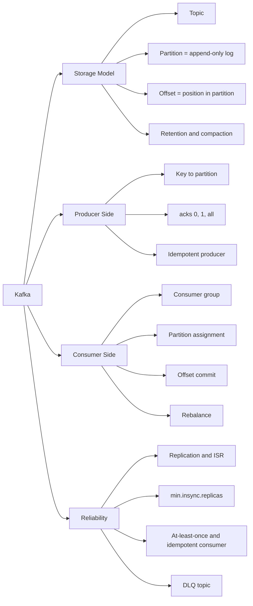
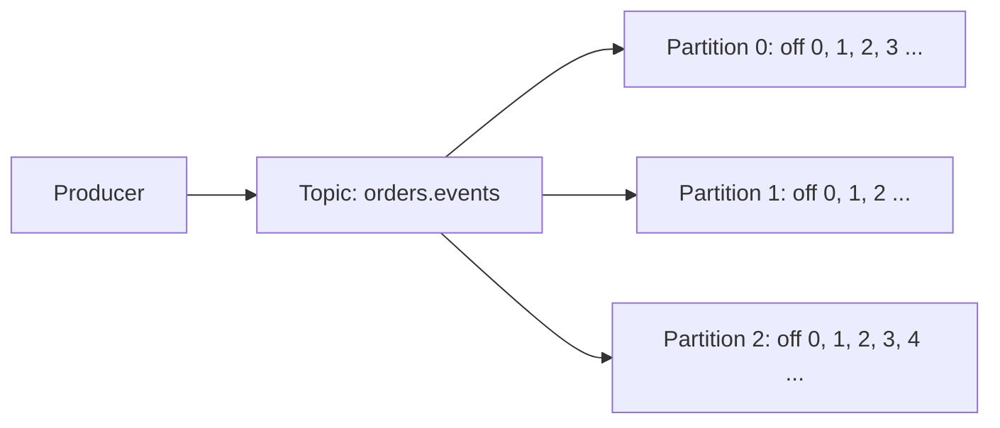
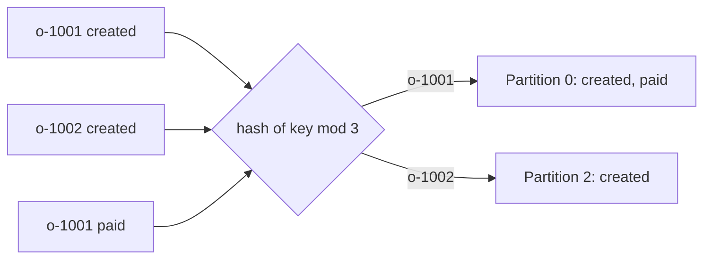
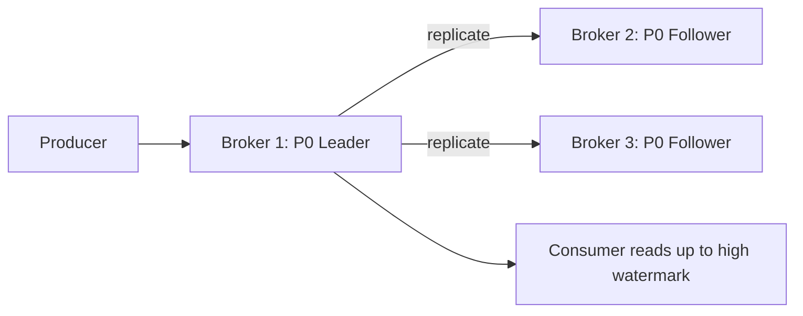
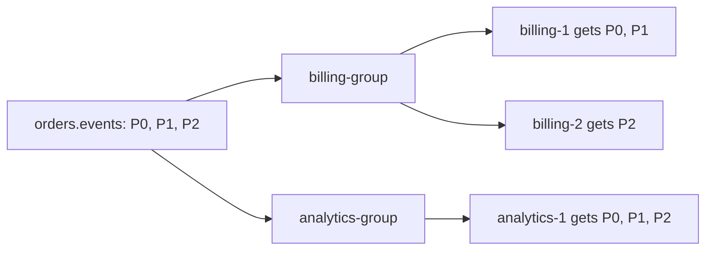
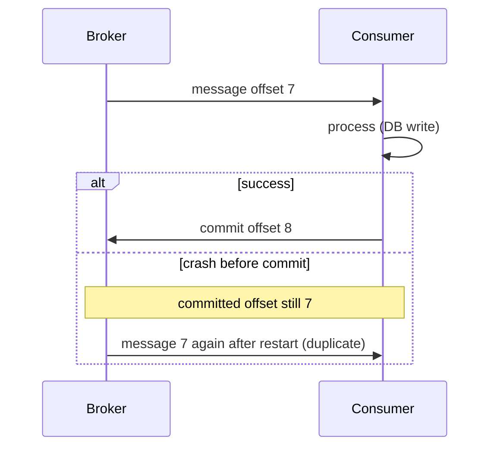
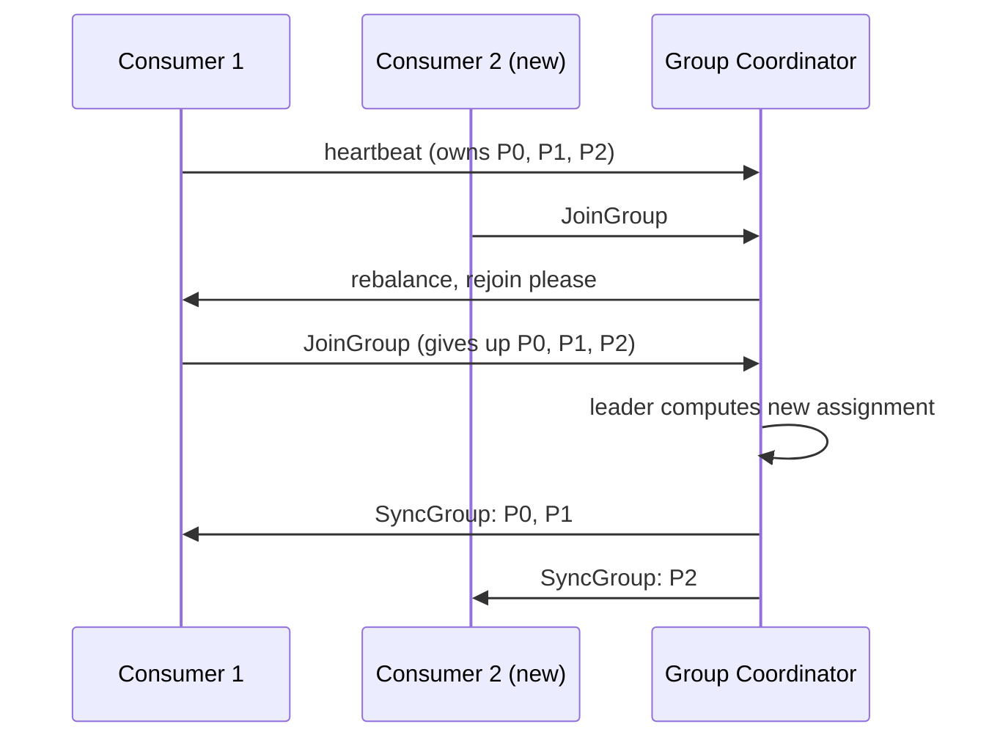

<callout icon="🎯" color="blue_bg">
	**Stage:** S6 Queues & Async Processing · **Day 38** · **Planned:** 2.5 h · **Type:** Coding
	**Deliverable:** KafkaJS producer/consumer; observe a rebalance
	**Tracker row:** <mention-page url="https://app.notion.com/p/3f4bcc23fb6581b0ada3e45856fc6f32"/>
</callout>
## 📌 Overview
- Aaj ka goal: Kafka ko **zero se production-level** tak samajhna — topic, partition, offset, consumer group, rebalance — aur Node.js (TypeScript + KafkaJS) me order-events pipeline banake **rebalance apni aankhon se dekhna**.
- Is page me 9 core topics hain: Kafka kya hai → Topic/Partition/Offset → Producer → Brokers & Replication → Consumer Groups → Offsets & Commits → Rebalancing → Retention/Compaction/Replay → Kafka vs RabbitMQ vs BullMQ.
- Mental model ek line me: **Producer → Topic (partitioned append-only log) → Consumer Group (har partition ka ek owner) → Offset commit (progress ka bookmark)**.
- Pehli baar padh rahe ho to **"Ek line me"** callouts aur mindmap padho, phir scaffold chalao. Revision me Production + Interview section.
### 🔗 Pichle notes se connection
- **Day 35 (Queue concepts + BullMQ):** <mention-page url="https://app.notion.com/p/3f5bcc23fb6581208eebc9eb79a5dde1"/> — wahan **per-key ordering** ka idea tha (`hash(key) mod N` queues, har queue pe ek worker). **Kafka me wahi cheez built-in hai:** partition key + partition = ordering unit.
- **Day 35 me bola tha:** Kafka me native DLQ nahi hota → manually `*.dlq` topic. Aaj uska code bhi hai.
- **Day 37 (RabbitMQ):** <mention-page url="https://app.notion.com/p/3f5bcc23fb658135ad28c463aa2cd48b"/> — wahan ek line thi "Kafka = log (replay, consumer offset), RabbitMQ = queue (consume ke baad delete)". Aaj us line ka poora detail hai.
- **Mapping jo dimag me rakho:**
	- RabbitMQ **ack** ≈ Kafka **offset commit**
	- RabbitMQ **per-service queue (pub/sub)** ≈ Kafka **alag consumer group per service**
	- RabbitMQ **competing consumers** ≈ Kafka **ek group ke andar multiple consumers**
	- RabbitMQ **consistent-hash exchange** ≈ Kafka **partition key**
- **Running example (same domain):** orders / billing / email / analytics. Event names wahi: `order.created`, `order.paid`, `order.cancelled`; failing order `o-1002` jisse DLQ flow test hota tha.
- **Idempotent consumer (Day 36 ka topic)** yahan bhi zaroori hai — Kafka bhi at-least-once deta hai jab commit processing ke baad ho.
- **Aage kya:** S6 ke baad **Checkpoint 2** — chaos gate: "kill consumer mid-job, no loss or duplicates". Aaj ka rebalance + offset commit ka samajh wahi kaam aayega.
## 🗺️ Mindmap

---
## 1️⃣ Kafka Kya Hai?
<callout icon="💡" color="green_bg">
	**Ek line me:** Kafka = **ek bahut badi, replicated, append-only diary (log)**. Producer diary me line likhta hai, **kabhi mitati nahi (retention tak)**, aur har reader (consumer group) apna **bookmark (offset)** khud rakhta hai.
</callout>
- **Distributed commit log / event streaming platform** — message broker se zyada "durable log" hai.
- **Queue vs Log (sabse bada difference):**
	- Queue (RabbitMQ/BullMQ): consume hua → **delete**. Message ek consumer ka hai.
	- Log (Kafka): consume hone par **delete nahi hota**. Retention (time/size) tak pada rehta hai → **replay** possible, **kai independent readers**.
- **Kyun use karte hain?**
	- **High throughput** (sequential disk write + batching).
	- **Replay / reprocess:** bug fix karke purane events dobara process karo.
	- **Multiple independent consumers:** billing, email, analytics — sab same events alag speed se padhte hain.
	- **Per-key ordering at scale** (partition key).
- **Kab Kafka mat use karo:**
	- Chhota background job (email, PDF) → BullMQ / RabbitMQ simple hai.
	- Complex routing (topic/header exchange), per-message ack/priority/TTL → RabbitMQ.
	- Ops capacity kam hai → managed (MSK, Confluent Cloud) lo ya queue use karo.
- **JS/Node analogy:** Kafka ≈ **ek durable, shared, replayable array** jisme sirf `push` hota hai, aur har reader apna `index` (offset) khud track karta hai. `EventEmitter` me purane events miss ho jaate hain; Kafka me offset se wapas ja sakte ho.
---
## 2️⃣ Topic, Partition, Offset (Core Trio)
<callout icon="💡" color="green_bg">
	**Ek line me:** **Topic** = category/folder (`orders.events`). **Partition** = us folder ki ek **ordered log file**. **Offset** = us file me message ka **line number** (0, 1, 2...).
</callout>

- **Topic:** logical stream. Ek topic = N partitions.
- **Partition:** ek **ordered, immutable, append-only** sequence. Naya message hamesha **end me** jaata hai.
- **Offset:** partition ke andar message ka **unique, monotonically increasing** number. **Offset sirf us partition me meaningful hai** — `(topic, partition, offset)` teeno mil ke message ka address.
- **Ordering guarantee (interview ka favourite):**
	- **Partition ke andar order guaranteed.**
	- **Partitions ke beech koi order guarantee nahi.**
	- Global order chahiye → 1 partition (par parallelism khatam).
- **Partition = parallelism ki unit:** ek group me ek partition **ek time pe sirf ek consumer** ko milta hai. Isliye **max parallelism = partition count**.
<table fit-page-width="true" header-row="true">
<tr>
<td>Concept</td>
<td>Analogy</td>
<td>Yaad rakhne wali baat</td>
</tr>
<tr>
<td>Topic</td>
<td>Folder</td>
<td>Logical name, N partitions</td>
</tr>
<tr>
<td>Partition</td>
<td>Ek log file</td>
<td>Order + parallelism ki unit</td>
</tr>
<tr>
<td>Offset</td>
<td>Line number</td>
<td>Per-partition, 0 se shuru</td>
</tr>
<tr>
<td>Segment</td>
<td>Log file ka chunk</td>
<td>Disk pe partition = kai segment files</td>
</tr>
</table>
- **Under the hood (disk par kya hota hai):**
	- Har partition ek **directory** hai, andar **segment files** (`00000000000000000000.log` + `.index` + `.timeindex`). File name = us segment ka **base offset**.
	- Write = **sequential append** → disk pe fast. Read bhi mostly sequential.
	- Kafka khud ka cache nahi rakhta — **OS page cache** use karta hai; consumers ko data **zero-copy (****`sendfile`****)** se network pe jaata hai.
	- Purane segments **retention** ke hisaab se delete hote hain (poori file, message-by-message nahi).
- **Interview line:** "Kafka fast isliye hai: sequential I/O + batching + page cache + zero-copy."
---
## 3️⃣ Producer — Key, Partitioner, acks, Idempotence
<callout icon="💡" color="green_bg">
	**Ek line me:** Producer ko sirf itna decide karna hai: **message kis partition me jaaye** (key se) aur **kitni safety chahiye** (acks).
</callout>
### 🧩 Message kis partition me jaata hai?
1. Agar **partition explicitly** diya → wahi.
2. Agar **key hai** → `hash(key) mod numPartitions` (murmur2, Java client compatible). **Same key = same partition = order preserved.**
3. Agar **key null** → partitions me spread (round-robin / sticky). **Order guarantee nahi.**
- **Key kya rakhein?** Wahi entity jiske events ka order chahiye: `orderId`, `userId`, `accountId`.
- Example: `o-1001` ke `created → paid → shipped` hamesha **ek hi partition** me, isliye consumer ko usi order me milenge.

### 🧩 acks — durability dial
<table fit-page-width="true" header-row="true">
<tr>
<td>acks</td>
<td>Matlab</td>
<td>Risk</td>
</tr>
<tr>
<td>`0`</td>
<td>Bhej ke bhool jao</td>
<td>Loss possible, sabse fast</td>
</tr>
<tr>
<td>`1`</td>
<td>Leader ne likh liya</td>
<td>Leader crash (replicate se pehle) = loss</td>
</tr>
<tr>
<td>`all` (`-1`)</td>
<td>Saare **in-sync replicas** ne likh liya</td>
<td>Safest, thoda slow. **Production default choice**</td>
</tr>
</table>
- **`acks=all`**** + ****`min.insync.replicas=2`**** + ****`replication.factor=3`** = ek broker girne par bhi na loss, na write block.
- **Idempotent producer** (`idempotent: true`): retry ki wajah se **duplicate nahi** — broker producer-id + sequence number se duplicate drop kar deta hai (per partition).
- **Batching:** producer messages ko batch me bhejta hai (`linger`, batch size). Throughput badhta hai, latency thodi badhti hai. **Compression** (gzip/snappy/lz4/zstd) batch level pe lagta hai.
- **Gotchas:**
	- Key skew: ek key bahut hot (e.g. ek bada merchant) → ek partition overload (**hot partition**).
	- Partitions badhaye to `hash(key) mod N` badal jaata hai → **purani key ka mapping toot-ta hai** (order break during transition).
	- Message size limit default \~1 MB — bade payload ke liye claim-check (ID pass karo).
---
## 4️⃣ Brokers, Replication, Leader & ISR
<callout icon="💡" color="green_bg">
	**Ek line me:** Har partition ka **ek leader** hota hai (read/write yahin) aur **followers** uski copy rakhte hain. Leader mara to follower leader ban jaata hai.
</callout>
- **Broker** = ek Kafka server. **Cluster** = kai brokers.
- **Replication factor (RF):** partition ki kitni copies (production me **3**).
- **Leader:** producers/consumers isi se baat karte hain. **Followers:** leader se fetch karke sync rehte hain.
- **ISR (In-Sync Replicas):** wo replicas jo leader ke saath **caught-up** hain. `acks=all` ka matlab = **ISR** ne likh liya.
- **High watermark:** wo offset jahan tak saare ISR replicate kar chuke. **Consumer sirf high watermark tak padh sakta hai** (uncommitted/unreplicated data nahi dikhta).
- **Failure:** leader broker down → controller ISR me se naya leader chunta hai. `unclean.leader.election.enable=false` rakho (out-of-sync replica leader bana to data loss).
- **Controller / metadata:** Kafka 4.0 se **ZooKeeper hata diya gaya — sirf KRaft** (Raft-based metadata quorum). Naye setup me KRaft hi hai.

- **JS/Node analogy:** leader/follower ≈ primary/replica DB; ISR ≈ "jo replicas lag me nahi hain".
---
## 5️⃣ Consumer Groups
<callout icon="💡" color="green_bg">
	**Ek line me:** **Consumer group** = ek team jo mil ke topic padhti hai. **Har partition team ke sirf ek member ko milta hai**; alag team (group) ko poora data alag se milta hai.
</callout>
- **Group id** (`groupId`) se pehchaan hoti hai. Same `groupId` = same team.
- **Rules (yaad kar lo):**
	- Ek group me **ek partition = ek consumer** (ek time pe).
	- Ek consumer **kai partitions** le sakta hai.
	- **Consumers greater than partitions** → extra consumers **idle** (kuch nahi milega).
	- **Alag groups independent** hain — har group ko saare messages milte hain, apne offsets ke saath.
- **Do patterns, ek hi mechanism:**
	- **Work queue (competing consumers):** ek group, kai consumers → load share.
	- **Pub/Sub:** kai groups (`billing-group`, `email-group`, `analytics-group`) → har service ko copy.

<table fit-page-width="true" header-row="true">
<tr>
<td>Partitions = 3</td>
<td>Group me consumers</td>
<td>Assignment</td>
</tr>
<tr>
<td>1 consumer</td>
<td>C1</td>
<td>C1 = P0, P1, P2</td>
</tr>
<tr>
<td>2 consumers</td>
<td>C1, C2</td>
<td>C1 = 2 partitions, C2 = 1 partition</td>
</tr>
<tr>
<td>3 consumers</td>
<td>C1, C2, C3</td>
<td>Har ek ko 1 partition</td>
</tr>
<tr>
<td>4 consumers</td>
<td>C1 to C4</td>
<td>3 ko 1-1, **chautha idle**</td>
</tr>
</table>
- **Under the hood:**
	- Ek broker **group coordinator** hota hai us group ka.
	- Consumers coordinator ko **JoinGroup** bhejte hain; ek consumer **group leader** chuna jaata hai jo **assignment strategy** (range / round-robin / sticky) se partitions baantta hai; result **SyncGroup** me sabko milta hai.
	- Consumers **heartbeat** bhejte rehte hain — coordinator ko batane ke liye "main zinda hoon".
- **Scale rule:** consumers badhana hai to **partitions pehle se kaafi** rakho (baad me partitions badhana ordering/mapping todta hai).
- **JS/Node analogy:** consumer group ≈ ek **cluster/PM2** jisme har process ko alag shard (partition) milta hai; naya process aaya to shards dobara baante jaate hain.
---
## 6️⃣ Offsets & Commits
<callout icon="💡" color="green_bg">
	**Ek line me:** **Committed offset** = "is group ne is partition me yahan tak ka kaam kar liya" ka **bookmark**. Restart/rebalance ke baad consumer **wahin se** aage padhta hai.
</callout>
- **Do alag offsets, confuse mat karna:**
	- **Log end offset (LEO):** partition me aakhri message ke baad ka position (producer kahan tak likh chuka).
	- **Committed offset:** group ne kahan tak process karke bookmark kiya.
	- **Lag = LEO minus committed offset.** Lag badh raha hai = consumers piche reh rahe hain.
- **Bookmark kahan store hota hai?** Internal topic **`__consumer_offsets`** me (key = group + topic + partition). Default 50 partitions.
- **Sabse important gotcha:** commit karte waqt **next offset** commit hota hai = `lastProcessedOffset + 1`. Message offset 7 process kiya → commit **8**.
- **Commit kab karein? (delivery semantics)**
<table fit-page-width="true" header-row="true">
<tr>
<td>Strategy</td>
<td>Semantics</td>
<td>Kya hota hai crash par</td>
</tr>
<tr>
<td>Commit **processing se pehle**</td>
<td>At-most-once</td>
<td>Message **lost** (commit ho gaya, kaam nahi hua)</td>
</tr>
<tr>
<td>Commit **processing ke baad**</td>
<td>At-least-once</td>
<td>Message **dobara** aayega → **duplicate** → idempotent consumer</td>
</tr>
<tr>
<td>Transactions (consume-transform-produce)</td>
<td>Exactly-once **Kafka ke andar**</td>
<td>External DB/API side-effect ke liye phir bhi idempotency chahiye</td>
</tr>
</table>
- **Auto-commit vs manual commit:**
	- **Auto-commit:** library periodically commit karti hai. Simple, par crash timing me **message lose ya duplicate** ho sakta hai.
	- **Manual commit:** handler ke **success ke baad** khud commit. At-least-once ke liye yahi sahi hai.
- **Offset kahan se shuru?** Group ka pehli baar aana (committed offset nahi) → `fromBeginning: true` = earliest, `false` = latest. **Committed offset hai to ye setting ignore hoti hai.**
- **Replay / reset:** group **stop** karke offsets reset karo (CLI `--reset-offsets --to-earliest`) → saare events dobara process honge. Bug-fix ke baad reprocess ka yahi tareeka.
- **Poison message + manual commit:** agar ek message har baar fail ho aur commit na karo → **partition atak jaata hai** (head-of-line blocking). Isliye bounded retry → **DLQ topic** pe bhejo → phir commit.

---
## 7️⃣ Rebalancing (Aaj ka Deliverable)
<callout icon="💡" color="green_bg">
	**Ek line me:** **Rebalance** = group ke members badle (join/leave/crash) to **partitions ka ownership dobara baanta jaata hai**. Ye normal hai, par **kharab bhi** — beech me processing ruk sakti hai.
</callout>
- **Rebalance kab hota hai?**
	- Naya consumer group join kare (scale-out / deploy).
	- Consumer **gracefully leave** kare (`disconnect`, SIGTERM).
	- Consumer **crash / hang** ho (heartbeat band → **session timeout** ke baad dead).
	- Topic me **partitions add** hon.
	- Subscription change (naya topic subscribe).
- **Kaise hota hai (classic protocol, 4 steps):**
	1. Trigger (join/leave/timeout) → coordinator group ko **rebalancing** state me daalta hai.
	2. Saare members **JoinGroup** karte hain; ek **leader** chuna jaata hai.
	3. Leader **assignment** banata hai → coordinator ko deta hai.
	4. Coordinator sabko **SyncGroup** me assignment deta hai → consumers naye partitions se padhna shuru.
- **Eager vs Cooperative:**
	- **Eager (stop-the-world):** rebalance me **sab consumers apne saare partitions chhod dete hain**, phir naya assignment milta hai → poore group me pause. **KafkaJS yahi karta hai.**
	- **Cooperative (incremental):** sirf jo partitions move honi hain wahi rukti hain, baaki chalti rehti hain (Java client me available).
	- Kafka 4.0 me naya **consumer group protocol (KIP-848)** aaya hai jo rebalance ko broker-side aur kam disruptive banata hai — Node library support alag cheez hai, isliye client ka docs check karo.
- **3 timeouts jo yaad rakhne hain (KafkaJS names):**
<table fit-page-width="true" header-row="true">
<tr>
<td>Setting</td>
<td>Default</td>
<td>Kaam</td>
</tr>
<tr>
<td>`heartbeatInterval`</td>
<td>3000 ms</td>
<td>Kitni der me heartbeat bhejna hai</td>
</tr>
<tr>
<td>`sessionTimeout`</td>
<td>30000 ms</td>
<td>Itni der heartbeat nahi aaya → consumer dead, rebalance</td>
</tr>
<tr>
<td>`rebalanceTimeout`</td>
<td>60000 ms</td>
<td>Rebalance me members ko join karne ka max time</td>
</tr>
</table>
- **Graceful vs crash (experiment me dekhoge):**
	- **Ctrl+C (SIGINT) + ****`consumer.disconnect()`** → consumer group chhodne ka batata hai → rebalance **turant**.
	- **`kill -9`** → coordinator ko pata nahi → `sessionTimeout` (30 s) tak wait → phir rebalance. Is dauraan uske partitions **koi nahi padh raha** (lag badhta hai).
- **Rebalance ke side-effects (production pain):**
	- **Processing pause** (eager me poore group ka).
	- **Duplicates:** commit se pehle partition chheen li gayi to doosra consumer wahi message dobara process karega.
	- **Rebalance storm:** consumers baar baar slow/crash hokar join-leave karte rahein → group kabhi stable nahi hota.
- **Node.js specific trap:** handler me **heavy sync code** (event loop block) → heartbeat nahi gaya → `sessionTimeout` par broker consumer ko dead maanta hai → **rebalance + duplicate**. (Day 35 me BullMQ ka stalled job bhi isi wajah se hota tha.) Long kaam me `heartbeat()` call karo ya kaam `worker_threads` me do.
- **Rebalance kam kaise karein:**
	- Graceful shutdown (SIGTERM pe `disconnect`).
	- `sessionTimeout` / `heartbeatInterval` sahi tune (bahut chhota = false-positive rebalance, bahut bada = crash detect me deri).
	- **Static membership** (`group.instance.id`, Java/librdkafka) — restart par rebalance skip. KafkaJS me ye nahi hai.
	- Handler fast rakho; heavy kaam offload.
	- Rolling deploy me ek-ek pod badlo.

---
## 8️⃣ Retention, Compaction & Replay
- **Retention:** message **read hone par delete nahi** hota. Delete tab hota hai jab **time** (`retention.ms`, default 7 din) ya **size** (`retention.bytes`) limit cross ho. Delete **segment file level** pe hota hai.
- **Log compaction (****`cleanup.policy=compact`****):** har **key ki sirf latest value** rakhta hai. Use: "current state" topics (user profile, config, changelog). Delete ke liye **tombstone** (value = null).
- **Replay use-cases:** bug fix ke baad reprocess, naya service (naya group) jo shuru se padhe, analytics rebuild, audit.
- **Replay ka dhyan:** consumer **idempotent** ho, warna duplicate side-effects (emails dobara!).
- **Retention vs consumer:** consumer retention se zyada der down raha to jo offset delete ho gaya wo gaya (**offset out of range**) → `auto.offset.reset` policy lagegi.
---
## 9️⃣ Kafka vs RabbitMQ vs BullMQ
<table fit-page-width="true" header-row="true">
<tr>
<td>Point</td>
<td>Kafka</td>
<td>RabbitMQ</td>
<td>BullMQ</td>
</tr>
<tr>
<td>Model</td>
<td>Partitioned log</td>
<td>Queue + exchange routing</td>
<td>Redis job queue</td>
</tr>
<tr>
<td>Consume ke baad</td>
<td>**Message rehta hai** (retention)</td>
<td>Ack par delete</td>
<td>Complete par delete/clean</td>
</tr>
<tr>
<td>Replay</td>
<td>Haan (offset reset)</td>
<td>Streams me hi</td>
<td>Nahi</td>
</tr>
<tr>
<td>Ordering</td>
<td>Per partition</td>
<td>Per queue (consumers badhe to toot-ta)</td>
<td>Best-effort FIFO</td>
</tr>
<tr>
<td>Pub/Sub</td>
<td>Alag consumer group</td>
<td>Per-service queue + fanout/topic</td>
<td>Alag queue ya QueueEvents</td>
</tr>
<tr>
<td>Per-message ack, delay, priority</td>
<td>Nahi (offset based)</td>
<td>Haan</td>
<td>Haan</td>
</tr>
<tr>
<td>Retry / DLQ</td>
<td>Manual (retry topic, `.dlq` topic)</td>
<td>DLX/DLQ</td>
<td>attempts + manual dlq</td>
</tr>
<tr>
<td>Scale unit</td>
<td>Partition</td>
<td>Queue / consumers</td>
<td>Workers</td>
</tr>
<tr>
<td>Best for</td>
<td>Event streaming, high volume, replay</td>
<td>Service messaging, routing</td>
<td>Node background jobs</td>
</tr>
</table>
- **Kab Kafka choose karoge?** Replay chahiye, bahut high throughput, event sourcing/analytics, kai teams same events consume karein, per-key ordering at scale.
- **Kab nahi?** Per-message delay/priority/TTL, complex routing, chhota job queue.
- **Ek line me:** Kafka me **broker dumb, consumer smart** (consumer offset khud manage karta hai); RabbitMQ me **broker smart, consumer dumb**.
---
## 🔟 Setup — Docker (KRaft) + CLI
- **Single-node Kafka (KRaft, ZooKeeper nahi):**
```bash
docker run -d --name kafka -p 9092:9092 apache/kafka:3.9.0
```
- **Topic banao (3 partitions):**
```bash
docker exec kafka /opt/kafka/bin/kafka-topics.sh \
  --bootstrap-server localhost:9092 \
  --create --topic orders.events --partitions 3 --replication-factor 1

docker exec kafka /opt/kafka/bin/kafka-topics.sh \
  --bootstrap-server localhost:9092 --describe --topic orders.events
```
- **Messages peek karo (partition + offset ke saath):**
```bash
docker exec kafka /opt/kafka/bin/kafka-console-consumer.sh \
  --bootstrap-server localhost:9092 --topic orders.events --from-beginning \
  --property print.key=true --property print.partition=true --property print.offset=true
```
- **Consumer group ka lag / assignment dekho (sabse useful command):**
```bash
docker exec kafka /opt/kafka/bin/kafka-consumer-groups.sh \
  --bootstrap-server localhost:9092 --describe --group billing-group
# columns: TOPIC, PARTITION, CURRENT-OFFSET, LOG-END-OFFSET, LAG, CONSUMER-ID
```
- **Offsets reset (group inactive hona chahiye):**
```bash
docker exec kafka /opt/kafka/bin/kafka-consumer-groups.sh \
  --bootstrap-server localhost:9092 --group billing-group \
  --topic orders.events --reset-offsets --to-earliest --execute
```
- **Node client:** `kafkajs` use kar rahe hain (learning ke liye simple API). Production me client ki maintenance status check karo; alternative: Confluent ka `@confluentinc/kafka-javascript` (librdkafka based, cooperative rebalance support ke saath).
- **Gotchas:**
	- Docker me **advertised listeners** galat ho to client connect ke baad timeout deta hai (broker apna address galat bata deta hai). Local single-node me `localhost:9092` kaafi hai.
	- Topic auto-create ON ho to typo wale topic naam se chupchap naya topic ban jaata hai — production me OFF rakho.
---
## 🚨 Production Concerns & Failure Modes
- **High load me kya toot-ta hai?**
	- **Consumer lag** badhta hai: consumers slow ya partitions kam → SLA miss. Alert: lag aur **oldest unprocessed message age**.
	- **Hot partition:** skewed key → ek partition overloaded, baaki idle. Fix: better key, salting, ya key redesign.
	- **Rebalance storm:** slow handler / event loop block / chhota `sessionTimeout` → baar baar rebalance → throughput zero, duplicates.
	- **Poison message:** manual commit + endless retry = partition atak jaata hai (head-of-line). Fix: bounded retry + DLQ topic + commit.
	- **Too many partitions:** zyada open files, slow leader election, zyada rebalance time. Partition count **throughput target** se nikalo, bina soche lakhs mat banao.
	- **Large messages / batch:** broker + consumer memory pressure (`maxBytesPerPartition` x assigned partitions = fetch memory).
	- **Retention cut:** consumer retention se zyada der down → offset out of range → data loss jaisa behaviour.
	- **Disk full:** broker down. Retention + disk alerts.
- **Backpressure se server kaise bachta hai?**
	- Kafka me **consumer pull karta hai** (push nahi) → consumer apni speed se padhta hai, broker overwhelm nahi karta.
	- Slow consumer ka asar sirf **lag** hai, producer ya broker nahi girte (retention limit ke andar).
	- Producer side: `buffer`/in-flight limits + `acks` + retries with backoff; broker quotas se noisy producer throttle hota hai.
	- Consumer side: `partitionsConsumedConcurrently`, chhota batch, `pause()/resume()` jab downstream (DB) slow ho.
- **Delivery guarantee ka full picture (zero loss):**
	- Producer: `acks=all` + idempotent producer.
	- Broker: RF=3, `min.insync.replicas=2`, `unclean.leader.election.enable=false`.
	- Consumer: **commit after processing** + idempotent handler.
	- Result: at-least-once. Exactly-once effect = idempotency (ya Kafka transactions sirf Kafka-to-Kafka ke liye).
- **Ordering:** order sirf **same key / same partition** me. Retry topics, multiple producers, partition count change order tod sakte hain.
- **Security risks:**
	- Broker pe **TLS + SASL (auth) + ACLs**; `PLAINTEXT` sirf local dev.
	- Messages me **PII** → encrypt/mask; retention ki wajah se data **7 din tak** (ya zyada) disk pe rehta hai, DLQ me bhi.
	- Untrusted payload ko **schema validate (zod / Schema Registry + Avro/Protobuf)** karo; schema evolution plan rakho.
- **Cost/Capacity:**
	- Disk = throughput x retention x RF. Retention 7 din x RF 3 = 21 din ka data jitni disk.
	- Cross-AZ replication network cost. Managed Kafka (MSK/Confluent) ka pricing partitions/throughput pe.
- **Observability:**
	- Metrics: consumer lag per partition, rebalance count, messages in/out rate, ISR shrink, under-replicated partitions, request latency, disk usage.
	- Tools: `kafka-consumer-groups.sh --describe`, Kafka UI / Redpanda Console, Prometheus JMX exporter, Burrow.
---
## 🧪 Runnable TypeScript Scaffold — Order Events on Kafka (KafkaJS)
- **Flow:** `publisher` order events bhejta hai (key = `orderId`) → `orders.events` topic (3 partitions) → **billing-group** (kai instances, rebalance dekho) + **analytics-group** (independent) → failure par `orders.events.dlq`.
- **Folder structure:**
```plain text
kafka-orders/
├── package.json
├── tsconfig.json
└── src/
    ├── config.ts
    ├── admin.ts          # create topics (3 partitions + dlq)
    ├── publisher.ts      # key=orderId, prints partition + offset
    ├── consumer.ts       # reusable: rebalance logs, manual commit, retry, DLQ, graceful shutdown
    └── run-consumer.ts   # GROUP=billing-group npm run consumer (har terminal = ek instance)
```
- **package.json:**
```json
{
  "name": "kafka-orders",
  "private": true,
  "type": "module",
  "scripts": {
    "admin": "tsx src/admin.ts",
    "publish": "tsx src/publisher.ts",
    "consumer": "tsx src/run-consumer.ts"
  },
  "dependencies": { "kafkajs": "^2.2.4" },
  "devDependencies": {
    "@types/node": "^22.0.0",
    "tsx": "^4.19.0",
    "typescript": "^5.6.0"
  }
}
```
- **src/config.ts:**
```typescript
import { Kafka, logLevel } from "kafkajs";

export const kafka = new Kafka({
  clientId: "orders-app",
  brokers: (process.env.KAFKA_BROKERS ?? "localhost:9092").split(","),
  logLevel: logLevel.WARN,
});

export const TOPICS = {
  events: "orders.events",
  dlq: "orders.events.dlq",
} as const;

export const PARTITIONS = 3;
```
- **src/admin.ts:**
```typescript
import { kafka, TOPICS, PARTITIONS } from "./config.js";

const admin = kafka.admin();
await admin.connect();

const created = await admin.createTopics({
  topics: [
    { topic: TOPICS.events, numPartitions: PARTITIONS, replicationFactor: 1 },
    { topic: TOPICS.dlq, numPartitions: 1, replicationFactor: 1 },
  ],
});

console.log(created ? "topics created" : "topics already exist");
console.log(JSON.stringify(await admin.fetchTopicMetadata({ topics: [TOPICS.events] }), null, 2));
await admin.disconnect();
```
- **src/publisher.ts:**
```typescript
import { randomUUID } from "node:crypto";
import { kafka, TOPICS } from "./config.js";

const producer = kafka.producer({
  idempotent: true, // broker drops duplicates caused by producer retries
  maxInFlightRequests: 1,
  allowAutoTopicCreation: false,
});

const sleep = (ms: number) => new Promise((r) => setTimeout(r, ms));
const EVENT_TYPES = ["order.created", "order.paid", "order.shipped"] as const;
const ORDER_IDS = ["o-1001", "o-1002", "o-1003", "o-1004", "o-1005", "o-1006"];

await producer.connect();

for (const eventType of EVENT_TYPES) {
  for (const orderId of ORDER_IDS) {
    const [meta] = await producer.send({
      topic: TOPICS.events,
      acks: -1, // wait for all in-sync replicas
      messages: [
        {
          key: orderId, // same key always lands in the same partition
          value: JSON.stringify({ orderId, eventType, amount: 499, at: Date.now() }),
          headers: { messageId: randomUUID(), eventType },
        },
      ],
    });
    console.log(`${eventType} ${orderId} -> partition ${meta.partition}, offset ${meta.baseOffset}`);
    await sleep(300); // slow enough to kill or start consumers while it runs
  }
}

await producer.disconnect();
```
- **src/consumer.ts:**
```typescript
import type { EachMessagePayload } from "kafkajs";
import { kafka, TOPICS } from "./config.js";

type Handler = (key: string, value: unknown) => Promise<void>;

const MAX_ATTEMPTS = 3;
const sleep = (ms: number) => new Promise((r) => setTimeout(r, ms));

// In-memory for the demo. In production use a DB unique constraint or Redis SET NX.
const processed = new Set<string>();

export async function startConsumer(groupId: string, handler: Handler) {
  const consumer = kafka.consumer({
    groupId,
    sessionTimeout: 30_000,
    heartbeatInterval: 3_000,
  });
  const dlqProducer = kafka.producer();
  const tag = `[${groupId}:${process.pid}]`;

  // ---- rebalance observability ----
  const { GROUP_JOIN, REBALANCING, CRASH } = consumer.events;
  consumer.on(REBALANCING, () => console.log(`${tag} REBALANCING... (paused)`));
  consumer.on(GROUP_JOIN, (e) => {
    console.log(`${tag} JOINED group, assignment = ${JSON.stringify(e.payload.memberAssignment)}`);
  });
  consumer.on(CRASH, (e) => console.error(`${tag} CRASH`, e.payload.error.message));

  await consumer.connect();
  await dlqProducer.connect();
  await consumer.subscribe({ topic: TOPICS.events, fromBeginning: true }); // only used when the group has no committed offset

  await consumer.run({
    autoCommit: false, // we commit manually, AFTER processing
    partitionsConsumedConcurrently: 3,
    eachMessage: async ({ topic, partition, message }: EachMessagePayload) => {
      const key = message.key?.toString() ?? "";
      const messageId = message.headers?.messageId?.toString() ?? `${partition}:${message.offset}`;
      const nextOffset = (Number(message.offset) + 1).toString(); // commit NEXT offset

      if (processed.has(messageId)) {
        await consumer.commitOffsets([{ topic, partition, offset: nextOffset }]);
        return; // duplicate, skip safely
      }

      let lastError: Error | undefined;
      for (let attempt = 1; attempt <= MAX_ATTEMPTS; attempt++) {
        try {
          const value = JSON.parse(message.value?.toString() ?? "{}");
          await handler(key, value);
          console.log(`${tag} p${partition} @${message.offset} key=${key} OK`);
          processed.add(messageId);
          lastError = undefined;
          break;
        } catch (err) {
          lastError = err as Error;
          console.warn(`${tag} attempt ${attempt}/${MAX_ATTEMPTS} failed: ${lastError.message}`);
          await sleep(200 * 2 ** attempt); // simple exponential backoff
        }
      }

      if (lastError) {
        // Retries exhausted: park the message in the DLQ topic, then move on.
        await dlqProducer.send({
          topic: TOPICS.dlq,
          messages: [
            {
              key,
              value: message.value,
              headers: {
                error: lastError.message,
                sourceTopic: topic,
                sourcePartition: String(partition),
                sourceOffset: message.offset,
              },
            },
          ],
        });
        console.error(`${tag} -> DLQ key=${key} @${message.offset}`);
      }

      // Commit only after success or after the DLQ handoff, otherwise the partition would block.
      await consumer.commitOffsets([{ topic, partition, offset: nextOffset }]);
    },
  });

  // ---- graceful shutdown: leaves the group immediately, so rebalance is fast ----
  const shutdown = async () => {
    console.log(`${tag} shutting down...`);
    await consumer.stop(); // wait for in-flight handlers
    await consumer.disconnect(); // tells the coordinator we are leaving
    await dlqProducer.disconnect();
    process.exit(0);
  };
  process.on("SIGINT", shutdown);
  process.on("SIGTERM", shutdown);
}
```
- **src/run-consumer.ts:**
```typescript
import { startConsumer } from "./consumer.js";

const groupId = process.env.GROUP ?? "billing-group";

await startConsumer(groupId, async (key, value) => {
  // Simulated billing failure to exercise retry + DLQ
  if (groupId === "billing-group" && key === "o-1002") {
    throw new Error("simulated billing failure");
  }
  console.log(`   handling ${key}`, value);
});

console.log(`consumer started for group ${groupId}`);
```
- **Run order:**
	- `docker run ... apache/kafka:3.9.0` → `npm i` → `npm run admin` (topics ban gaye)
	- Terminal 1: `GROUP=billing-group npm run consumer`
	- Terminal 4: `npm run publish`
---
## 🔬 Rebalance Experiments (Deliverable: observe a rebalance)
- **Exp 1 — Akela consumer:** Terminal 1 me `billing-group` start karo. Log me assignment dekho: **teeno partitions (0, 1, 2) usi ko**.
- **Exp 2 — Scale out:** Terminal 2 me same `GROUP=billing-group` start karo. Terminal 1 me `REBALANCING...` aayega, phir dono ko nayi assignment (jaise 2 + 1). **Ye hai rebalance.**
- **Exp 3 — Teesra consumer:** Terminal 3 start karo → har ek ko **1 partition**.
- **Exp 4 — Chautha consumer (idle):** Ek aur instance → uski assignment **khali** (partitions 3 hi hain). Consumers greater than partitions = idle.
- **Exp 5 — Graceful leave:** Ek terminal me **Ctrl+C**. Baaki consumers me turant `REBALANCING` + nayi assignment.
- **Exp 6 — Crash:** Ek consumer ko `kill -9 PID` karo. **Kuch seconds tak kuch nahi hoga** (sessionTimeout \~30 s), phir rebalance. Us dauraan `kafka-consumer-groups.sh --describe` me lag badhta dikhega.
- **Exp 7 — Pub/Sub:** Naye terminal me `GROUP=analytics-group` start karo → ise **saare messages alag se** milte hain (billing ke offsets se independent).
- **Exp 8 — Per-key ordering:** Publisher ke output me dekho: `o-1001` ke `created, paid, shipped` **hamesha same partition** me aur offsets badhte hue.
- **Exp 9 — Lag + resume:** Saare billing consumers band karo → publish karo → `--describe` me **LAG** dekho → consumer start karo → wo **committed offset se** resume karega, shuru se nahi.
- **Exp 10 — Replay:** Group band karke `--reset-offsets --to-earliest --execute`, phir consumer start → saare events dobara process (isliye idempotency!).
- **Exp 11 — Duplicate dekhna:** Handler me commit se **pehle** `process.exit(1)` daalo, restart karo → wahi message dobara aayega (at-least-once).
- **Exp 12 — DLQ:** `o-1002` billing me fail hoga → 3 attempts → `orders.events.dlq` me. Console consumer se check karo:
```bash
docker exec kafka /opt/kafka/bin/kafka-console-consumer.sh \
  --bootstrap-server localhost:9092 --topic orders.events.dlq --from-beginning \
  --property print.key=true --property print.headers=true
```
---
## 🎤 Interview Q&A
<details>
<summary>Q1. Kafka me partition kya hai? Kitne partitions rakhoge aur baad me badhane se kya hota hai?</summary>
	- Partition = topic ka ek **ordered, append-only log**; **ordering aur parallelism ki unit**.
	- Count nikalne ka tareeka: **target throughput / ek consumer ka throughput**, thoda headroom ke saath; aur future consumers ke liye.
	- Zyada partitions = zyada parallelism, par zyada open files, slow leader election, lamba rebalance, zyada memory.
	- Badhana possible hai, **ghatana nahi**. Badhane par `hash(key) mod N` badalta hai → same key ka naya partition → **transition me per-key order tootta hai**. Isliye pehle se plan karo.
</details>
<details>
<summary>Q2. Consumer group kaise kaam karta hai? Consumers partitions se zyada ho to?</summary>
	- Same `groupId` wale consumers topic ke partitions aapas me baant lete hain; **ek partition ek time pe ek group me sirf ek consumer** ko.
	- Consumers greater than partitions → extra consumers **idle** (standby ki tarah, failover ke kaam aate hain).
	- Alag groups independent hain: har group ko saare messages aur apne offsets → yahi Kafka ka **pub/sub**.
	- Group coordinator (broker) membership + heartbeat dekhta hai; group leader assignment compute karta hai.
</details>
<details>
<summary>Q3. Offset commit strategies aur delivery semantics samjhao. Duplicate kab aate hain?</summary>
	- **Commit before process** = at-most-once (loss). **Commit after process** = at-least-once (duplicate). Kafka transactions = exactly-once **Kafka ke andar**.
	- Committed offset = **next offset to read** (last processed + 1).
	- Duplicate sources: crash before commit, **rebalance** me partition chheen li gayi, commit fail hua, replay/offset reset, producer retry (idempotent producer se bachta hai).
	- Handling: idempotent consumer (messageId / unique constraint / upsert), manual commit after side-effect, poison message ke liye bounded retry + DLQ topic.
</details>
<details>
<summary>Q4. Rebalance kya hai, kab hota hai, aur production me kaise kam karoge?</summary>
	- Group me member join/leave/crash ya partitions add hone par **partition ownership dobara baanta** jaata hai.
	- Eager protocol me poore group ka **stop-the-world pause**; cooperative me sirf moving partitions rukti hain.
	- Kam karne ke tareeke: graceful shutdown (`disconnect` on SIGTERM), sahi `sessionTimeout`/`heartbeatInterval`, handler fast rakho (Node me **event loop block mat karo** warna heartbeat miss), static membership / cooperative protocol (jahan client support kare), rolling deploys.
	- Rebalance ke duplicates ke liye idempotent consumer.
</details>
<details>
<summary>Q5. Zero message loss + per-order ordering ka end-to-end config batao. Kafka vs RabbitMQ kab?</summary>
	- **Producer:** `acks=all`, idempotent producer, key = `orderId`. **Broker:** RF=3, `min.insync.replicas=2`, `unclean.leader.election.enable=false`. **Consumer:** manual commit after processing + idempotent handler + DLQ topic.
	- Order sirf **same partition** me guaranteed — isliye same key; partition count baad me badalne se bacho.
	- **Kafka choose:** replay, high throughput, many independent consumers, event streaming. **RabbitMQ choose:** complex routing, per-message ack/delay/priority, task queues, low-latency work distribution.
	- Practical answer: dono saath bhi chalte hain — Kafka event backbone, RabbitMQ/BullMQ task execution.
</details>
---
## ✅ Quick Revision Checklist
- [ ] Kafka = partitioned append-only log; message consume par delete nahi, retention tak rehta hai
- [ ] Topic → partitions; offset sirf per-partition; address = (topic, partition, offset)
- [ ] Order sirf partition ke andar; same key = same partition (`hash(key) mod N`)
- [ ] Max parallelism = partition count; consumers greater than partitions = idle
- [ ] Pub/Sub = alag consumer groups; work queue = ek group me kai consumers
- [ ] acks 0/1/all; `acks=all` + `min.insync.replicas` + RF=3; idempotent producer
- [ ] Leader/follower, ISR, high watermark; Kafka 4.0 = KRaft only
- [ ] Committed offset = next offset (processed + 1); stored in `__consumer_offsets`
- [ ] Lag = log end offset minus committed offset
- [ ] Commit after processing = at-least-once; duplicate ke liye idempotent consumer
- [ ] Rebalance triggers (join, leave, crash, partitions add) + eager vs cooperative
- [ ] `heartbeatInterval`, `sessionTimeout`, `rebalanceTimeout` ka role; event loop block = rebalance
- [ ] Graceful shutdown (`stop` + `disconnect`) vs `kill -9` ka difference dekha
- [ ] Poison message: bounded retry + `.dlq` topic + commit (warna partition block)
- [ ] Retention vs compaction; replay via `--reset-offsets`
- [ ] Kafka vs RabbitMQ vs BullMQ decision clear
- [ ] Scaffold chalaya: 1 to 4 consumers ka rebalance dekha, lag + resume dekha, `o-1002` DLQ me verify kiya